# mm-sim

A market-making research lab in Python. It has a limit order book with
price-time priority, background order flow from the Cont-Stoikov-Talreja model,
an event-driven simulator where bots quote against that flow, the
Avellaneda-Stoikov and Gueant-Lehalle-Fernandez-Tapia inventory models (each
checked against its paper), informed traders with a private view of the
fundamental value, markout analysis to measure what they cost a market maker,
the Glosten-Milgrom and Kyle models of why spreads and price impact exist,
queue-position tracking with a measurement of what priority is worth, per-agent
latency on market data and order entry, Hawkes processes for clustered
order flow, a quoting signal that reads the Hawkes intensity off the public
trade tape, and an exact split of P&L into spread, adverse selection and
inventory. Sessions can run on the C++ [orderbook](https://github.com/louisbelot/orderbook)
engine instead of the Python book, several bots can compete in one session, and
a flow whose randomness does not depend on the bots lets two versions of a bot
trade the same market. Real NASDAQ data comes next.

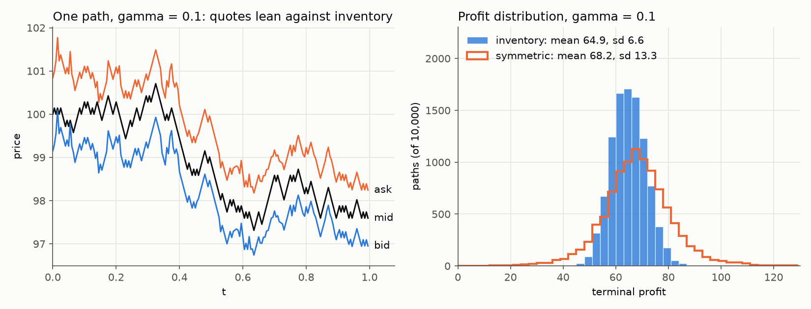

## Avellaneda-Stoikov, rerun

Avellaneda and Stoikov (2008) quote around a reservation price
r = s - q gamma sigma^2 (T - t) that leans against the inventory q, with a total
spread of gamma sigma^2 (T - t) + (2 / gamma) ln(1 + gamma / k). Section 3.3 of
the paper compares this with a symmetric strategy that quotes the same average
spread around the mid. `avellaneda.simulate` reruns that experiment with the
paper's parameters (s = 100, T = 1, sigma = 2, dt = 0.005, k = 1.5, A = 140).
10,000 paths per row here, 1000 in the paper, paper values in brackets:

| gamma | strategy  | spread      | mean profit | sd profit   | mean final q   | sd final q |
|-------|-----------|-------------|-------------|-------------|----------------|------------|
| 0.1   | inventory | 1.49 (1.49) | 64.9 (65.0) | 6.6 (6.6)   | 0.01 (0.08)    | 2.9 (2.9)  |
| 0.1   | symmetric | 1.49 (1.49) | 68.2 (68.4) | 13.3 (12.7) | -0.03 (0.26)   | 8.4 (8.4)  |
| 0.01  | inventory | 1.35 (1.35) | 68.4 (68.6) | 8.9 (8.7)   | -0.01 (0.12)   | 5.2 (5.1)  |
| 0.01  | symmetric | 1.35 (1.35) | 68.6 (68.8) | 13.5 (12.8) | -0.10 (0.09)   | 8.7 (8.7)  |
| 1     | inventory | 3.02 (3.02) | 31.4 (31.4) | 4.9 (5.0)   | 0.01 (0.02)    | 1.7 (1.7)  |
| 1     | symmetric | 3.02 (3.02) | 43.8 (44.0) | 11.0 (11.0) | -0.03 (0.00)   | 5.2 (5.1)  |

At gamma = 0.1 the inventory strategy gives up 3.3 of mean profit and halves the
standard deviation. At gamma = 1 it gives up 12.4 and the standard deviation goes
from 11.0 to 4.9. At gamma = 0.01 the trader is close to risk neutral: mean
profits are within 0.2 of each other and the gap in risk narrows, as the paper
says it should. The tests check every
row against the published one, with a tolerance that covers the sampling error of
both runs.

## The same idea on an order book

The paper's fills arrive at a rate A exp(-k delta) that only depends on the
distance from the mid. On a real book a quote fills when the queue in front of it
clears. In this simulator, stepping back one tick from the best quote cuts the
fill rate from 0.348 to 0.009 lots per minute, because the order now waits behind
a whole queue and loses its place every time the bot moves it. The chart below
puts a bot that joins the best bid and ask next to the Avellaneda-Stoikov bot,
with sigma = 1 tick per sqrt(minute) and k = 3.6 per tick, both measured on this
flow. Each point is 200 sessions of 390 minutes.

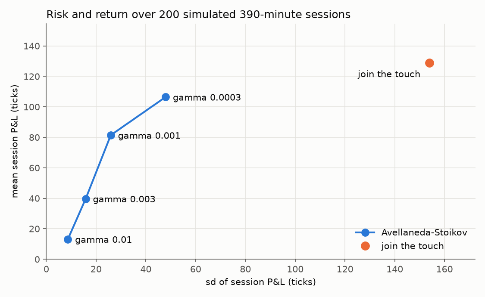

| strategy         | mean P&L (se) | sd P&L | mean / sd | sd final q | mean abs q | fills |
|------------------|---------------|--------|-----------|------------|------------|-------|
| join the touch   | 128.9 (10.9)  | 153.9  | 0.84      | 13.8       | 7.80       | 274   |
| AS, gamma 0.0003 | 106.5 (3.4)   | 48.0   | 2.22      | 7.3        | 2.48       | 253   |
| AS, gamma 0.001  | 81.4 (1.8)    | 25.9   | 3.14      | 4.5        | 1.08       | 220   |
| AS, gamma 0.003  | 39.7 (1.1)    | 15.8   | 2.51      | 3.7        | 0.45       | 128   |
| AS, gamma 0.01   | 13.2 (0.6)    | 8.7    | 1.52      | 2.5        | 0.14       | 47    |

P&L is in ticks per session, marked at the mid of everyone else's quotes, with
no fees. Joining the touch makes the most money and ends the day with an
inventory whose standard deviation is 14 lots. At gamma = 0.001 the AS bot keeps
63% of that mean with a sixth of the risk. Past that point its quotes sit far
enough back that it barely trades. This flow has no informed traders, so the
only adverse selection is mechanical (a fill often means the queue just
emptied and the price is about to move through it). The informed traders
below change that.

## Gueant-Lehalle-Fernandez-Tapia, solved exactly

Avellaneda-Stoikov leans on a horizon: its skew is gamma sigma^2 (T - t) per lot,
so at the open of a long session it is huge and at the close it is zero. Gueant,
Lehalle and Fernandez-Tapia (2013) solve the same problem with a hard inventory
bound |q| <= Q. The substitution u = -exp(-gamma (x + q s)) v_q(t)^(-gamma/k)
turns the HJB equation into a linear system v' = M v, where M is tridiagonal with
alpha q^2 on the diagonal and -eta off it (alpha = k gamma sigma^2 / 2,
eta = A (1 + gamma/k)^-(1 + k/gamma)). So v(t) = exp(-M (T - t)) 1 and the
quotes are

```
delta_bid(q) = (1/k) ln(v_q / v_{q+1}) + (1/gamma) ln(1 + gamma/k)
delta_ask(q) = (1/k) ln(v_q / v_{q-1}) + (1/gamma) ln(1 + gamma/k)
```

with no bid at q = Q and no ask at q = -Q. `glft.Model` computes this for any t,
the long-horizon limit (the ground state of M), the paper's closed-form
approximation, and its two extensions: a drift mu in the mid and a price impact xi
per fill, which is the paper's model of adverse selection.

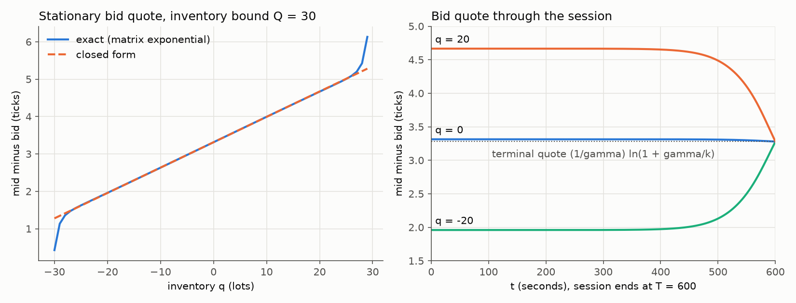

This is the paper's example (sigma = 0.3 tick per sqrt(s), A = 0.9 per s, k = 0.3
per tick, gamma = 0.01 per tick, T = 600 s). Far from the end the quotes barely
depend on t (at t = 0 they are within 4e-7 ticks of the infinite-horizon limit), and the stationary spread is 6.6261 ticks against 6.626 from
the closed form. The closed form is within 0.002 ticks for |q| <= 10 and drifts
off near the bound: at q = 29 the exact bid sits 6.13 ticks below the mid, the
closed form says 5.28. For comparison, Avellaneda-Stoikov at t = 0 with q = 20
would move its reservation price by 10.8 ticks; GLFT moves its bid by 1.35.

The checks: the quotes match a direct solve of the nonlinear HJB system (Radau,
in log space) to 1e-6 ticks, with and without drift and impact. Near the end
they reduce to the Avellaneda-Stoikov expansion, the paper's footnote 8. Taking
the plotted window [-30, 30] out of a bound of Q = 50 reproduces the axis ranges
of the paper's figures 1 to 3. And an exact Monte Carlo (Poisson fills by
thinning, the Brownian part integrated out analytically, Q = 4 and T = 50) earns
a certainty equivalent of 63.93 +- 0.08 ticks against the value function's
63.90, while moving every quote 0.3 ticks in or out loses about 0.8.

## Informed traders and markouts

`informed.py` adds a fundamental value V that follows a Brownian motion nobody
else can see, and informed traders who wake up at Poisson times and send a
market order whenever V is beyond the best quote. They are the only link between
V and the book, so the mid follows V with a lag, and every informed trade is
profitable at the moment it happens. Fills now record who the counterparty was,
and the simulator keeps a tape of every change in the mid, so `markout.py` can
measure, for each fill, how far the mid has moved for or against it h minutes
later.

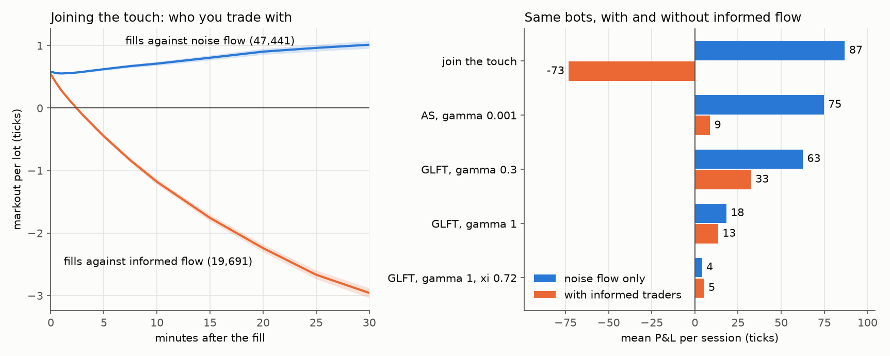

One informed trader at 1 order per minute, V moving 1 tick per sqrt(minute),
200 sessions of 390 minutes per row, every bot capped at 5 lots:

| strategy           | informed flow | mean P&L (se) | sd P&L | fills |
|--------------------|---------------|---------------|--------|-------|
| join the touch     | no            | 86.9 (4.0)    | 56.3   | 252   |
| join the touch     | yes           | -73.2 (5.1)   | 72.6   | 336   |
| AS, gamma 0.001    | no            | 74.7 (2.0)    | 28.7   | 218   |
| AS, gamma 0.001    | yes           | 8.7 (2.8)     | 40.0   | 295   |
| GLFT, gamma 0.3    | no            | 62.5 (1.3)    | 17.9   | 202   |
| GLFT, gamma 0.3    | yes           | 32.6 (1.8)    | 25.7   | 285   |
| GLFT, gamma 1      | no            | 18.3 (0.8)    | 10.6   | 83    |
| GLFT, gamma 1      | yes           | 13.5 (1.1)    | 15.6   | 159   |
| GLFT, gamma 1, xi  | no            | 4.1 (0.3)     | 4.4    | 13    |
| GLFT, gamma 1, xi  | yes           | 5.3 (0.6)     | 8.7    | 36    |

The markouts tell the story. Against noise flow the touch quoter earns its half
spread and keeps it. Against informed flow it earns the same 0.54 ticks at the
instant of the fill, is underwater after 2.5 minutes and is down 2.96 ticks per
lot after 30. Three fills in ten are informed, and that is enough to turn +87
ticks a session into -73.

The noise curve rising to +1.01 is a side effect of the position cap: once
informed buying has pushed the quoter to -5 lots it only shows a bid, so its
remaining noise fills are buys made while the price is still catching up with V.
Without the cap the curve stays flat (0.60 at the fill, 0.54 after 30 minutes,
over 40 sessions).

Inventory control turns out to be the defence. Informed flow is one-sided, so it
builds inventory, and a bot that leans against its inventory stops feeding it.
GLFT with gamma = 0.3 keeps more than half its P&L. The bot's sigma, k and A were
measured on noise flow only, so it does not know the informed traders exist.

The paper's own answer to adverse selection is xi, a permanent price impact per
fill. It widens both quotes by xi / 2 and makes the inventory penalty steeper.
Measured from the touch quoter's markouts (fill to 30 minutes, all
counterparties) it is 0.72 ticks, which moves the flat-inventory quotes from 0.57
to 1.24 ticks off the mid. The spread on this book is one tick 74% of the time,
so the bot now sits a tick behind the best price whenever it is flat, where the
fill rate is about 40 times lower. It drops from 83 fills a session to 13 and
makes 4 to 5 ticks with or without the informed traders. On a tick grid, leaning
on inventory did far more than widening.

## Why spreads exist: Glosten-Milgrom and Kyle

The models above get their spread from inventory risk and an assumed fill-rate
curve. The two classic information models get one from a risk-neutral market
maker that holds no inventory risk at all.

In Glosten and Milgrom (1985) a competitive market maker meets one trader at a
time. With probability alpha the trader is informed; otherwise the trader buys
or sells with probability eta each, whatever the price. The market maker sets
the ask to E[V | the next trader buys] and the bid to E[V | the next trader
sells], so it breaks even on average: what it loses to insiders it gets back
from everyone else. With V either lo or hi and P(V = hi) = mu,

```
ask = lo + (hi - lo) mu (alpha + u) / (mu alpha + u)      u = (1 - alpha) eta
bid = lo + (hi - lo) mu u / ((1 - mu) alpha + u)
```

and with an even prior the spread is exactly alpha (hi - lo). Each trade updates
the belief, and only the net number of buys matters: with eta = 1/2 every buy
multiplies the odds by (1 + alpha) / (1 - alpha).

`glosten.py` also solves a version on a grid of values, with insiders who see V
plus Gaussian noise and stay out when their estimate is inside the quotes (close
to Das 2005). The quotes are then fixed points, ask = E[V | a buy at that ask],
found by root-finding, and a no-trade is information too. With a two-point grid
and noise near zero it reproduces the closed form to 1e-9.

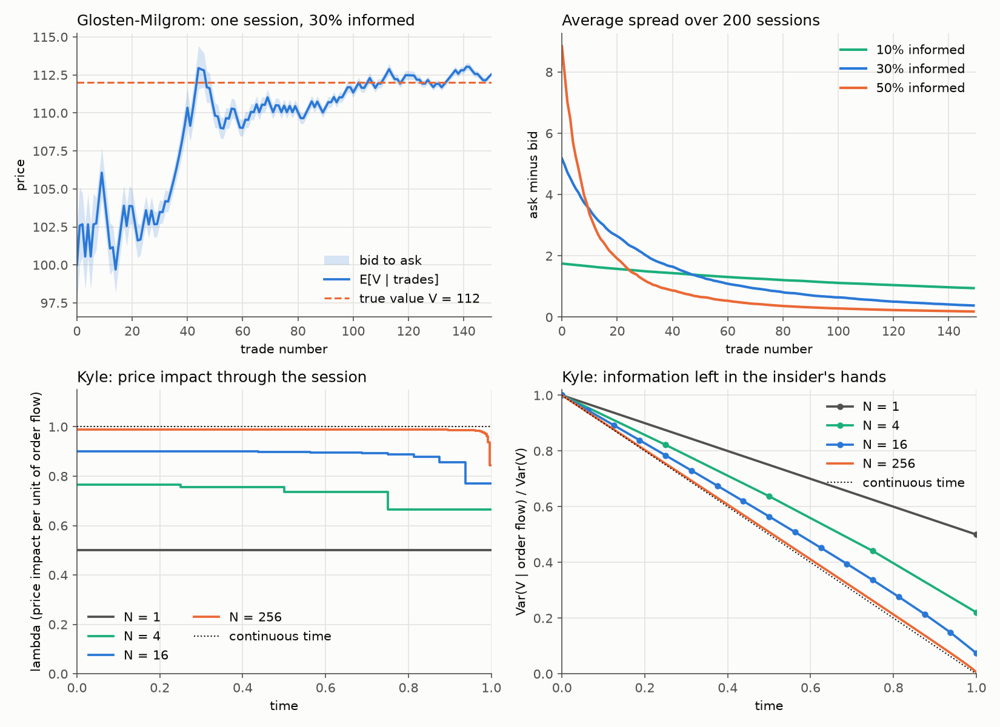

`examples/why_spreads.py` draws V from a normal prior (sd 10; insiders' noise sd
5, eta 0.4) and runs 200 sessions of 150 trades for each alpha:

| informed | first spread | spread after 150 trades | market maker P&L per session (se) | insiders' P&L per session |
|----------|--------------|-------------------------|-----------------------------------|---------------------------|
| 10%      | 1.75         | 0.95                    | -5.2 (7.5)                        | 81.6                      |
| 30%      | 5.18         | 0.38                    | -2.8 (3.7)                        | 58.3                      |
| 50%      | 8.84         | 0.18                    | -1.9 (2.5)                        | 32.9                      |

More insiders make a wider spread at the open and a faster collapse, because
the price learns faster. As a group the insiders earn the most when they are
rare. The market maker's P&L is zero within its standard error in every row, so
the uninformed pay for all of it.

Kyle (1985) has one insider who knows V ~ N(p0, Sigma0), noise traders who send
N(0, sigma_u^2 dt) to each of N auctions, and market makers who set the price to
E[V | order flow so far]. In equilibrium the insider trades beta_n (V - p) dt and
the price moves lambda_n per unit of net order flow. With one auction
lambda = sqrt(Sigma0) / (2 sigma_u) and the insider makes sqrt(Sigma0) sigma_u / 2.
For N auctions `kyle.solve` runs Kyle's backward recursion, where each step
solves a cubic for lambda_n on (0, 1 / (2 alpha_n)) given the next period's
value-function coefficient alpha_n. The recursion is homogeneous in Sigma, so it
runs once with Sigma_N = 1 and again rescaled to hit Sigma0. With
Sigma0 = sigma_u = 1:

| N    | lambda, first auction | lambda, last auction | Sigma_N | insider profit |
|------|-----------------------|----------------------|---------|----------------|
| 1    | 0.5000                | 0.5000               | 0.5000  | 0.5000         |
| 4    | 0.7648                | 0.6642               | 0.2206  | 0.7307         |
| 16   | 0.9012                | 0.7707               | 0.0742  | 0.8860         |
| 256  | 0.9881                | 0.8437               | 0.0056  | 0.9869         |
| 4096 | 0.9989                | 0.8530               | 0.0004  | 0.9988         |

As N grows the solution converges to continuous time: lambda constant at 1,
Sigma falling linearly to 0, and a profit of 1, twice the one-shot value. The
insider trades just slowly enough that the price only reaches V at the close.
The last auction stays different (lambda about 0.85 of the continuous value)
because there is no later auction to save information for.

The checks do not reuse the recursion. lambda_n equals the Kalman gain of the
market makers' filter given beta_n, to 1e-10. The value function
alpha_0 Sigma0 + delta_0 equals the insider's expected profit computed forward
from the strategy. Moving any single beta_n by 5% either way lowers that profit,
so the strategy is a best response. A Monte Carlo of 200,000 paths matches
Sigma_n to 2% and the profit within 4 standard errors, and its price changes are
uncorrelated with each other and with the remaining pricing error.

## Queue position

The simulator records where each order joined its queue. `LiveOrder.ahead` is
the quantity in front of the order when it joined its level, and
`ctx.ahead(oid)` gives the live value. A modify keeps the old number only when
it shrinks the order in place, the same rule the book uses for time priority.
Maker fills carry `ahead` and `left`, the quantity still resting at the fill
price once the incoming order is done. `left == 0` means the fill emptied the
level and the price went through it.

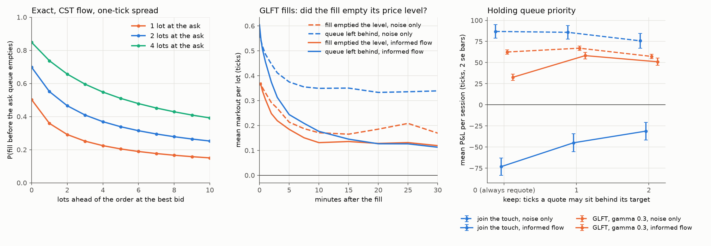

The left panel is exact. In the CST model with a one-tick spread, the
probability that an order at the best bid fills before the ask queue empties
falls quickly with the lots in front of it: against two lots at the ask it is
0.70 at the front, 0.47 two lots back and 0.25 ten lots back. It is the same
linear system as `prob_fill_first`, which a simulator test already checks.

In the simulator (200 sessions of 390 minutes per row, the informed traders from
the previous section), the fills that emptied their level are the bad ones. For
the GLFT bot the markout at the fill is 0.36 ticks when the fill took out the
level and 0.57 when it left a queue behind, with or without informed flow. Most
of those fills come from orders that stepped alone into a new price level
(`ahead == 0`); those get hit first and the level empties 67 to 73% of the
time. Position further back in the queue makes little difference to the longer
markouts compared to the noise in these runs.

That points to a policy. `Quoter` takes `keep`: a live quote stays put when it
sits at most `keep` ticks behind the new target, so the bot holds its place
instead of chasing every one-tick move. A quote never stays ahead of its target,
so the bot never quotes more aggressively than its model asks.

| strategy        | informed flow | keep | mean P&L (se) | sd P&L | fills | markout at fill |
|-----------------|---------------|------|---------------|--------|-------|-----------------|
| join the touch  | no            | 0    | 86.9 (4.0)    | 56.3   | 252   | 0.57            |
| join the touch  | no            | 1    | 85.8 (4.0)    | 56.0   | 184   | 0.69            |
| join the touch  | no            | 2    | 75.8 (4.4)    | 61.6   | 143   | 0.75            |
| join the touch  | yes           | 0    | -73.2 (5.1)   | 72.6   | 336   | 0.57            |
| join the touch  | yes           | 1    | -44.9 (5.3)   | 74.4   | 256   | 0.73            |
| join the touch  | yes           | 2    | -31.1 (5.2)   | 73.7   | 204   | 0.81            |
| GLFT, gamma 0.3 | no            | 0    | 62.5 (1.3)    | 17.9   | 202   | 0.52            |
| GLFT, gamma 0.3 | no            | 1    | 67.0 (1.3)    | 18.9   | 150   | 0.68            |
| GLFT, gamma 0.3 | no            | 2    | 57.3 (1.3)    | 18.6   | 111   | 0.77            |
| GLFT, gamma 0.3 | yes           | 0    | 32.6 (1.8)    | 25.7   | 285   | 0.52            |
| GLFT, gamma 0.3 | yes           | 1    | 58.2 (1.9)    | 26.9   | 221   | 0.73            |
| GLFT, gamma 0.3 | yes           | 2    | 51.0 (2.2)    | 30.5   | 172   | 0.84            |

The keep = 0 rows reproduce the informed-trader table exactly, rerun after the
queue changes. Against informed flow, keep = 1 takes GLFT from 32.6 to 58.2
ticks a session. It trades less, each fill is worth about 0.2 ticks more at the
instant it happens, and it takes about a quarter fewer fills from the informed
trader. Without informed flow it is close to neutral (+4.5 for GLFT, -1.1 for
the touch quoter), and at keep = 2 the bot starts missing fills that were worth
having.

## Latency

So far a bot saw every change to the book the moment it happened, and its
orders reached the book the moment it sent them. `Latency` takes that away. It
uses the split hftbacktest uses, three legs per agent: `feed` (market data from
the exchange to the bot), `entry` (orders from the bot to the matching engine)
and `response` (acks and fill reports back to the bot), plus an optional
`jitter`, an extra exponential delay with that mean on every leg. Each leg is
first in, first out, like a TCP session, so jitter can bunch messages up but
never reorders them.

```python
from mmsim.sim import Latency

lag = Latency(feed=0.1, entry=0.05, response=0.05)  # minutes, like the rest of the clock
sim = Simulator(flow, [bot, insider], latency={bot: lag})
```

With latency, what the bot knows and what the exchange knows come apart.
`ctx.orders` is the bot's own view: an order is in it from the moment it is
sent, `acked` once the acceptance comes back and `canceling` once a cancel is on
its way. `ctx.position` changes when a fill report arrives. The exchange books
the fill in `ctx.account` when it happens and `Fill.t` is that time, so P&L and
markouts measure what actually happened. A fill on an order whose cancel was
already in flight is marked `stale`: the bot lost the race to cancel.

The delayed feed is a replica. A bot with feed latency gets its own copy of the
book, and every command that reaches the exchange (background flow, other
agents, its own orders) is replayed on that copy `feed` later. The matching
engine is deterministic, so the same commands in the same order give the same
book. A test runs an hour of flow and checks that at every update the lagged
copy equals the exchange book from `feed` earlier, five levels deep on both
sides. `ctx.book`, `ctx.bid`, `ctx.ask` and `ctx.mid` all read the copy. With
no latency the bot reads the exchange book directly and nothing is queued, and
the sessions behind the earlier tables come out the same, fill for fill.

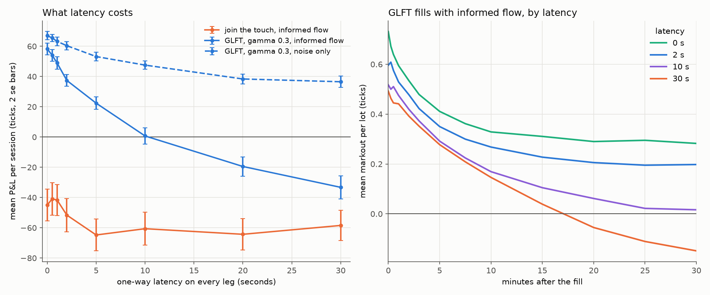

The clock is in minutes and the CST flow changes the book about 38 times a
minute, once every 1.6 seconds; the mid moves every 24 seconds. Seconds of
latency would be absurd on a real exchange, where a liquid book changes every
few microseconds, but what matters is latency against the time between book
events, and 10 seconds here is about six of them. Both bots run with keep = 1
against the informed trader from before, 200 sessions of 390 minutes per row,
the same latency on all three legs:

| one-way latency | GLFT, gamma 0.3 | stale fills | GLFT, noise only | join the touch |
|-----------------|-----------------|-------------|------------------|----------------|
| 0               | 58.2 (1.9)      | 0           | 67.0 (1.3)       | -44.9 (5.3)    |
| 0.5 s           | 54.1 (1.9)      | 1.4%        | 65.5 (1.2)       | -40.9 (5.3)    |
| 1 s             | 49.0 (2.1)      | 2.9%        | 63.3 (1.5)       | -41.6 (5.1)    |
| 2 s             | 37.4 (1.9)      | 5.4%        | 60.4 (1.4)       | -51.6 (5.5)    |
| 5 s             | 22.4 (2.0)      | 11.2%       | 53.2 (1.4)       | -64.7 (5.2)    |
| 10 s            | 0.7 (2.6)       | 17.5%       | 47.6 (1.3)       | -60.6 (5.5)    |
| 20 s            | -19.5 (3.2)     | 24.5%       | 38.4 (1.7)       | -64.3 (5.2)    |
| 30 s            | -33.3 (3.8)     | 28.9%       | 36.5 (1.8)       | -58.4 (5.0)    |

Mean P&L per session in ticks (standard error). The zero row is the keep = 1
row of the queue table, rerun through the new code. Against informed flow GLFT
gives up about 10 ticks per second of latency over the first two seconds, then
about 4 per second, and is at break-even by ten seconds. Without informed flow the same ten seconds cost 19 ticks, so most
of the damage is adverse selection made worse. The stale fills are the bad
ones: up to 10 seconds of latency, five minutes later they are down 0.24 to
0.59 ticks per lot while the rest are up about 0.40. At 30 seconds one GLFT session in five goes past its 5-lot
limit at some point, because the fills that take it over are still on their way
when it decides to keep quoting. The touch quoter is already losing to the
informed trader, and the extra 15 to 20 ticks it loses is two to three standard
errors.

Which leg matters? GLFT again, with 10 seconds on one leg at a time:

| 10 s on          | informed flow | noise only  | stale fills, informed |
|------------------|---------------|-------------|-----------------------|
| nothing          | 58.2 (1.9)    | 67.0 (1.3)  | 0                     |
| feed             | 20.6 (2.6)    | 56.1 (1.4)  | 0                     |
| entry            | 21.8 (2.2)    | 51.9 (1.5)  | 21.9%                 |
| response         | 52.8 (1.8)    | 63.5 (1.4)  | 0                     |
| feed 5, entry 5  | 24.9 (2.3)    | 55.4 (1.2)  | 11.4%                 |
| all three        | 0.7 (2.6)     | 47.6 (1.3)  | 17.5%                 |

Feed and entry latency cost the same, and splitting ten seconds between them
costs about as much as putting it all on one. What matters is the time from a
change in the market to the bot's order acting on it, which is what trading
firms call tick-to-trade. Only entry latency produces stale fills: with a slow
feed the cancel goes out late but lands at once, so the loss is just as large
and the stale flag never sees it. Counting lost cancel races measures half the
problem. Response latency is cheap here, since it only delays when the bot
learns about its own fills and skews for them.

## Clustered order flow: Hawkes processes

In the CST model every market order is an independent Poisson arrival. Real
market orders come in bursts: one buy makes the next buy more likely for a
while. A Hawkes process captures that with an intensity that jumps at each
event and decays back,

```
lambda_i(t) = mu_i + sum_j sum_{t_k of type j, t_k < t} alpha_ij exp(-beta_ij (t - t_k))
```

`hawkes.py` has the multivariate process with exponential kernels. The
branching matrix alpha / beta holds the expected number of type-i events each
type-j event triggers directly; when its spectral radius is below one the
process is stationary with mean rates (I - alpha / beta)^-1 mu. `simulate` uses
Ogata's thinning, `loglik` and `fit` do maximum likelihood with an analytic
gradient, and `residuals` applies the time-rescaling theorem: under the right
model the compensator increments between consecutive events are i.i.d. Exp(1),
which gives a goodness-of-fit test for any candidate model.

`HawkesFlow` keeps the CST limit orders and cancels and replaces the market
orders with a two-dimensional Hawkes process (buys, sells). `Hawkes.symmetric`
sets the base rate so the long-run rate per side stays at the CST value of 0.94
a minute. Here each market order triggers 0.6 more on its own side and 0.1 on
the other, with a decay time of 10 seconds (beta = 6 per minute).

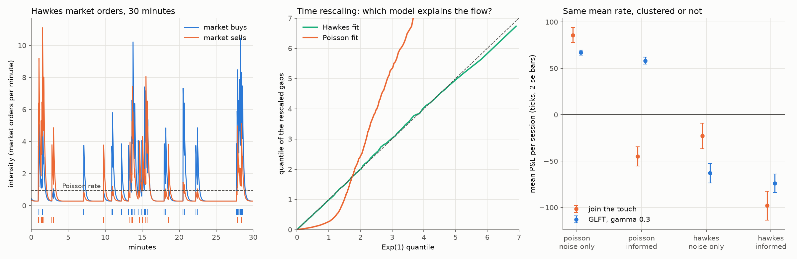

Fitting the model back on 2000 minutes of the simulated flow (3570 market
orders) gives a branching matrix of [[0.604, 0.113], [0.106, 0.600]] against
the true [[0.6, 0.1], [0.1, 0.6]]. The rescaled gaps under that fit pass a
Kolmogorov-Smirnov test against Exp(1) (statistic 0.012, p = 0.69); under a
Poisson fit with the same rates the statistic is 0.40 and the p-value is zero
to machine precision. The middle panel is the QQ plot of the two.

The book looks the same either way: the spread is one tick 79% of the time
against 76%, the mean bid depth is 15.5 lots against 15.6, and the book is
one-sided 0.15% of the time. Only the timing changes. 200 sessions of 390
minutes per row, keep = 1, no latency:

| strategy        | market orders | informed flow | mean P&L (se) | sd P&L | fills | mean abs q | markout 0 / 5 min |
|-----------------|---------------|---------------|---------------|--------|-------|------------|-------------------|
| join the touch  | Poisson       | no            | 85.8 (4.0)    | 56.0   | 184   | 2.64       | 0.69 / 0.65       |
| join the touch  | Poisson       | yes           | -44.9 (5.3)   | 74.4   | 256   | 3.09       | 0.73 / 0.46       |
| join the touch  | Hawkes        | no            | -22.8 (6.9)   | 98.1   | 240   | 2.95       | 0.76 / 0.19       |
| join the touch  | Hawkes        | yes           | -98.1 (7.7)   | 109.1  | 331   | 3.10       | 0.76 / 0.19       |
| GLFT, gamma 0.3 | Poisson       | no            | 67.0 (1.3)    | 18.9   | 150   | 0.70       | 0.68 / 0.51       |
| GLFT, gamma 0.3 | Poisson       | yes           | 58.2 (1.9)    | 26.9   | 221   | 0.84       | 0.73 / 0.41       |
| GLFT, gamma 0.3 | Hawkes        | no            | -63.0 (5.3)   | 74.5   | 220   | 1.26       | 0.77 / -0.08      |
| GLFT, gamma 0.3 | Hawkes        | yes           | -73.9 (5.1)   | 71.5   | 298   | 1.23       | 0.77 / -0.05      |

With the same number of market orders, clustering alone turns GLFT from +67 to
-63 ticks a session, with no informed trader anywhere. The fills look as good
as ever at the instant they happen (0.77 ticks) and are worth nothing five
minutes later. Clustered flow is predictable flow: a market sell that hits the
bot's bid is likely to be followed by more sells within seconds, and they walk
the price down through the level the bot just bought at. The bot then requotes
at the new touch and gets hit again. The standard deviation of one-minute mid
moves goes from 0.85 to 1.17 ticks. Clustering hurts more than the informed
trader does here, which says that a quoting model that treats fills as
independent Poisson events is missing the thing that matters most.

## Leaning on the flow

If market orders cluster, the trades a bot has just seen tell it something about
the next few seconds. Cartea, Jaimungal and Ricci (2014) build this into the
market maker's control problem: market orders excite each other and push the
mid, and a market maker who ignores that short-term drift gets picked off. The
version here is the first-order one: estimate the drift and quote around the mid
plus that drift instead of the mid.

Every agent now gets `on_trade` with a `Print` (time, aggressor side, worst
price, quantity) for each aggressive order, before its fills and its book update
from the same event, and through its feed latency if it has one. `Tracker` in
`hawkes.py` keeps the decayed sums of a fitted Hawkes model up to date from
those prints, so it knows the current intensity of market buys and sells. What
it needs is the expected number of extra market orders still to come. With
x = s - s_bar the excitation above its stationary level, the expectation obeys
the linear ODE dx/dt = M x, where M = -diag(beta) plus the alpha-weighted map
from x to the excess intensities. The expected excess count over the next h
minutes is then S M^-1 (exp(M h) - I) x, with S summing x into intensities;
`Hawkes.forecast(h)` builds that matrix once. In one dimension it reduces to
x (1 - e^-(beta - alpha) h) / (beta - alpha), which a test checks, and in two
dimensions with unequal betas it matches the mean counts of 20,000 simulated
paths from an empty start.

`FlowLean` multiplies the expected net excess (buys minus sells) by kappa, the
mid move per expected order, and any `Quoter` given a `signal` quotes around the
mid plus that shift.

There are two ways to get kappa from a history of prints and mids.
`FlowLean.fit` regresses the mid change over the next h minutes on the forecast
at each market order, without an intercept. `FlowLean.from_impact` reads the
average signed change in the mid across each market order straight off the tape
(`Tape.before` gives the mid just before an order, `Tape.at` the mid after it).
On background flow they measure nearly the same thing (0.39 and 0.37 per order
in the population, below). The expected mid change is linear in the forecast
(the ratio stays between 0.36 and 0.42 in nine deciles of the forecast out of
ten) and the slope is the same at every horizon, which is what a permanent price
impact per market order looks like. If the impact is permanent, the fair value
is the mid plus the impact times all the excess orders still to come, not just
those in the next half minute, so `from_impact` forecasts to an infinite
horizon. For this model that forecast is 1.36 times the half-minute one, so the
impact lean acts like kappa = 0.51 on the half-minute scale.

An earlier version of this section fitted the regression on one 2000-minute
history and reported 0.30, 0.26, 0.19 and 0.12 ticks per order for h = 0.25,
0.5, 1 and 2. Those numbers were wrong twice over. The first problem was a bug:
the market-order times came from a clock inside `HawkesFlow` that added up the
same waiting times as the simulator in a different order and drifted from it by
up to about 1e-12 minutes. A third of the orders were stamped early. About half
of those had moved the mid, so for one order in six the regression read the mid
from before the order and counted the order's own impact as part of the move it
was meant to predict. The simulator now keeps the public tape itself
(`Simulator.prints`, every aggressive order on its own clock, warm-up included)
and the flow keeps no clock. Fixed, the same history gives 0.21, 0.19, 0.14 and
0.08. The second problem is noise. Across 40 independent 2000-minute histories:

| kappa from 2000 minutes                | the history above | mean of 40 | sd    | range          |
|----------------------------------------|-------------------|------------|-------|----------------|
| regression, h = 0.5, as first reported | 0.256             |            |       |                |
| regression, h = 0.5                    | 0.194             | 0.393      | 0.110 | 0.202 to 0.657 |
| impact per order                       | 0.378             | 0.369      | 0.019 | 0.335 to 0.433 |
| impact, on the half-minute scale       | 0.514             | 0.502      | 0.025 | 0.456 to 0.589 |

The regression lands anywhere from 0.2 to 0.66, and the history used for the old
tables is a low draw. In the population it does not fall with the horizon either
(0.38, 0.39, 0.39 and 0.37 for h = 0.25 to 2); the decline reported before was
noise. The impact estimate is six times tighter from the same data.

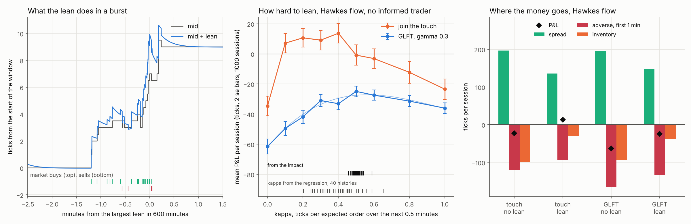

The old sweep scaled that noisy kappa and ran 200 sessions per point, too few to
find the top of a flat curve: at kappa = 0.3 the first 200 seeds give -38.3 and
all 1000 give -31.0. The middle panel runs 1000 sessions per point on an absolute
scale, Hawkes flow, no informed trader, mean P&L per session (se):

| kappa           | 0           | 0.1         | 0.2         | 0.3         | 0.4         | 0.5         | 0.6         | 0.8         | 1.0         |
|-----------------|-------------|-------------|-------------|-------------|-------------|-------------|-------------|-------------|-------------|
| GLFT, gamma 0.3 | -61.5 (2.5) | -49.5 (2.3) | -41.8 (2.2) | -31.0 (2.0) | -33.1 (2.0) | -24.9 (1.8) | -27.4 (1.7) | -31.4 (1.8) | -36.0 (1.7) |
| join the touch  | -34.6 (3.2) | 7.1 (3.2)   | 10.7 (3.1)  | 9.1 (3.3)   | 13.7 (3.2)  | -0.8 (3.4)  | -3.1 (3.3)  | -12.2 (3.6) | -23.4 (3.4) |

GLFT gains quickly up to 0.3, has a flat top around 0.5 and gives ground back
beyond 0.8. A cubic through the points (chi-squared 8.1 on 5 degrees of freedom)
peaks at 0.57 with -27.2. Run with the impact lean fitted on the history above
(0.378 per order, infinite horizon) over the same 1000 seeds, it makes -26.7 (se
1.7), on the peak with nothing tuned. What each calibration costs it, read off
the cubic and averaged over the 40 histories:

| kappa fitted on 2000 minutes            | GLFT, mean P&L | worst tenth of histories |
|-----------------------------------------|----------------|--------------------------|
| regression                              | -30.9          | -38.3                    |
| impact, infinite horizon                | -27.5          | -28.0                    |
| the old tables (regression, clock bug)  | -36.1          |                          |

The regression costs about 4 ticks a session on average and 11 in one history
in ten.

The touch quoter behaves differently. It rounds the fair value minus and plus
half a tick outward, so at a one-tick spread any positive shift moves its ask a
tick back and any negative one its bid. The first 0.1 of kappa is worth 42 ticks
(-34.6 to 7.1), the curve is flat up to 0.4 (13.7), and it falls once the shift
often passes a whole tick and steps a quote back two. The impact lean is past
its top: -0.8 at 0.5.

GLFT's peak is not a law either. On a second Hawkes flow with slower and more
mutual excitation (0.5 own, 0.2 cross, beta = 3 per minute) the impact is 0.40
per order and the regression on the same 2000 minutes says 0.14. GLFT makes
50.8, 52.7, 47.5, 43.1 and 35.4 with the impact lean scaled by 0, 0.5, 1, 1.5
and 2 (1000 sessions each, se 1.1 to 1.3): there the best lean is half the
impact or less, and the whole signal is worth about 2 ticks. The attribution
says why (lean against none, 400 sessions each). On the main flow the lean gives
up 48 ticks of spread and gets back 33 of first-minute adverse selection and 46
of inventory. On the second it gives up 14 of spread, gets back 12 of inventory
and nothing of adverse selection: when a burst of sells also brings buys, the
fills a shift steps away from are not the bad ones.

So the impact gives the right order of magnitude, not the optimum: GLFT here
wants about 1.1 times it, the touch quoter 0.2 to 0.8 times, GLFT on the second
flow 0.2 to 0.5 times. On a tick grid GLFT steps a whole tick back once the shift
passes 0.09 ticks, so a small expected drift buys a large change in queue
position, and a shift of the mid has no idea how often each side is about to be
hit. Cartea, Jaimungal and Ricci solve for the quotes with the intensity of
market orders on each side in the state, which is the next thing to try.

Two things I expected to explain the old gap did not. One was a regression
weighted the way fills are, the plan in the devlog: over 219,000 market orders
that filled the GLFT bot, conditioning on them moves the slope by 3% (0.64
against 0.62 over all orders in the same sessions). The other was the bot moving
the market it measures. With GLFT at the touch a market order moves the mid 0.20
ticks on average instead of 0.37, because the bot's lot absorbs much of it, while
a burst still moves the price about as far as before. A regression on the bot's
own sessions sees that steeper response, and also the bot's own quoting. Leaning
at 0.5, it gives 0.55 on the full book's mid, close to the peak, but that mid
includes the bot's own requote at the same instant; on everyone else's mid, the
one the bot is marked at, it gives 0.75, which overshoots.

The bots below use the impact lean. 200 sessions of 390 minutes per row, same
seeds as the Hawkes table, so the rows without a lean are that table again:

| strategy        | lean | market orders | informed flow | mean P&L (se) | fills | spread | adverse, 1 min | inventory |
|-----------------|------|---------------|---------------|---------------|-------|--------|----------------|-----------|
| join the touch  | no   | Hawkes        | no            | -22.8 (7.0)   | 240   | 197.0  | -119.9         | -100.0    |
| join the touch  | yes  | Hawkes        | no            | 12.9 (7.8)    | 126   | 135.9  | -92.6          | -30.4     |
| GLFT, gamma 0.3 | no   | Hawkes        | no            | -63.0 (5.3)   | 220   | 195.6  | -165.6         | -93.1     |
| GLFT, gamma 0.3 | yes  | Hawkes        | no            | -24.3 (3.7)   | 166   | 147.8  | -133.2         | -39.0     |
| join the touch  | no   | Hawkes        | yes           | -98.1 (7.7)   | 331   | 271.5  | -145.1         | -224.5    |
| join the touch  | yes  | Hawkes        | yes           | -7.3 (7.2)    | 180   | 197.4  | -112.8         | -92.0     |
| GLFT, gamma 0.3 | no   | Hawkes        | yes           | -73.9 (5.1)   | 298   | 264.8  | -205.6         | -133.1    |
| GLFT, gamma 0.3 | yes  | Hawkes        | yes           | -40.8 (4.2)   | 236   | 213.5  | -178.3         | -76.0     |
| GLFT, gamma 0.3 | no   | Poisson       | no            | 67.0 (1.3)    | 150   | 110.8  | -19.3          | -24.5     |
| GLFT, gamma 0.3 | yes  | Poisson       | no            | 46.0 (1.3)    | 121   | 92.0   | -27.2          | -18.7     |

Paired over the same seeds, the lean is worth 35.8 ticks a session (se 10.2) to
the touch quoter and 38.6 (se 6.3) to GLFT on Hawkes flow, and 33.1 (se 6.6) to
GLFT with the informed trader as well. The touch quoter goes from losing to
making money without the informed trader and close to even with it. GLFT still
makes 67.0 on Poisson flow against -24.3 here, so clustering costs it about 90
ticks a session even with the lean.

The attribution columns say where the gain comes from. Spread capture goes down,
because the bot fills less (166 fills against 220 for GLFT). The first-minute
adverse term improves by 32 ticks and the inventory term by 54. Without the lean
the bot keeps buying into a burst of sells and carries that position while the
burst runs on. With it, the bot's bid has already stepped back and its ask has
come down, so it sheds the position into the same burst instead. Most of the
first-minute loss stays, because the print that fills the bot is often the first
order of a burst and nothing before it predicted it.

The lean costs money where there is nothing to read: on Poisson flow the same
fitted model sees bursts that predict nothing, and GLFT gives up 21.0 ticks a
session (se 1.9). The signal has to be fitted on the flow it trades against.

## P&L attribution

`attribution.attribute(fills, tape, horizon, end)` splits a session's P&L
exactly. For a fill of signed size q at price p, with m_0 the mid just before
it, m_h the mid `horizon` minutes later (capped at the close) and m_T the
closing mid,

```
q (m_T - p) = q (m_0 - p) + q (m_h - m_0) + q (m_T - m_h)
                spread      adverse          inventory
```

Summed over fills and less fees, the three terms add up to the account value
marked at the closing tape mid, to 1e-9 in a test with maker rebates. Spread
plus adverse is the fill's markout at the horizon, which ties it to
`markout.py`. The split depends on the horizon: everything that happens to the
price within it counts as adverse selection, everything after it as the cost of
holding inventory. When the book was one-sided before a fill there is no mid,
and the fill gets no spread credit.

## The C++ matching engine as the book

`Simulator(..., book=NativeBook)` sends every order to the C++
[orderbook](https://github.com/louisbelot/orderbook) engine through its C API
and ctypes package. The engine decides every fill. `NativeBook` keeps an
order-level view built from the engine's event stream, the way a feed handler
builds a book from a market data feed, because the bots and the flow need
per-order information (owner, queue position) that the C API only gives by id.
`audit()` compares that view with the engine's own depth and order lookups.

Two things pin it to the Python book. The same random command stream, with
cancels, modifies, IOC, FOK, post-only and bad inputs, gives identical events
and identical resting orders in the same queue order as the brute-force
reference book (30 seeds of 2000 commands). And whole sessions (Poisson and
Hawkes flow, three bots, with and without latency) give the same position, cash
and fill list to the last bit on both books. Breaking the view's handling of
partial fills or of priority on a modify fails 42 and 31 of the 43 tests.

On a 390-minute GLFT session the Python book takes 0.29 s and the engine path
0.32 s, with the same 169 fills. The session cost is the flow's event menu and
the bots in Python, so the engine does not make a simulation faster. What it
buys is that the matching logic being tested is the one that will replay ITCH
data. `examples/native_speed.py` prints the timing.

Setup: build the engine (`cmake -S . -B build -G Ninja -DCMAKE_BUILD_TYPE=Release`
in the orderbook repo), `pip install -e path/to/orderbook/python`, and point
`OB_LIBRARY` at the shared library if it is not in `build/`. Without it the
native tests skip.

## A tournament

`tournament.session` puts several bots in one session against the same flow and
marks everyone at the closing mid of the tape. `standings` ranks them and pairs
each bot with its own solo run on the same seeds, so the cost of sharing the
queue is measured against the same flow instead of guessed. Seat order is
shuffled by seed. 100 sessions of 390 minutes, P&L in ticks:

| Poisson flow    | together (se) | alone | crowding (se) | sd   | mean/sd | wins | fills |
|-----------------|---------------|-------|---------------|------|---------|------|-------|
| join the touch  | 82.3 (5.6)    | 146.1 | -63.8 (14.5)  | 56.4 | 1.46    | 0.72 | 245   |
| AS, gamma 0.001 | 66.3 (1.3)    | 83.3  | -17.0 (3.0)   | 13.5 | 4.91    | 0.28 | 205   |
| GLFT            | 15.4 (0.9)    | 68.9  | -53.5 (2.0)   | 9.3  | 1.65    | 0.00 | 51    |
| GLFT + lean     | 11.3 (0.6)    | 46.0  | -34.8 (1.9)   | 5.8  | 1.93    | 0.00 | 27    |

| Hawkes flow     | together (se) | alone  | crowding (se) | sd    | mean/sd | wins | fills |
|-----------------|---------------|--------|---------------|-------|---------|------|-------|
| GLFT + lean     | 22.9 (2.6)    | -19.3  | 42.2 (5.3)    | 26.4  | 0.87    | 0.67 | 42    |
| GLFT            | -54.4 (6.4)   | -71.7  | 17.3 (9.2)    | 63.7  | -0.85   | 0.00 | 65    |
| AS, gamma 0.001 | -67.7 (8.9)   | -118.0 | 50.3 (23.5)   | 89.0  | -0.76   | 0.00 | 166   |
| join the touch  | -112.9 (25.4) | 160.0  | -273.0 (34.7) | 253.9 | -0.44   | 0.33 | 202   |

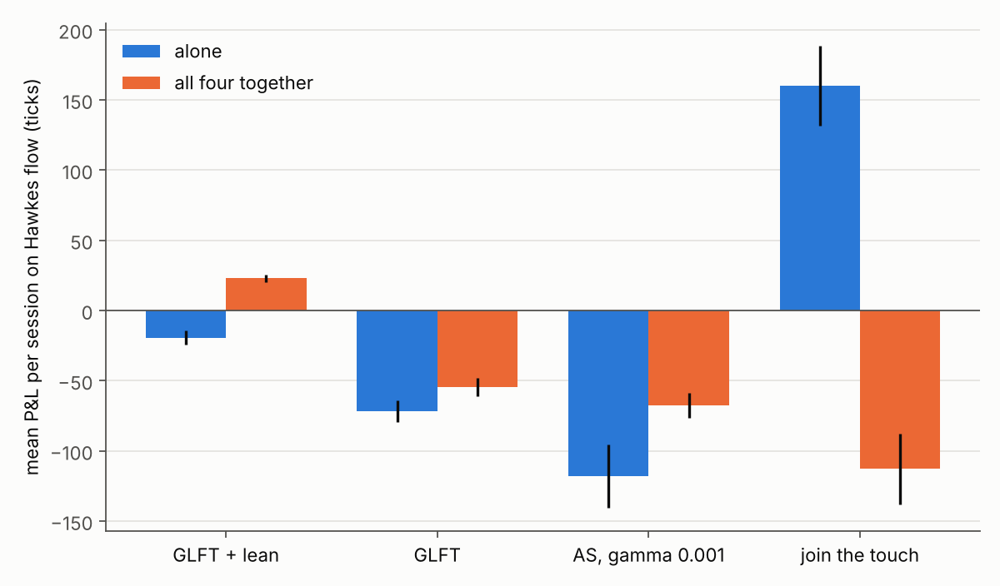

The leaning bot uses the impact lean from "Leaning on the flow" above (0.378
ticks per order, infinite horizon); the other bots' solo runs are the same as
before. On Poisson flow every bot makes less in company, and the
two GLFT bots lose about three quarters of their profit. Nobody has an edge
there, so competition only takes, and these two quote one tick behind the best
price they see, which is now set by the touch bot and AS. On Hawkes flow the
touch bot goes from 160 alone to -113 in company, while the leaning bot is the
only one above zero (22.9 together, -19.3 alone) and GLFT and AS also do better
in company than alone. "A backstop" below shows why: the touch bot has no
position limit and absorbs the bursts, which takes most of their price impact
away for everyone. The mean/sd column is per session, not annualised.

## Paired sessions

Every comparison above is between averages of independent sessions, and a
market maker's P&L per session is noisy: GLFT on Hawkes flow has a standard
deviation of 55 to 85 ticks a session. Running both versions of a bot on the
same seeds ought to help, but with `ZeroIntelligence` and `HawkesFlow` it hardly
does. The flow draws every event from one random stream, so as soon as a bot's
quote changes the book, or a timer interrupts a draw, every later draw lands on
a different event and the two sessions have little in common. Over the same 300
seeds, GLFT's P&L with kappa 0.4 and with kappa 0.5 correlates at 0.12.

`PairedFlow(params, hawkes=None)` simulates the same model from random streams
that do not depend on what the agents do. Market orders and limit orders arrive
at rates that never depend on the book, so each comes from a generator of its
own, seeded from the simulator's seed, and a pending arrival is kept rather than
redrawn. Cancellations do depend on the book: each flow order draws an Exp(1)
threshold when it is placed and is cancelled once its accumulated hazard (theta
at its current distance from the opposite best, integrated over time) reaches
the threshold. The flow is called after every change to the book, so the
hazard rates are constant in between and the integral is exact. Table 3, the
queue races, the long-run limit-order rate and the Hawkes refit pass on both
flows, and a bot that only sets timers leaves a `PairedFlow` market identical
order for order, which it does not with `ZeroIntelligence`.

One convention differs from `HawkesFlow`: a market order that arrives while the
other side of the book is empty does not trade but still counts in the Hawkes
process. Dropping it instead shifts every later arrival, and Hawkes bursts empty
one side of the book at some point in most sessions (14 of 24 in a check), so
the streams would come apart again. Over 1000 sessions GLFT makes -63.8 (se 2.6)
on `PairedFlow` against -61.5 (2.5) on `HawkesFlow` without a lean, and -27.8
(1.9) against -24.9 (1.8) with the impact lean, with 216 and 166 fills against
220 and 166.

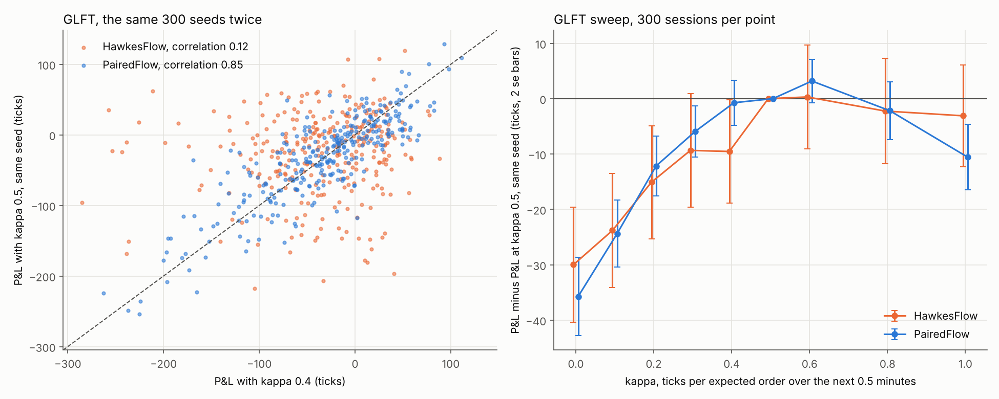

`examples/paired_sessions.py`, 300 sessions per row, the same seeds on both
flows, P&L in ticks:

| comparison                  | flow       | correlation | difference | paired se | unpaired se | variance ratio |
|-----------------------------|------------|-------------|------------|-----------|-------------|----------------|
| GLFT, kappa 0.4 to 0.5      | HawkesFlow | 0.12        | 9.5        | 4.65      | 4.95        | 1.1            |
| GLFT, kappa 0.4 to 0.5      | PairedFlow | 0.85        | 0.7        | 2.03      | 5.24        | 6.6            |
| GLFT, kappa 0 to 0.5        | HawkesFlow | 0.08        | 30.0       | 5.21      | 5.43        | 1.1            |
| GLFT, kappa 0 to 0.5        | PairedFlow | 0.70        | 35.7       | 3.52      | 6.09        | 3.0            |
| join the touch, 0.2 to 0.4  | HawkesFlow | 0.05        | 9.3        | 7.74      | 7.94        | 1.1            |
| join the touch, 0.2 to 0.4  | PairedFlow | 0.69        | 0.1        | 4.76      | 8.56        | 3.2            |
| join the touch, 0 to 0.4    | HawkesFlow | -0.03       | 52.5       | 8.37      | 8.24        | 1.0            |
| join the touch, 0 to 0.4    | PairedFlow | 0.42        | 50.8       | 6.64      | 8.72        | 1.7            |

The variance ratio is how many independent sessions one paired session is
worth. It is largest for small changes: telling kappa 0.4 from 0.5 takes 6.6
times fewer sessions. The bigger the change, the sooner the bot's own trading
pulls the two markets apart, and no stream can share that part. The tournament
is the extreme case, since a bot alone and the same bot among three others trade
in very different books: on paired Hawkes flow the crowding standard errors of
the leaning GLFT, GLFT, AS and the touch bot are 6.6, 6.7, 8.1 and 32.1, against
5.3, 9.2, 23.5 and 34.7.

The right panel is the GLFT sweep from the lean section again, as differences
from kappa = 0.5. With 300 paired sessions the curve comes out smooth: -35.7,
-24.4, -12.2, -5.9, -0.7, 0, 3.2, -2.2 and -10.6 for kappa 0 to 1.0 (paired se
2.0 to 3.5, against 2.5 to 3.1 for the same differences from 1000 independent
sessions). It has a flat top from 0.4 to 0.8 and peaks near 0.6, in line with
the cubic fitted to the independent sweep (0.57), and the dip at 0.4 in that
sweep does not appear. Pairing sharpens differences, not levels: each point's
level still has the standard error of 300 independent sessions, so a paired
sweep says where the top is, not how much the top makes.

## Which side is about to be hit

The lean moves the mid the bot quotes around. Cartea, Jaimungal and Ricci put
the intensity of market orders on each side into the market maker's state as
well, since a side that is about to be hit often is a side where inventory
builds up. GLFT can say what that is worth. With fill intensities A_bid and
A_ask the linear system keeps its shape, but the two off-diagonals of M differ:
-eta_bid couples v_q to v_{q+1} and -eta_ask couples it to v_{q-1}. A diagonal
similarity D = diag(r^q) with r = sqrt(eta_ask / eta_bid) turns M into the
symmetric matrix with the geometric mean on both off-diagonals, so the
eigenvalues do not change, and in the long run v_q picks up a factor r^q. The
quotes then move by exactly

```
delta_bid = delta_bid(geometric mean) + ln(A_bid / A_ask) / 2k
delta_ask = delta_ask(geometric mean) - ln(A_bid / A_ask) / 2k
```

When market sells are the busier side, the bid steps back and the ask comes in,
because the bot expects to get long and finds it harder to get out.
`glft.Model(skew=...)` takes the log ratio. The tests solve the nonlinear HJB with
different intensities on each side to 1e-6 and check the long-run shift to
1e-9; swapping the two sides fails both.

`GLFT(..., sides=True)` reads the intensity of each side from its signal's
Hawkes tracker and tilts its quotes by that formula. The ablation below also has
an "activity" variant, which re-solves GLFT for the geometric-mean intensity it
sees, so that a busier market means more fills to earn the spread on.
`examples/which_side.py` runs everything on `PairedFlow`, 300 sessions per row,
on the Hawkes flow used so far (each market order triggers 0.6 more on its own
side and 0.1 on the other, so bursts are one-sided) and on the second flow from
the lean section (0.5 and 0.2, slower decay, so bursts bring orders on both
sides):

| GLFT, gain over plain (paired se) | one-sided bursts | two-sided bursts |
|-----------------------------------|------------------|------------------|
| lean                              | +38.0 (3.6)      | -4.7 (1.8)       |
| sides                             | +11.7 (2.1)      | +1.1 (1.2)       |
| sides + activity                  | -6.6 (2.4)       | -6.1 (1.5)       |
| lean + sides                      | +34.0 (4.0)      | -7.3 (1.8)       |
| lean + sides + activity           | +20.2 (4.2)      | -12.7 (2.0)      |

The tilt on its own is safe but small: a third of what the lean is worth where
bursts are one-sided, nothing where they are not. On top of the lean it adds
nothing. Activity loses on both flows. GLFT has no adverse selection in it, so
more market orders look like more chances to earn the spread, and the bot
tightens into exactly the bursts it should stay out of. A model with the
intensities in the state only helps if the fills those intensities bring are
priced as the bad fills they are.

The lean's problem on the second flow is a tick. GLFT steps a whole tick back as
soon as the shift passes 0.09 ticks, so a small expected drift costs a full tick
of queue. `FlowLean(..., dead=d)` ignores shifts smaller than d ticks and keeps
larger ones whole. Against the lean without one, same sessions:

| dead zone (ticks)              | 0.1        | 0.2        | 0.3        | 0.5         | 0.8         |
|--------------------------------|------------|------------|------------|-------------|-------------|
| GLFT, one-sided bursts         | -0.0 (0.5) | +0.4 (1.5) | +0.3 (1.9) | -2.7 (2.1)  | -10.3 (2.6) |
| GLFT, two-sided bursts         | -0.6 (0.6) | +3.9 (1.3) | +4.2 (1.4) | +4.6 (1.7)  | +3.8 (1.7)  |
| join the touch, one-sided      | -1.8 (5.8) | -2.2 (5.8) | -4.0 (5.8) | -19.7 (6.0) | -28.1 (7.0) |

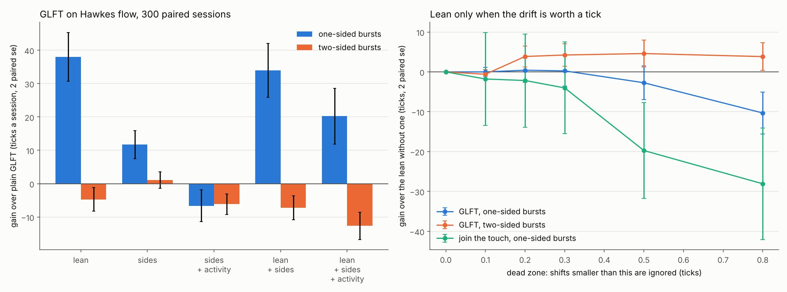

A dead zone of 0.2 to 0.3 ticks takes away the lean's loss where bursts are
two-sided (+4.2, se 1.4, against a loss of 4.7) and costs GLFT nothing where they
are one-sided, because the drifts that matter there are large. It does not turn
the lean into a gain on the second flow, where there is little to read. For the
touch quoter, whose lean at a one-tick spread follows only the sign of the
shift, the cost of 0.3 is within its noise (-4.0, se 5.8) and 0.5 is clearly too
much.

## A backstop

The tournament left a question open: on Hawkes flow, GLFT and AS make more among
the other bots than alone. `examples/backstop.py` pairs GLFT with one bot at a
time on `PairedFlow`, 300 sessions each, marking everyone at the closing mid of
the tape as the tournament does. The fills column is lots per session from fills
that emptied their price level, against GLFT's total; impact is the mid's move
across a market order in its direction, and volatility the sd of one-minute mid
changes:

| GLFT next to               | GLFT's gain (se) | adverse, 1 min | emptying fills | impact | volatility | partner's P&L | partner's peak position |
|----------------------------|------------------|----------------|----------------|--------|------------|---------------|-------------------------|
| nobody                     |                  | -172.5         | 124 of 222     | 0.21   | 1.21       |               |                         |
| touch bot                  | +47.5 (4.0)      | -72.1          | 0 of 164       | 0.08   | 0.69       | -67.9         | 24.0                    |
| touch bot, 20-lot limit    | +40.3 (3.8)      | -76.3          | 1 of 165       | 0.09   | 0.75       | -166.9        | 17.7                    |
| touch bot, 5-lot limit     | +8.9 (3.3)       | -97.6          | 4 of 165       | 0.12   | 0.97       | -138.1        | 5.0                     |
| touch bot, keeps its place | +72.1 (4.2)      | -64.0          | 12 of 172      | 0.09   | 0.68       | -63.1         | 23.9                    |
| AS                         | -24.2 (3.6)      | -119.2         | 4 of 158       | 0.14   | 1.10       | -98.2         | 7.3                     |
| a second GLFT              | -27.1 (3.3)      | -118.1         | 15 of 164      | 0.14   | 1.09       | -89.7         | 4.1                     |

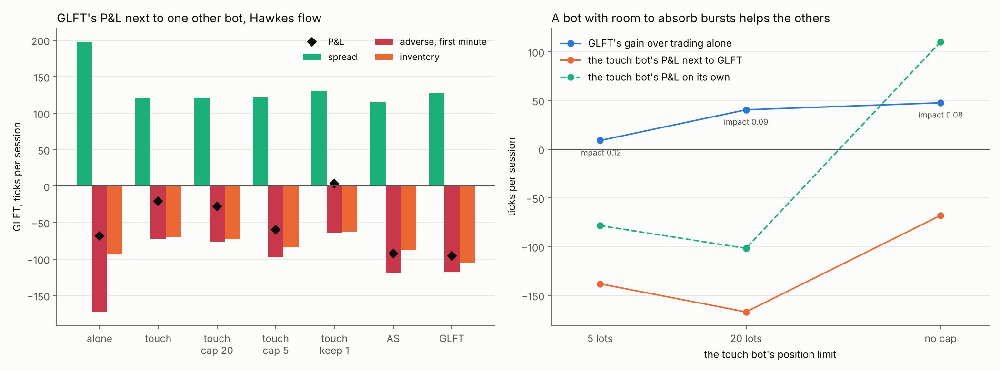

Only the touch bot helps, and only while it has room. The tournament's touch bot
quotes one lot on each side half a tick from the mid, which is at the touch or
inside it, has no position limit and requotes as soon as it is filled, so it
keeps buying into a burst of sells and selling into a burst of buys. The bursts
then move the price less: the impact of a market order falls from 0.21 to 0.08
ticks and one-minute volatility from 1.21 to 0.69. GLFT's fills also stop
emptying their level, and those were the bad fills (see the queue section):
market orders are one lot and the touch bot always has a lot at the best price,
so an order that reaches GLFT there leaves the touch bot's lot behind it. GLFT's
first-minute adverse selection falls from -172.5 to -72.1 ticks a session. The
touch bot pays.

With a 5-lot limit the touch bot runs out of room early in a burst and stops
quoting that side: GLFT gains only 8.9, and the touch bot loses 138, holding a
full position while the move runs on. At 20 lots most of the effect is back. A
touch bot that keeps its place in the queue helps GLFT more still. AS and a
second GLFT lean against their inventory, so they are not backstops, and next to
them GLFT simply shares the flow and makes less.

The touch bot on its own, same seeds:

| the touch bot alone | P&L (se)       | peak position | impact | volatility |
|---------------------|----------------|---------------|--------|------------|
| no limit            | +110.2 (20.6)  | 36.6          | 0.12   | 0.80       |
| 20-lot limit        | -101.7 (19.8)  | 19.4          | 0.14   | 0.89       |
| 5-lot limit         | -78.4 (6.3)    | 5.0           | 0.21   | 1.11       |

Without a limit it damps the bursts it trades against and makes money. With one
it is run over, worst at 20 lots where the position it carries into a move is
largest (paired against the unlimited bot: 211.9 lower, se 17.4, and 188.7 lower
at 5 lots, se 20.1). Next to GLFT the unlimited bot makes 178.1 less than alone
(se 15.9). It gets a third fewer fills (243 a session instead of 363), its
first-minute adverse selection per fill doubles (0.37 ticks instead of 0.19) and
its inventory term falls from -39.5 to -120.8: it still absorbs the bursts, but
now shares the quieter flow that paid for them. That is the tournament's touch
bot going from 160 alone to -113 in company.

## Install

```
python -m venv .venv
.venv/Scripts/pip install -e ".[dev]"     # .venv/bin/pip on Linux and macOS
.venv/Scripts/python -m pytest
```

Requires Python 3.10+, numpy and scipy. matplotlib is only needed for the
examples.

## Usage

```python
from mmsim.bots import AvellanedaStoikov
from mmsim.flow import CSTParams, ZeroIntelligence
from mmsim.sim import Simulator

bot = AvellanedaStoikov(gamma=0.001, sigma=1.0, k=3.6)
sim = Simulator(ZeroIntelligence(CSTParams.sky_perfect()), [bot], seed=1)
sim.seed(10_000, 10_001)  # best bid and ask, in ticks
sim.warm_up(30)           # minutes of background flow before the bot starts
sim.run(390)
ctx = sim.contexts[0]
ctx.pnl(), ctx.position, len(ctx.account.fills)  # (27.0, 2, 208)
```

A bot is a subclass of `Agent` with any of `on_start`, `on_book` (after every
background event), `on_fill` and `on_timer`. Its `ctx` gives the clock, the book,
everyone else's best bid, ask and mid, its own open orders and account, and
`buy`, `sell`, `cancel`, `modify` and `set_timer`.

```python
from mmsim import avellaneda as av
from mmsim.flow import prob_mid_up

run = av.simulate(0.1, "inventory", n_paths=10_000, seed=1)
run.profit.mean(), run.profit.std()               # (64.87, 6.58)
bid, ask = av.quotes(100.0, 3, 0.5, 0.1, 2.0, 1.5)   # 98.65, 100.15: long, so both lower
prob_mid_up(2, 1, lam=1.85, mu=0.94, theta=0.71)   # 0.335; CST Table 3 says 0.336
```

```python
from mmsim.bots import GLFT
from mmsim.glft import Model
from mmsim.informed import Fundamental, InformedTrader
from mmsim.markout import curve, markouts

m = Model(sigma=0.3, A=0.9, k=0.3, gamma=0.01, Q=30)
bid, ask = m.quotes(float("inf"))   # mid minus bid and ask minus mid, q = -30..30
bid[30] + ask[30]                   # 6.626, the spread at q = 0

value = Fundamental(sigma=1.0, seed=1)
bot = GLFT(Model(sigma=1.0, A=2.1, k=3.6, gamma=0.3, Q=5))
flow = ZeroIntelligence(CSTParams.sky_perfect())
sim = Simulator(flow, [bot, InformedTrader(value, rate=1.0, seed=1)], seed=1)
sim.seed(10_000, 10_001)
sim.warm_up(30)
sim.run(390)
fills = sim.contexts[0].account.fills
curve(fills, markouts(fills, sim.tape, [0, 1, 5, 30], sim.end))
# mean markout per lot 0.50, 0.42, 0.23, 0.11 over 271 fills

from mmsim.attribution import attribute

a = attribute(fills, sim.tape, 1.0, sim.end)
a.spread, a.adverse, a.inventory, a.total   # (178.0, -63.0, -91.5, 23.5)
```

```python
import numpy as np

from mmsim import glosten as gm
from mmsim import kyle

gm.binary_quotes(0.5, 0.3, 90.0, 110.0)   # (97.0, 103.0): the spread is alpha (hi - lo)
v = np.linspace(60, 140, 321)
prior = np.exp(-0.5 * ((v - 100) / 10) ** 2)
prior /= prior.sum()
gm.quotes(gm.Model(0.3, noise=5.0, eta=0.4), v, prior)   # (97.41, 102.59)

eq = kyle.solve(16, Sigma0=1.0, sigma_u=1.0)
eq.lam[0], eq.Sigma[-1], eq.profit                     # (0.901, 0.074, 0.886)
```

`python examples/as_replication.py`, `cst_sessions.py`, `glft_quotes.py`,
`informed_flow.py`, `why_spreads.py`, `queue_value.py`, `latency_cost.py`,
`hawkes_flow.py`, `flow_lean.py`, `tournament.py`, `paired_sessions.py`,
`which_side.py` and `backstop.py` redraw the thirteen charts. The session experiments run 1600 to 20,000 sessions on all
cores. `flow_lean.py` is the longest: its 1000-session sweep makes it about
20,000 sessions, which took 100 minutes on four cores; `paired_sessions.py`
(7200 sessions) and `which_side.py` (8700) took about half an hour each, and
`backstop.py` (3000) nine minutes. `latency_cost.py` takes 8 minutes here
and `tournament.py` 1.

## Notes

**Matching engine.** `book.py` ports the rules of the C++ engine: limit and
market orders, IOC, FOK, post-only, and modify, which keeps time priority only
when an order shrinks at the same price. It emits the same event stream as the
C++ engine, which `NativeBook` swaps in without touching the bots. Levels are keyed by
sign times price, with bids negated, so the best level of either side is the
smallest key and one matching loop serves both. A differential test runs 30 seeds
of 2000 random commands against a deliberately naive reference book (one flat
list, sorted on every take) and compares every event and every resting order.
Six hand-injected bugs each failed between 22 and 30 of the seeds.

**Order flow.** In Cont, Stoikov and Talreja (2010) every limit order, market
order and cancel is a Poisson arrival with a rate that depends only on the
distance from the opposite best quote, so the whole book is a continuous-time
Markov chain. `ZeroIntelligence.step` simulates it exactly: the waiting time is
exponential in the total rate and the event is drawn in proportion to its own
rate. When a bot's timer comes first, the draw is thrown away and redrawn later,
which is exact because the chain is memoryless. Parameters are the paper's
estimates for Sky Perfect Communications on the Tokyo Stock Exchange (rates per
minute).

The check against the paper: with a one-tick spread, the probability that the
mid moves up next is a race between two independent birth-death queues to empty
first. `prob_mid_up` solves it as a sparse linear system with one equation per
pair of queue sizes, instead of the paper's Laplace inversion. All 25 entries of
the paper's Table 3 match within 0.001, and simulated races through the real
book land within sampling error of the solve. Run for 20,000 minutes, the flow
has a one-tick spread 74% of the time and an average depth profile that peaks two
ticks from the opposite quote, the hump the paper describes.

**Simulator.** Every change to the book comes back as the book's own events, and
those update accounts, open orders and fills. Bots see `ctx.mid`, the mid of
everyone else's quotes. A bot that quoted around the full book's mid would be
quoting around its own orders, and those quotes would stay put when the market
moved. Callbacks never nest: all the events from one book change are booked
before any callback runs, and orders a bot sends from a callback are queued
behind it. Timers, orders in flight, fill reports and delayed feed updates all
wait in one heap keyed by time and a sequence number, so two things due at the
same instant happen in the order they were scheduled. The background flow draws
its next event with the time to the top of the heap as its horizon. The clock
belongs to the simulator alone: the mid tape and the trade prints (`sim.tape`,
`sim.prints`) are both stamped with it, so a print's time finds the mid its own
order left behind.

**Avellaneda-Stoikov on a book.** The model allows a quote on the far side of
the mid; on a book that is a market order. The bot rounds the model's prices
away from the reservation price and then keeps them passive, so a bid never
reaches past one tick below everyone else's ask. Inventory risk shows up as the
bot stepping back on the side that would add to its position, which on a queue
mostly means that side stops filling.

**Solving GLFT without losing the tails.** The quotes depend on ratios of
neighbouring entries of v = exp(-M tau) 1, and those entries can span many orders
of magnitude: with the order-book calibration (gamma = 1, Q = 10) the smallest is
1e-18 of the largest. An eigendecomposition gets the tails wrong, because the
eigenvectors are only accurate to about 1e-16 of their largest entry. But -M tau
has nonnegative off-diagonal entries, so shifting it by its smallest diagonal
entry makes every entry nonnegative. The Taylor series of a nonnegative matrix
has no cancellation, and neither does repeated squaring, so every entry of the
exponential comes out with full relative precision (the same idea as
uniformization for Markov chains). The long-horizon quotes are this exponential
at tau = 80 / (spectral gap), by which point the other eigenvectors have decayed
by e^-80.

**Markouts.** A markout is side times (mid at t + h minus fill price). The tape
keeps the last mid of each instant, so h = 0 already includes the book's
reaction to the fill. Horizons that run past the end of the session are left
out. Summed to the close, a fill's markouts are exactly its contribution to
P&L, which a test pins down.

## License

MIT
