# mm-sim

A market-making research lab in Python. It has a limit order book with
price-time priority, background order flow from the Cont-Stoikov-Talreja model,
an event-driven simulator where bots quote against that flow, the
Avellaneda-Stoikov and Gueant-Lehalle-Fernandez-Tapia inventory models (each
checked against its paper), informed traders with a private view of the
fundamental value, markout analysis to measure what they cost a market maker,
the Glosten-Milgrom and Kyle models of why spreads and price impact exist,
queue-position tracking with a measurement of what priority is worth, per-agent
latency on market data and order entry, Hawkes processes for clustered
order flow, a quoting signal that reads the Hawkes intensity off the public
trade tape, and an exact split of P&L into spread, adverse selection and
inventory. Sessions can run on the C++ [orderbook](https://github.com/louisbelot/orderbook)
engine instead of the Python book, and several bots can compete in one session.
The background market can also be a real day of NASDAQ ITCH data for one stock,
the flow models can be calibrated from it, and a queue-reactive model fitted to
that feed reproduces the real mid-move rate and most of a quoter's adverse
selection. A second replay fill rule bounds the fills the usual no-impact
assumption leaves out, and every fill is labelled with what caused it. On the
same tape it estimates Stoikov's microprice and the Cont-Kukanov-Stoikov
order-flow imbalance, checks both out of sample, and runs a quoter centred on
the microprice. The Cartea-Jaimungal-Penalva market maker with a short-term
alpha is solved numerically, calibrated from the replay's own fills, and run on
the same sessions, along with a measurement of how much of each signal is left
after a given latency. Finally, the simulator is wrapped as a Gymnasium
environment, a PPO market maker written from scratch in numpy is trained on it
and compared with the tuned inventory models, and every bot is stress-tested on
volatility spikes, a thinning book and informed flow. Next to the book sits a
concentrated-liquidity pool, with its loss-versus-rebalancing replicated in
closed form and in simulation, and compared with a quoter on the same price
path, including arbitrageurs who pay a quoter's spread to hedge and the
fixed-block correction that involves zeta(1/2), and pool fees that follow a
volatility estimate through calm hours and spikes. The same comparison runs for
prediction markets: Hanson's LMSR and a constant-product pool against a
Glosten-Milgrom quoter and the liquidity-sensitive LMSR, with bettors who hold
noisy signals. Last, a multi-asset market maker quotes correlated
assets with the Bergault-Evangelista-Gueant-Vieira closed form, checked against
the exact HJB on an inventory grid, and an ETF dealer hedges QQQ in its
components: measured on the tape with the Hayashi-Yoshida estimator and a
lead-lag scan, then modelled with impact-costed hedging, redemption at the
close and the creation/redemption arbitrage band. Pre-averaged HY recovers the
covariance the tick-level estimator loses, and shows that the hedge's
one-second shortfall is quote noise and a reverting basis rather than delay. An
options market maker quotes a real SPY smile, delta hedges on a schedule and
manages its portfolio vega with the Baldacci-Bergault-Gueant model, solved in
closed form and as an exact one-dimensional HJB. The
counterparty can also be an execution algorithm: Almgren-Chriss and
Obizhaeva-Wang schedules checked against their papers, the book's own impact
measured and fed back into both models, and a hidden-Markov filter on the trade
tape that lets a quoter find a working order and lean with it.

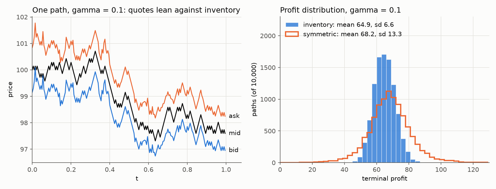

## Avellaneda-Stoikov, rerun

Avellaneda and Stoikov (2008) quote around a reservation price
r = s - q gamma sigma^2 (T - t) that leans against the inventory q, with a total
spread of gamma sigma^2 (T - t) + (2 / gamma) ln(1 + gamma / k). Section 3.3 of
the paper compares this with a symmetric strategy that quotes the same average
spread around the mid. `avellaneda.simulate` reruns that experiment with the
paper's parameters (s = 100, T = 1, sigma = 2, dt = 0.005, k = 1.5, A = 140).
10,000 paths per row here, 1000 in the paper, paper values in brackets:

| gamma | strategy  | spread      | mean profit | sd profit   | mean final q   | sd final q |
|-------|-----------|-------------|-------------|-------------|----------------|------------|
| 0.1   | inventory | 1.49 (1.49) | 64.9 (65.0) | 6.6 (6.6)   | 0.01 (0.08)    | 2.9 (2.9)  |
| 0.1   | symmetric | 1.49 (1.49) | 68.2 (68.4) | 13.3 (12.7) | -0.03 (0.26)   | 8.4 (8.4)  |
| 0.01  | inventory | 1.35 (1.35) | 68.4 (68.6) | 8.9 (8.7)   | -0.01 (0.12)   | 5.2 (5.1)  |
| 0.01  | symmetric | 1.35 (1.35) | 68.6 (68.8) | 13.5 (12.8) | -0.10 (0.09)   | 8.7 (8.7)  |
| 1     | inventory | 3.02 (3.02) | 31.4 (31.4) | 4.9 (5.0)   | 0.01 (0.02)    | 1.7 (1.7)  |
| 1     | symmetric | 3.02 (3.02) | 43.8 (44.0) | 11.0 (11.0) | -0.03 (0.00)   | 5.2 (5.1)  |

At gamma = 0.1 the inventory strategy gives up 3.3 of mean profit and halves the
standard deviation. At gamma = 1 it gives up 12.4 and the standard deviation goes
from 11.0 to 4.9. At gamma = 0.01 the trader is close to risk neutral: mean
profits are within 0.2 of each other and the gap in risk narrows, as the paper
says it should. The tests check every
row against the published one, with a tolerance that covers the sampling error of
both runs.

## The same idea on an order book

The paper's fills arrive at a rate A exp(-k delta) that only depends on the
distance from the mid. On a real book a quote fills when the queue in front of it
clears. In this simulator, stepping back one tick from the best quote cuts the
fill rate from 0.348 to 0.009 lots per minute, because the order now waits behind
a whole queue and loses its place every time the bot moves it. The chart below
puts a bot that joins the best bid and ask next to the Avellaneda-Stoikov bot,
with sigma = 1 tick per sqrt(minute) and k = 3.6 per tick, both measured on this
flow. Each point is 200 sessions of 390 minutes.

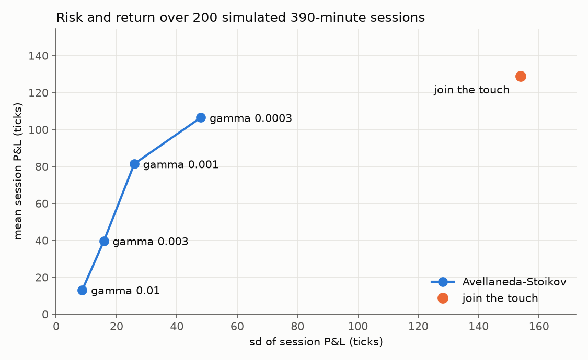

| strategy         | mean P&L (se) | sd P&L | mean / sd | sd final q | mean abs q | fills |
|------------------|---------------|--------|-----------|------------|------------|-------|
| join the touch   | 128.9 (10.9)  | 153.9  | 0.84      | 13.8       | 7.80       | 274   |
| AS, gamma 0.0003 | 106.5 (3.4)   | 48.0   | 2.22      | 7.3        | 2.48       | 253   |
| AS, gamma 0.001  | 81.4 (1.8)    | 25.9   | 3.14      | 4.5        | 1.08       | 220   |
| AS, gamma 0.003  | 39.7 (1.1)    | 15.8   | 2.51      | 3.7        | 0.45       | 128   |
| AS, gamma 0.01   | 13.2 (0.6)    | 8.7    | 1.52      | 2.5        | 0.14       | 47    |

P&L is in ticks per session, marked at the mid of everyone else's quotes, with
no fees. Joining the touch makes the most money and ends the day with an
inventory whose standard deviation is 14 lots. At gamma = 0.001 the AS bot keeps
63% of that mean with a sixth of the risk. Past that point its quotes sit far
enough back that it barely trades. This flow has no informed traders, so the
only adverse selection is mechanical (a fill often means the queue just
emptied and the price is about to move through it). The informed traders
below change that.

## Gueant-Lehalle-Fernandez-Tapia, solved exactly

Avellaneda-Stoikov leans on a horizon: its skew is gamma sigma^2 (T - t) per lot,
so at the open of a long session it is huge and at the close it is zero. Gueant,
Lehalle and Fernandez-Tapia (2013) solve the same problem with a hard inventory
bound |q| <= Q. The substitution u = -exp(-gamma (x + q s)) v_q(t)^(-gamma/k)
turns the HJB equation into a linear system v' = M v, where M is tridiagonal with
alpha q^2 on the diagonal and -eta off it (alpha = k gamma sigma^2 / 2,
eta = A (1 + gamma/k)^-(1 + k/gamma)). So v(t) = exp(-M (T - t)) 1 and the
quotes are

```
delta_bid(q) = (1/k) ln(v_q / v_{q+1}) + (1/gamma) ln(1 + gamma/k)
delta_ask(q) = (1/k) ln(v_q / v_{q-1}) + (1/gamma) ln(1 + gamma/k)
```

with no bid at q = Q and no ask at q = -Q. `glft.Model` computes this for any t,
the long-horizon limit (the ground state of M), the paper's closed-form
approximation, and its two extensions: a drift mu in the mid and a price impact xi
per fill, which is the paper's model of adverse selection.

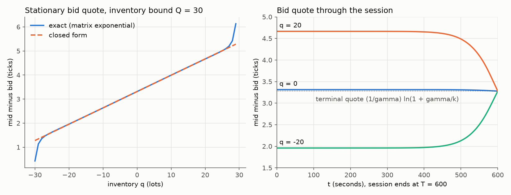

This is the paper's example (sigma = 0.3 tick per sqrt(s), A = 0.9 per s, k = 0.3
per tick, gamma = 0.01 per tick, T = 600 s). Far from the end the quotes barely
depend on t (at t = 0 they are within 4e-7 ticks of the infinite-horizon limit), and the stationary spread is 6.6261 ticks against 6.626 from
the closed form. The closed form is within 0.002 ticks for |q| <= 10 and drifts
off near the bound: at q = 29 the exact bid sits 6.13 ticks below the mid, the
closed form says 5.28. For comparison, Avellaneda-Stoikov at t = 0 with q = 20
would move its reservation price by 10.8 ticks; GLFT moves its bid by 1.35.

The checks: the quotes match a direct solve of the nonlinear HJB system (Radau,
in log space) to 1e-6 ticks, with and without drift and impact. Near the end
they reduce to the Avellaneda-Stoikov expansion, the paper's footnote 8. Taking
the plotted window [-30, 30] out of a bound of Q = 50 reproduces the axis ranges
of the paper's figures 1 to 3. And an exact Monte Carlo (Poisson fills by
thinning, the Brownian part integrated out analytically, Q = 4 and T = 50) earns
a certainty equivalent of 63.93 +- 0.08 ticks against the value function's
63.90, while moving every quote 0.3 ticks in or out loses about 0.8.

## Informed traders and markouts

`informed.py` adds a fundamental value V that follows a Brownian motion nobody
else can see, and informed traders who wake up at Poisson times and send a
market order whenever V is beyond the best quote. They are the only link between
V and the book, so the mid follows V with a lag, and every informed trade is
profitable at the moment it happens. Fills now record who the counterparty was,
and the simulator keeps a tape of every change in the mid, so `markout.py` can
measure, for each fill, how far the mid has moved for or against it h minutes
later.

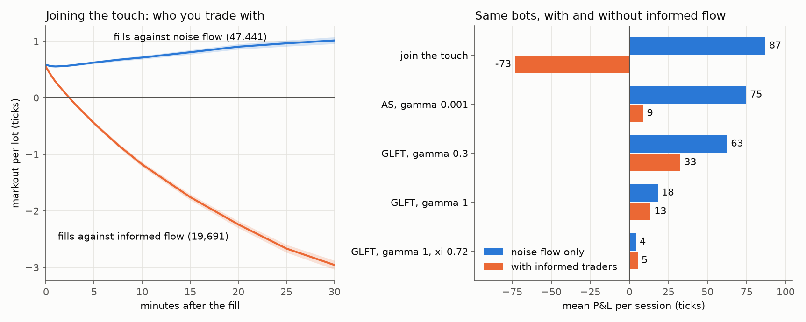

One informed trader at 1 order per minute, V moving 1 tick per sqrt(minute),
200 sessions of 390 minutes per row, every bot capped at 5 lots:

| strategy           | informed flow | mean P&L (se) | sd P&L | fills |
|--------------------|---------------|---------------|--------|-------|
| join the touch     | no            | 86.9 (4.0)    | 56.3   | 252   |
| join the touch     | yes           | -73.2 (5.1)   | 72.6   | 336   |
| AS, gamma 0.001    | no            | 74.7 (2.0)    | 28.7   | 218   |
| AS, gamma 0.001    | yes           | 8.7 (2.8)     | 40.0   | 295   |
| GLFT, gamma 0.3    | no            | 62.5 (1.3)    | 17.9   | 202   |
| GLFT, gamma 0.3    | yes           | 32.6 (1.8)    | 25.7   | 285   |
| GLFT, gamma 1      | no            | 18.3 (0.8)    | 10.6   | 83    |
| GLFT, gamma 1      | yes           | 13.5 (1.1)    | 15.6   | 159   |
| GLFT, gamma 1, xi  | no            | 4.1 (0.3)     | 4.4    | 13    |
| GLFT, gamma 1, xi  | yes           | 5.3 (0.6)     | 8.7    | 36    |

The markouts tell the story. Against noise flow the touch quoter earns its half
spread and keeps it. Against informed flow it earns the same 0.54 ticks at the
instant of the fill, is underwater after 2.5 minutes and is down 2.96 ticks per
lot after 30. Three fills in ten are informed, and that is enough to turn +87
ticks a session into -73.

The noise curve rising to +1.01 is a side effect of the position cap: once
informed buying has pushed the quoter to -5 lots it only shows a bid, so its
remaining noise fills are buys made while the price is still catching up with V.
Without the cap the curve stays flat (0.60 at the fill, 0.54 after 30 minutes,
over 40 sessions).

Inventory control turns out to be the defence. Informed flow is one-sided, so it
builds inventory, and a bot that leans against its inventory stops feeding it.
GLFT with gamma = 0.3 keeps more than half its P&L. The bot's sigma, k and A were
measured on noise flow only, so it does not know the informed traders exist.

The paper's own answer to adverse selection is xi, a permanent price impact per
fill. It widens both quotes by xi / 2 and makes the inventory penalty steeper.
Measured from the touch quoter's markouts (fill to 30 minutes, all
counterparties) it is 0.72 ticks, which moves the flat-inventory quotes from 0.57
to 1.24 ticks off the mid. The spread on this book is one tick 74% of the time,
so the bot now sits a tick behind the best price whenever it is flat, where the
fill rate is about 40 times lower. It drops from 83 fills a session to 13 and
makes 4 to 5 ticks with or without the informed traders. On a tick grid, leaning
on inventory did far more than widening.

## Why spreads exist: Glosten-Milgrom and Kyle

The models above get their spread from inventory risk and an assumed fill-rate
curve. The two classic information models get one from a risk-neutral market
maker that holds no inventory risk at all.

In Glosten and Milgrom (1985) a competitive market maker meets one trader at a
time. With probability alpha the trader is informed; otherwise the trader buys
or sells with probability eta each, whatever the price. The market maker sets
the ask to E[V | the next trader buys] and the bid to E[V | the next trader
sells], so it breaks even on average: what it loses to insiders it gets back
from everyone else. With V either lo or hi and P(V = hi) = mu,

```
ask = lo + (hi - lo) mu (alpha + u) / (mu alpha + u)      u = (1 - alpha) eta
bid = lo + (hi - lo) mu u / ((1 - mu) alpha + u)
```

and with an even prior the spread is exactly alpha (hi - lo). Each trade updates
the belief, and only the net number of buys matters: with eta = 1/2 every buy
multiplies the odds by (1 + alpha) / (1 - alpha).

`glosten.py` also solves a version on a grid of values, with insiders who see V
plus Gaussian noise and stay out when their estimate is inside the quotes (close
to Das 2005). The quotes are then fixed points, ask = E[V | a buy at that ask],
found by root-finding, and a no-trade is information too. With a two-point grid
and noise near zero it reproduces the closed form to 1e-9.

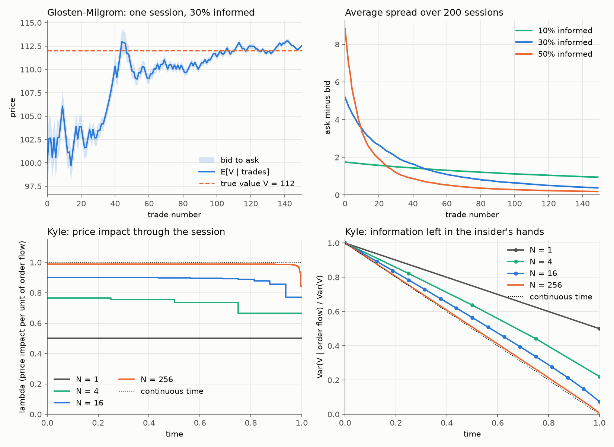

`examples/why_spreads.py` draws V from a normal prior (sd 10; insiders' noise sd
5, eta 0.4) and runs 200 sessions of 150 trades for each alpha:

| informed | first spread | spread after 150 trades | market maker P&L per session (se) | insiders' P&L per session |
|----------|--------------|-------------------------|-----------------------------------|---------------------------|
| 10%      | 1.75         | 0.95                    | -5.2 (7.5)                        | 81.6                      |
| 30%      | 5.18         | 0.38                    | -2.8 (3.7)                        | 58.3                      |
| 50%      | 8.84         | 0.18                    | -1.9 (2.5)                        | 32.9                      |

More insiders make a wider spread at the open and a faster collapse, because
the price learns faster. As a group the insiders earn the most when they are
rare. The market maker's P&L is zero within its standard error in every row, so
the uninformed pay for all of it.

Kyle (1985) has one insider who knows V ~ N(p0, Sigma0), noise traders who send
N(0, sigma_u^2 dt) to each of N auctions, and market makers who set the price to
E[V | order flow so far]. In equilibrium the insider trades beta_n (V - p) dt and
the price moves lambda_n per unit of net order flow. With one auction
lambda = sqrt(Sigma0) / (2 sigma_u) and the insider makes sqrt(Sigma0) sigma_u / 2.
For N auctions `kyle.solve` runs Kyle's backward recursion, where each step
solves a cubic for lambda_n on (0, 1 / (2 alpha_n)) given the next period's
value-function coefficient alpha_n. The recursion is homogeneous in Sigma, so it
runs once with Sigma_N = 1 and again rescaled to hit Sigma0. With
Sigma0 = sigma_u = 1:

| N    | lambda, first auction | lambda, last auction | Sigma_N | insider profit |
|------|-----------------------|----------------------|---------|----------------|
| 1    | 0.5000                | 0.5000               | 0.5000  | 0.5000         |
| 4    | 0.7648                | 0.6642               | 0.2206  | 0.7307         |
| 16   | 0.9012                | 0.7707               | 0.0742  | 0.8860         |
| 256  | 0.9881                | 0.8437               | 0.0056  | 0.9869         |
| 4096 | 0.9989                | 0.8530               | 0.0004  | 0.9988         |

As N grows the solution converges to continuous time: lambda constant at 1,
Sigma falling linearly to 0, and a profit of 1, twice the one-shot value. The
insider trades just slowly enough that the price only reaches V at the close.
The last auction stays different (lambda about 0.85 of the continuous value)
because there is no later auction to save information for.

The checks do not reuse the recursion. lambda_n equals the Kalman gain of the
market makers' filter given beta_n, to 1e-10. The value function
alpha_0 Sigma0 + delta_0 equals the insider's expected profit computed forward
from the strategy. Moving any single beta_n by 5% either way lowers that profit,
so the strategy is a best response. A Monte Carlo of 200,000 paths matches
Sigma_n to 2% and the profit within 4 standard errors, and its price changes are
uncorrelated with each other and with the remaining pricing error.

## Queue position

The simulator records where each order joined its queue. `LiveOrder.ahead` is
the quantity in front of the order when it joined its level, and
`ctx.ahead(oid)` gives the live value. A modify keeps the old number only when
it shrinks the order in place, the same rule the book uses for time priority.
Maker fills carry `ahead` and `left`, the quantity still resting at the fill
price once the incoming order is done. `left == 0` means the fill emptied the
level and the price went through it.

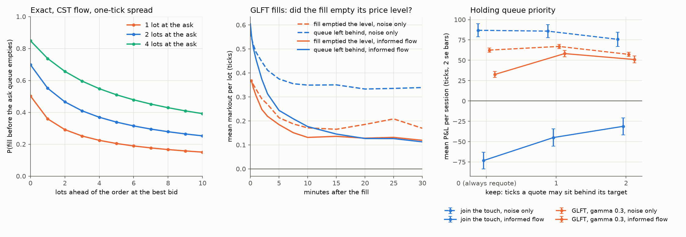

The left panel is exact. In the CST model with a one-tick spread, the
probability that an order at the best bid fills before the ask queue empties
falls quickly with the lots in front of it: against two lots at the ask it is
0.70 at the front, 0.47 two lots back and 0.25 ten lots back. It is the same
linear system as `prob_fill_first`, which a simulator test already checks.

In the simulator (200 sessions of 390 minutes per row, the informed traders from
the previous section), the fills that emptied their level are the bad ones. For
the GLFT bot the markout at the fill is 0.36 ticks when the fill took out the
level and 0.57 when it left a queue behind, with or without informed flow. Most
of those fills come from orders that stepped alone into a new price level
(`ahead == 0`); those get hit first and the level empties 67 to 73% of the
time. Position further back in the queue makes little difference to the longer
markouts compared to the noise in these runs.

That points to a policy. `Quoter` takes `keep`: a live quote stays put when it
sits at most `keep` ticks behind the new target, so the bot holds its place
instead of chasing every one-tick move. A quote never stays ahead of its target,
so the bot never quotes more aggressively than its model asks.

| strategy        | informed flow | keep | mean P&L (se) | sd P&L | fills | markout at fill |
|-----------------|---------------|------|---------------|--------|-------|-----------------|
| join the touch  | no            | 0    | 86.9 (4.0)    | 56.3   | 252   | 0.57            |
| join the touch  | no            | 1    | 85.8 (4.0)    | 56.0   | 184   | 0.69            |
| join the touch  | no            | 2    | 75.8 (4.4)    | 61.6   | 143   | 0.75            |
| join the touch  | yes           | 0    | -73.2 (5.1)   | 72.6   | 336   | 0.57            |
| join the touch  | yes           | 1    | -44.9 (5.3)   | 74.4   | 256   | 0.73            |
| join the touch  | yes           | 2    | -31.1 (5.2)   | 73.7   | 204   | 0.81            |
| GLFT, gamma 0.3 | no            | 0    | 62.5 (1.3)    | 17.9   | 202   | 0.52            |
| GLFT, gamma 0.3 | no            | 1    | 67.0 (1.3)    | 18.9   | 150   | 0.68            |
| GLFT, gamma 0.3 | no            | 2    | 57.3 (1.3)    | 18.6   | 111   | 0.77            |
| GLFT, gamma 0.3 | yes           | 0    | 32.6 (1.8)    | 25.7   | 285   | 0.52            |
| GLFT, gamma 0.3 | yes           | 1    | 58.2 (1.9)    | 26.9   | 221   | 0.73            |
| GLFT, gamma 0.3 | yes           | 2    | 51.0 (2.2)    | 30.5   | 172   | 0.84            |

The keep = 0 rows reproduce the informed-trader table exactly, rerun after the
queue changes. Against informed flow, keep = 1 takes GLFT from 32.6 to 58.2
ticks a session. It trades less, each fill is worth about 0.2 ticks more at the
instant it happens, and it takes about a quarter fewer fills from the informed
trader. Without informed flow it is close to neutral (+4.5 for GLFT, -1.1 for
the touch quoter), and at keep = 2 the bot starts missing fills that were worth
having.

## Latency

So far a bot saw every change to the book the moment it happened, and its
orders reached the book the moment it sent them. `Latency` takes that away. It
uses the split hftbacktest uses, three legs per agent: `feed` (market data from
the exchange to the bot), `entry` (orders from the bot to the matching engine)
and `response` (acks and fill reports back to the bot), plus an optional
`jitter`, an extra exponential delay with that mean on every leg. Each leg is
first in, first out, like a TCP session, so jitter can bunch messages up but
never reorders them.

```python
from mmsim.sim import Latency

lag = Latency(feed=0.1, entry=0.05, response=0.05)  # minutes, like the rest of the clock
sim = Simulator(flow, [bot, insider], latency={bot: lag})
```

With latency, what the bot knows and what the exchange knows come apart.
`ctx.orders` is the bot's own view: an order is in it from the moment it is
sent, `acked` once the acceptance comes back and `canceling` once a cancel is on
its way. `ctx.position` changes when a fill report arrives. The exchange books
the fill in `ctx.account` when it happens and `Fill.t` is that time, so P&L and
markouts measure what actually happened. A fill on an order whose cancel was
already in flight is marked `stale`: the bot lost the race to cancel.

The delayed feed is a replica. A bot with feed latency gets its own copy of the
book, and every command that reaches the exchange (background flow, other
agents, its own orders) is replayed on that copy `feed` later. The matching
engine is deterministic, so the same commands in the same order give the same
book. A test runs an hour of flow and checks that at every update the lagged
copy equals the exchange book from `feed` earlier, five levels deep on both
sides. `ctx.book`, `ctx.bid`, `ctx.ask` and `ctx.mid` all read the copy. With
no latency the bot reads the exchange book directly and nothing is queued, and
the sessions behind the earlier tables come out the same, fill for fill.

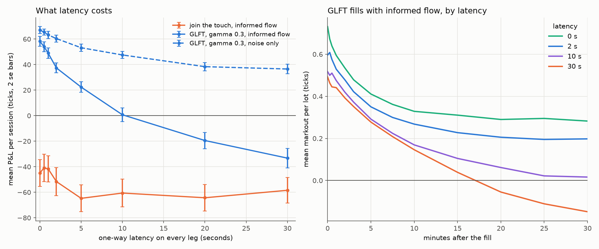

The clock is in minutes and the CST flow changes the book about 38 times a
minute, once every 1.6 seconds; the mid moves every 24 seconds. Seconds of
latency would be absurd on a real exchange, where a liquid book changes every
few microseconds, but what matters is latency against the time between book
events, and 10 seconds here is about six of them. Both bots run with keep = 1
against the informed trader from before, 200 sessions of 390 minutes per row,
the same latency on all three legs:

| one-way latency | GLFT, gamma 0.3 | stale fills | GLFT, noise only | join the touch |
|-----------------|-----------------|-------------|------------------|----------------|
| 0               | 58.2 (1.9)      | 0           | 67.0 (1.3)       | -44.9 (5.3)    |
| 0.5 s           | 54.1 (1.9)      | 1.4%        | 65.5 (1.2)       | -40.9 (5.3)    |
| 1 s             | 49.0 (2.1)      | 2.9%        | 63.3 (1.5)       | -41.6 (5.1)    |
| 2 s             | 37.4 (1.9)      | 5.4%        | 60.4 (1.4)       | -51.6 (5.5)    |
| 5 s             | 22.4 (2.0)      | 11.2%       | 53.2 (1.4)       | -64.7 (5.2)    |
| 10 s            | 0.7 (2.6)       | 17.5%       | 47.6 (1.3)       | -60.6 (5.5)    |
| 20 s            | -19.5 (3.2)     | 24.5%       | 38.4 (1.7)       | -64.3 (5.2)    |
| 30 s            | -33.3 (3.8)     | 28.9%       | 36.5 (1.8)       | -58.4 (5.0)    |

Mean P&L per session in ticks (standard error). The zero row is the keep = 1
row of the queue table, rerun through the new code. Against informed flow GLFT
gives up about 10 ticks per second of latency over the first two seconds, then
about 4 per second, and is at break-even by ten seconds. Without informed flow the same ten seconds cost 19 ticks, so most
of the damage is adverse selection made worse. The stale fills are the bad
ones: up to 10 seconds of latency, five minutes later they are down 0.24 to
0.59 ticks per lot while the rest are up about 0.40. At 30 seconds one GLFT session in five goes past its 5-lot
limit at some point, because the fills that take it over are still on their way
when it decides to keep quoting. The touch quoter is already losing to the
informed trader, and the extra 15 to 20 ticks it loses is two to three standard
errors.

Which leg matters? GLFT again, with 10 seconds on one leg at a time:

| 10 s on          | informed flow | noise only  | stale fills, informed |
|------------------|---------------|-------------|-----------------------|
| nothing          | 58.2 (1.9)    | 67.0 (1.3)  | 0                     |
| feed             | 20.6 (2.6)    | 56.1 (1.4)  | 0                     |
| entry            | 21.8 (2.2)    | 51.9 (1.5)  | 21.9%                 |
| response         | 52.8 (1.8)    | 63.5 (1.4)  | 0                     |
| feed 5, entry 5  | 24.9 (2.3)    | 55.4 (1.2)  | 11.4%                 |
| all three        | 0.7 (2.6)     | 47.6 (1.3)  | 17.5%                 |

Feed and entry latency cost the same, and splitting ten seconds between them
costs about as much as putting it all on one. What matters is the time from a
change in the market to the bot's order acting on it, which is what trading
firms call tick-to-trade. Only entry latency produces stale fills: with a slow
feed the cancel goes out late but lands at once, so the loss is just as large
and the stale flag never sees it. Counting lost cancel races measures half the
problem. Response latency is cheap here, since it only delays when the bot
learns about its own fills and skews for them.

## Clustered order flow: Hawkes processes

In the CST model every market order is an independent Poisson arrival. Real
market orders come in bursts: one buy makes the next buy more likely for a
while. A Hawkes process captures that with an intensity that jumps at each
event and decays back,

```
lambda_i(t) = mu_i + sum_j sum_{t_k of type j, t_k < t} alpha_ij exp(-beta_ij (t - t_k))
```

`hawkes.py` has the multivariate process with exponential kernels. The
branching matrix alpha / beta holds the expected number of type-i events each
type-j event triggers directly; when its spectral radius is below one the
process is stationary with mean rates (I - alpha / beta)^-1 mu. `simulate` uses
Ogata's thinning, `loglik` and `fit` do maximum likelihood with an analytic
gradient, and `residuals` applies the time-rescaling theorem: under the right
model the compensator increments between consecutive events are i.i.d. Exp(1),
which gives a goodness-of-fit test for any candidate model.

`HawkesFlow` keeps the CST limit orders and cancels and replaces the market
orders with a two-dimensional Hawkes process (buys, sells). `Hawkes.symmetric`
sets the base rate so the long-run rate per side stays at the CST value of 0.94
a minute. Here each market order triggers 0.6 more on its own side and 0.1 on
the other, with a decay time of 10 seconds (beta = 6 per minute).

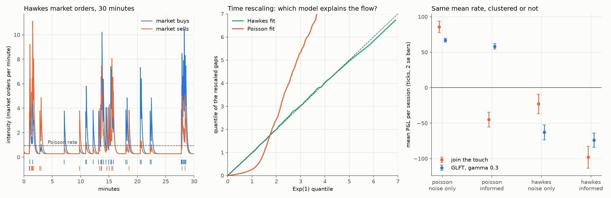

Fitting the model back on 2000 minutes of the simulated flow (3570 market
orders) gives a branching matrix of [[0.604, 0.113], [0.106, 0.600]] against
the true [[0.6, 0.1], [0.1, 0.6]]. The rescaled gaps under that fit pass a
Kolmogorov-Smirnov test against Exp(1) (statistic 0.012, p = 0.69); under a
Poisson fit with the same rates the statistic is 0.40 and the p-value is zero
to machine precision. The middle panel is the QQ plot of the two.

The book looks the same either way: the spread is one tick 79% of the time
against 76%, the mean bid depth is 15.5 lots against 15.6, and the book is
one-sided 0.15% of the time. Only the timing changes. 200 sessions of 390
minutes per row, keep = 1, no latency:

| strategy        | market orders | informed flow | mean P&L (se) | sd P&L | fills | mean abs q | markout 0 / 5 min |
|-----------------|---------------|---------------|---------------|--------|-------|------------|-------------------|
| join the touch  | Poisson       | no            | 85.8 (4.0)    | 56.0   | 184   | 2.64       | 0.69 / 0.65       |
| join the touch  | Poisson       | yes           | -44.9 (5.3)   | 74.4   | 256   | 3.09       | 0.73 / 0.46       |
| join the touch  | Hawkes        | no            | -22.8 (6.9)   | 98.1   | 240   | 2.95       | 0.76 / 0.19       |
| join the touch  | Hawkes        | yes           | -98.1 (7.7)   | 109.1  | 331   | 3.10       | 0.76 / 0.19       |
| GLFT, gamma 0.3 | Poisson       | no            | 67.0 (1.3)    | 18.9   | 150   | 0.70       | 0.68 / 0.51       |
| GLFT, gamma 0.3 | Poisson       | yes           | 58.2 (1.9)    | 26.9   | 221   | 0.84       | 0.73 / 0.41       |
| GLFT, gamma 0.3 | Hawkes        | no            | -63.0 (5.3)   | 74.5   | 220   | 1.26       | 0.77 / -0.08      |
| GLFT, gamma 0.3 | Hawkes        | yes           | -73.9 (5.1)   | 71.5   | 298   | 1.23       | 0.77 / -0.05      |

With the same number of market orders, clustering alone turns GLFT from +67 to
-63 ticks a session, with no informed trader anywhere. The fills look as good
as ever at the instant they happen (0.77 ticks) and are worth nothing five
minutes later. Clustered flow is predictable flow: a market sell that hits the
bot's bid is likely to be followed by more sells within seconds, and they walk
the price down through the level the bot just bought at. The bot then requotes
at the new touch and gets hit again. The standard deviation of one-minute mid
moves goes from 0.85 to 1.17 ticks. Clustering hurts more than the informed
trader does here, which says that a quoting model that treats fills as
independent Poisson events is missing the thing that matters most.

## Leaning on the flow

If market orders cluster, the trades a bot has just seen tell it something about
the next few seconds. Cartea, Jaimungal and Ricci (2014) build this into the
market maker's control problem: market orders excite each other and push the
mid, and a market maker who ignores that short-term drift gets picked off. The
version here is the first-order one: estimate the drift and quote around the mid
plus that drift instead of the mid.

Every agent now gets `on_trade` with a `Print` (time, aggressor side, worst
price, quantity) for each aggressive order, before its fills and its book update
from the same event, and through its feed latency if it has one. `Tracker` in
`hawkes.py` keeps the decayed sums of a fitted Hawkes model up to date from
those prints, so it knows the current intensity of market buys and sells. What
it needs is the expected number of extra market orders still to come. With
x = s - s_bar the excitation above its stationary level, the expectation obeys
the linear ODE dx/dt = M x, where M = -diag(beta) plus the alpha-weighted map
from x to the excess intensities. The expected excess count over the next h
minutes is then S M^-1 (exp(M h) - I) x, with S summing x into intensities;
`Hawkes.forecast(h)` builds that matrix once. In one dimension it reduces to
x (1 - e^-(beta - alpha) h) / (beta - alpha), which a test checks, and in two
dimensions with unequal betas it matches the mean counts of 20,000 simulated
paths from an empty start.

`FlowLean` multiplies the expected net excess (buys minus sells) by kappa, the
mid move per expected order, and any `Quoter` given a `signal` quotes around the
mid plus that shift. `FlowLean.fit` gets kappa by regressing the mid change over
the next h minutes on the forecast at each market order, without an intercept.
It recovers a planted permanent impact of 0.4 ticks to within 10% and finds
nothing in a random walk. Fitted on 2000 minutes of background flow (the same
Hawkes fit as above), kappa is 0.30, 0.26, 0.19 and 0.12 ticks per order for
h = 0.25, 0.5, 1 and 2 minutes. The bots use h = 0.5.

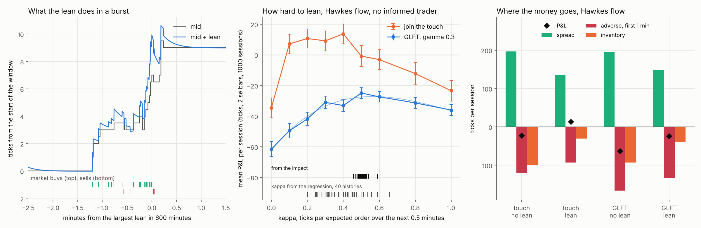

200 sessions of 390 minutes per row, same seeds as the Hawkes table, so the rows
without a lean are that table again:

| strategy        | lean | market orders | informed flow | mean P&L (se) | fills | spread | adverse, 1 min | inventory |
|-----------------|------|---------------|---------------|---------------|-------|--------|----------------|-----------|
| join the touch  | no   | Hawkes        | no            | -22.8 (6.9)   | 240   | 197.0  | -119.9         | -100.0    |
| join the touch  | yes  | Hawkes        | no            | 15.4 (6.6)    | 143   | 161.7  | -98.0          | -48.3     |
| GLFT, gamma 0.3 | no   | Hawkes        | no            | -63.0 (5.3)   | 220   | 195.6  | -165.6         | -93.1     |
| GLFT, gamma 0.3 | yes  | Hawkes        | no            | -34.1 (4.7)   | 184   | 167.8  | -149.9         | -52.2     |
| join the touch  | no   | Hawkes        | yes           | -98.1 (7.7)   | 331   | 271.5  | -145.1         | -224.5    |
| join the touch  | yes  | Hawkes        | yes           | 20.1 (6.9)    | 197   | 224.8  | -134.3         | -70.6     |
| GLFT, gamma 0.3 | no   | Hawkes        | yes           | -73.9 (5.1)   | 298   | 264.8  | -205.6         | -133.1    |
| GLFT, gamma 0.3 | yes  | Hawkes        | yes           | -39.1 (4.9)   | 258   | 237.7  | -192.3         | -84.6     |
| GLFT, gamma 0.3 | no   | Poisson       | no            | 67.0 (1.3)    | 150   | 110.8  | -19.3          | -24.5     |
| GLFT, gamma 0.3 | yes  | Poisson       | no            | 55.3 (1.2)    | 126   | 97.4   | -21.8          | -20.4     |

Paired over the same seeds, the lean is worth 38.3 ticks a session (se 9.0) to
the touch quoter and 28.9 (se 6.4) to GLFT on Hawkes flow, and 34.8 (se 7.1) to
GLFT with the informed trader as well. The touch quoter goes from losing to
making money in both cases. GLFT gets back about half of what clustering took
from it.

The attribution columns say where the gain comes from. Spread capture goes
down, because the bot fills less (184 fills against 220 for GLFT). The adverse
move in the first minute after a fill barely changes. Most of the gain is in the
inventory term: without the lean the bot keeps buying into a burst of sells and
carries that position while the burst runs on. With it, the bot's bid has
already stepped back and its ask has come down, so it sheds the position into
the same burst instead. The first-minute loss stays because the print that
fills the bot is often the first order of a burst, and nothing before it
predicted it.

The middle panel scales kappa by 0 to 3. The touch quoter peaks at the fitted
kappa (15.4) and falls off on both sides. GLFT keeps improving up to 1.5 times
kappa (-24.3) and is flat beyond that. A regression over all market orders
underweights the moments that matter to a market maker, since fills happen
during bursts, so leaning harder than the unconditional fit is not surprising.

The lean costs money where there is nothing to read: on Poisson flow the same
fitted model sees bursts that predict nothing, and GLFT gives up 11.7 ticks a
session (se 1.8). The signal has to be fitted on the flow it trades against.

## P&L attribution

`attribution.attribute(fills, tape, horizon, end)` splits a session's P&L
exactly. For a fill of signed size q at price p, with m_0 the mid just before
it, m_h the mid `horizon` minutes later (capped at the close) and m_T the
closing mid,

```
q (m_T - p) = q (m_0 - p) + q (m_h - m_0) + q (m_T - m_h)
                spread      adverse          inventory
```

Summed over fills and less fees, the three terms add up to the account value
marked at the closing tape mid, to 1e-9 in a test with maker rebates. Spread
plus adverse is the fill's markout at the horizon, which ties it to
`markout.py`. The split depends on the horizon: everything that happens to the
price within it counts as adverse selection, everything after it as the cost of
holding inventory. When the book was one-sided before a fill there is no mid,
and the fill gets no spread credit.

## The C++ matching engine as the book

`Simulator(..., book=NativeBook)` sends every order to the C++
[orderbook](https://github.com/louisbelot/orderbook) engine through its C API
and ctypes package. The engine decides every fill. `NativeBook` keeps an
order-level view built from the engine's event stream, the way a feed handler
builds a book from a market data feed, because the bots and the flow need
per-order information (owner, queue position) that the C API only gives by id.
`audit()` compares that view with the engine's own depth and order lookups.

Two things pin it to the Python book. The same random command stream, with
cancels, modifies, IOC, FOK, post-only and bad inputs, gives identical events
and identical resting orders in the same queue order as the brute-force
reference book (30 seeds of 2000 commands). And whole sessions (Poisson and
Hawkes flow, three bots, with and without latency) give the same position, cash
and fill list to the last bit on both books. Breaking the view's handling of
partial fills or of priority on a modify fails 42 and 31 of the 43 tests.

On a 390-minute GLFT session the Python book takes 0.29 s and the engine path
0.32 s, with the same 169 fills. The session cost is the flow's event menu and
the bots in Python, so the engine does not make a simulation faster. What it
buys is that the matching logic being tested is the one that will replay ITCH
data. `examples/native_speed.py` prints the timing.

Setup: build the engine (`cmake -S . -B build -G Ninja -DCMAKE_BUILD_TYPE=Release`
in the orderbook repo), `pip install -e path/to/orderbook/python`, and point
`OB_LIBRARY` at the shared library if it is not in `build/`. Without it the
native tests skip.

## A tournament

`tournament.session` puts several bots in one session against the same flow and
marks everyone at the closing mid of the tape. `standings` ranks them and pairs
each bot with its own solo run on the same seeds, so the cost of sharing the
queue is measured against the same flow instead of guessed. Seat order is
shuffled by seed. 100 sessions of 390 minutes, P&L in ticks:

| Poisson flow    | together (se) | alone | crowding (se) | sd   | mean/sd | wins | fills |
|-----------------|---------------|-------|---------------|------|---------|------|-------|
| join the touch  | 95.9 (5.5)    | 146.1 | -50.3 (14.1)  | 55.3 | 1.74    | 0.74 | 245   |
| AS, gamma 0.001 | 70.1 (1.3)    | 83.3  | -13.2 (3.0)   | 13.4 | 5.22    | 0.26 | 206   |
| GLFT            | 14.6 (1.0)    | 68.9  | -54.2 (2.0)   | 9.6  | 1.53    | 0.00 | 48    |
| GLFT + lean     | 8.5 (0.6)     | 54.6  | -46.0 (1.7)   | 5.7  | 1.49    | 0.00 | 26    |

| Hawkes flow     | together (se) | alone  | crowding (se) | sd    | mean/sd | wins | fills |
|-----------------|---------------|--------|---------------|-------|---------|------|-------|
| GLFT + lean     | 3.9 (2.7)     | -38.2  | 42.1 (7.6)    | 27.3  | 0.14    | 0.60 | 48    |
| GLFT            | -53.6 (5.1)   | -71.7  | 18.1 (9.2)    | 50.6  | -1.06   | 0.00 | 65    |
| AS, gamma 0.001 | -64.4 (6.9)   | -118.0 | 53.6 (23.9)   | 69.1  | -0.93   | 0.04 | 168   |
| join the touch  | -106.8 (23.5) | 160.0  | -266.9 (39.0) | 234.9 | -0.45   | 0.36 | 204   |

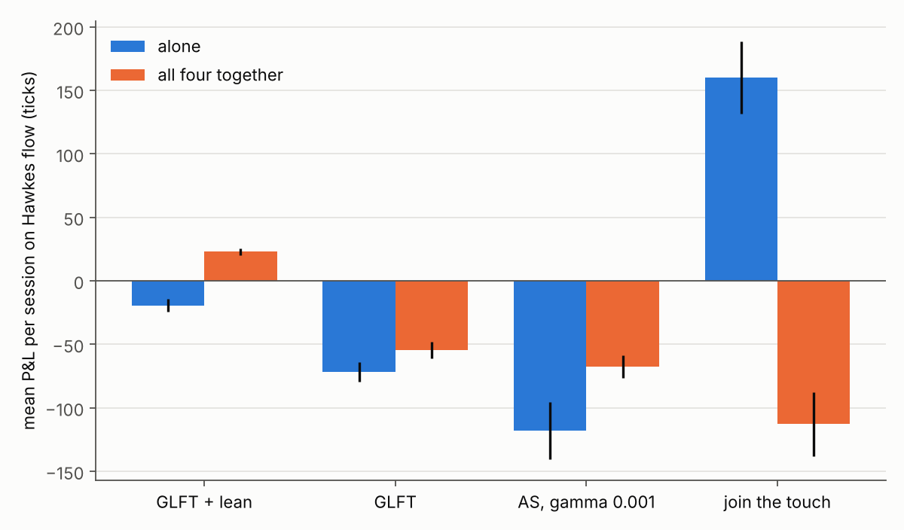

On Poisson flow every bot makes less in company, and the two GLFT bots lose
about four fifths of their profit. Nobody has an edge there, so competition only
takes, and these two quote one tick behind the best price they see, which is now
set by the touch bot and AS. On Hawkes flow the touch bot goes from 160 alone to
-107 in company, while the leaning bot is the only one above zero and GLFT and
AS do better in company than alone. I have not
isolated why. One candidate is that the touch bot, now sharing the front of the
queue, takes the bursts that used to hit the others. The mean/sd column is per
session, not annualised.

## Real NASDAQ flow

Everything above runs on simulated flow. `itch.py` reads NASDAQ TotalView-ITCH
5.0 and `replay.py` turns one stock's day into the background market, so the
same bots quote against what actually happened on 30 December 2019.

NASDAQ posts sample files at
[emi.nasdaq.com/ITCH](https://emi.nasdaq.com/ITCH/Nasdaq%20ITCH/). The one used
here, `12302019.NASDAQ_ITCH50.gz`, is 3.5 GB compressed and 8.3 GB raw.
`python -m mmsim.itch path/to/12302019.NASDAQ_ITCH50 CSCO INTC --out data` walks
it once (68 s for six symbols) and writes each stock's messages, unchanged, to
`data/<SYMBOL>.itch`. CSCO comes out at 16.6 MB and 550,473 messages. `data/` is
gitignored.

The real orders sit in a `ReplayBook` under negative ids and follow the feed
exactly. The bot's orders sit in the same price-time queues, and fill by three
rules:

- When the feed executes a real order, the aggressor would have reached every
  bot order with priority over it first: a better price, or the same price and
  earlier in the queue. Those fill, up to the executed size.
- A real limit order added at or through a bot quote fills the quote, up to the
  added size, and then rests in full.
- A bot order that takes liquidity fills against the displayed real orders
  without removing them. What is left of a GTC order that still crosses is
  cancelled.
- Optional, `ReplayBook(sweep=True)`: when one aggressor's executions empty a
  price level of real orders, the bot orders still resting there fill too. See
  [Fills the replay hides](#fills-the-replay-hides).

So the real book never feels the bot. That is the usual assumption for
backtesting passive quotes, and with 100-share quotes against queues of a few
thousand shares it costs little, but a bot that took liquidity in size would be
flattered by it. Executions that share a nanosecond timestamp are one aggressor,
so a sweep through five resting orders is one print. Hidden-order trades (`P`)
change nothing in the book and fill nobody; their side field is `B` on all 2457
of CSCO's, so it says nothing about direction anyway. Orders priced off the cent
grid, stub bids at $0.0001 and the like, are dropped along with their history.
The clock is minutes after midnight, so `warm_up(575)` replays the morning up to
9:35.

The book matches the orderbook repo's C++ ITCH reader (`ob-itch`): the top five
levels of CSCO at noon, price, size and order count (checked by hand, since the
data is not in the repo), and the whole book plus all
1200 traded shares of an ITCH file that the C++ engine wrote itself
(`tests/data/session.itch`, 790 bytes). Twelve random feeds of 3000 messages,
with partial cancels, replaces and sweeps, are replayed with a quoting bot of
three sizes, and the real orders end up exactly where a replay without the bot
puts them, in the same queue order. Five injected bugs (ignoring queue order,
letting a taking bot, an add or an execution move the real book, splitting
sweeps into separate prints) each fail at least one test. A full CSCO day with a
quoting bot replays in 5 seconds.

`calibrate` measures the Cont-Stoikov-Talreja quantities on the real feed between
two times: the limit order rate lambda(i) at i ticks from the opposite best
quote, the cancel rate theta(i) per resting share at that distance (cancelled
shares per minute over the time-averaged queue, sampled every second), and the
market order rate mu in units of the mean limit order size, as in section 3.1 of
the paper. `cst()` returns `CSTParams` that `ZeroIntelligence` runs directly, and
`hawkes()` fits the two-dimensional Hawkes process to the market order times.
CSCO from 9:35 to 15:55, both sides averaged:

| i  | lambda(i) per min | theta(i) per min | mean queue (shares) |
|----|-------------------|------------------|---------------------|
| 1  | 183.7             | 14.17            | 2927                |
| 2  | 52.0              | 3.82             | 3528                |
| 3  | 15.1              | 2.37             | 4157                |
| 4  | 13.0              | 2.10             | 5397                |
| 5  | 9.9               | 0.60             | 4095                |
| 10 | 4.3               | 0.36             | 1975                |

256,523 limit orders averaging 272 shares (54% of them exactly 100), 4008 market
orders averaging 399 shares, so mu is 7.72 units a minute per side. 317,011 of
the 1,915,733 shares traded hit hidden orders.

Then the experiment: the same bots on the real tape and on the two calibrated
models, in twelve 30-minute sessions each (9:35 to 15:35 on the tape, twelve
seeds in the models). The bot starts flat, quotes 100 shares a side with a 1000
share limit (one unit of 272 shares and four units in the models), and is marked
at the session's last mid. Cents per share traded, P&L split with a one-minute
markout, standard errors from the twelve sessions:

| CSCO           | flow    | P&L (se)       | spread | adverse | inventory | shares/session | mid moves/min |
|----------------|---------|----------------|--------|---------|-----------|----------------|---------------|
| join the touch | real    | -0.117 (0.112) | 0.514  | -0.727  | 0.096     | 11,550         | 11.16         |
| join the touch | Poisson | 0.500 (0.000)  | 0.500  | 0.000   | 0.000     | 53,242         | 0.01          |
| join the touch | Hawkes  | 0.498 (0.002)  | 0.500  | 0.001   | -0.002    | 44,659         | 0.04          |
| keep priority  | real    | -0.047 (0.190) | 0.521  | -0.710  | 0.142     | 6,901          | 11.16         |
| keep priority  | Poisson | 0.500 (0.000)  | 0.500  | 0.000   | 0.000     | 50,472         | 0.01          |
| keep priority  | Hawkes  | 0.498 (0.002)  | 0.500  | 0.001   | -0.003    | 34,669         | 0.04          |

The calibrated model keeps about 11 units at the touch and refills them at 184
orders a minute against 7.7 units of market flow, so its best queue almost never
empties: the mid moves about once every 100 minutes in the model and 11 times
a minute on the tape. A quoter in the model collects half a tick per share and
nothing else. On the tape it collects the same half tick and gives back 0.73
within a minute. The Hawkes version does not help. A single exponential kernel
locks onto the sub-millisecond bursts (decay 0.27 and 0.36 ms, branching 0.34 and
0.38), its time-rescaled residuals fail a Kolmogorov-Smirnov test (statistic
about 0.12 on 2000 events a side), and clustering that fast is over before a
quote could react. Independent unit-size orders cannot empty a queue of 3000
shares on their own. Real queues empty because cancels and market orders come
together, which is what the queue-reactive model of Huang, Lehalle and Rosenbaum
(2015) is built for.

The same bot on six symbols:

| join the touch | P&L (se)       | spread | adverse | inventory | $/session | mid moves/min |
|----------------|----------------|--------|---------|-----------|-----------|---------------|
| CSCO           | -0.117 (0.112) | 0.514  | -0.727  | 0.096     | -13.5     | 11.2          |
| INTC           | -0.256 (0.055) | 0.509  | -0.718  | -0.047    | -53.0     | 18.6          |
| CMCSA          | 0.112 (0.062)  | 0.514  | -0.658  | 0.255     | 15.6      | 11.4          |
| MSFT           | -0.361 (0.095) | 0.537  | -0.765  | -0.133    | -148.7    | 118.0         |
| AAPL           | -0.962 (0.254) | 0.674  | -1.962  | 0.326     | -810.3    | 373.2         |
| QQQ            | -0.353 (0.198) | 0.529  | -0.661  | -0.221    | -118.3    | 297.3         |

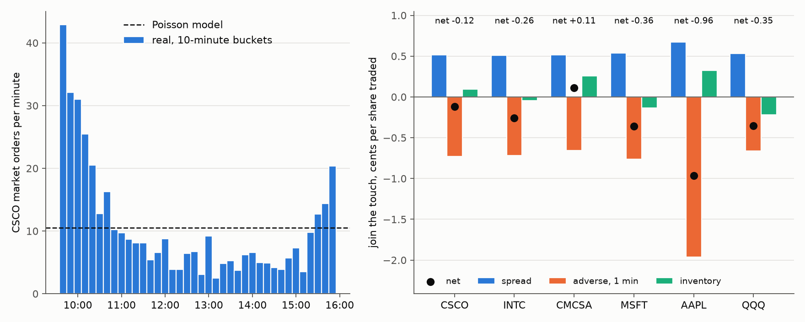

Joining the touch loses on five of the six. The spread term is close to the half
tick everywhere, and adverse selection over one minute takes more than that
everywhere, most of all on AAPL, a $290 stock whose price moves many ticks in a
minute. CMCSA is the one positive row, and its inventory term (0.26) is bigger
than its whole P&L, so that is drift, not edge. Keeping priority (staying up to a
tick behind instead of requoting) changes little; the example prints its rows
too. The left panel shows another thing the model misses: market orders arrive
at 43 a minute in the first ten minutes, 2.5 to 9 between noon and 15:00, and
20 in the last ten, against a flat 10.5.

Caveats. One day. The tables above have zero latency and no fees; the next two
sections add both. `examples/itch_replay.py` prints the tables and draws the
chart in about 3 minutes once the six files are extracted.

## Queue-reactive flow

The calibrated models above fail for one reason: they cannot empty a queue. So
before building another model I measured how CSCO's best queues actually end. The
spread is one tick 99.6% of the time, and best queues end 5.59 times a minute,
which is half of the 11.18 mid moves: every mid move is one side of a gap opening
or closing. The mean touch queue is 2927 shares, but the median queue just before
it ends is 200. Market orders finish 70% of them, and at every percentile from the
10th to the 90th that last order takes exactly what is left. The gap then closes
in a median of 71 microseconds, and a new level is born small (median 200 shares).
Prices move on small fresh queues, and the big queues mostly just sit there.

`qr.py` is the model of Huang, Lehalle and Rosenbaum (2015) built around that. The
rate of limit orders, cancels and market orders at each level depends on the
queue size in units of the level's average event size, estimated as events over
time spent in the state, which is the maximum likelihood estimate for a Markov
jump process. Market orders run from 76 a minute at one unit to 2 a minute at ten
units, a factor of 40 the Poisson model has no way to express:

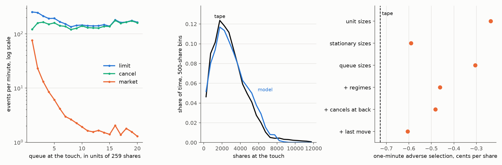

Nothing below was fitted to the target. The paper calibrates two probabilities
(theta, theta_reinit) to match volatility and mean reversion. Here the same
effects are read off the feed, so every number in the model is a count over a
time, and the moves, volatility and P&L that come out are predictions. The ladder
adds one measured ingredient at a time, 48 seeded 30-minute sessions per row
against the same twelve sessions of tape. The bot is the same touch quoter with
100 shares and a 1000 share limit:

| CSCO              | P&L (se)       | spread | adverse | shares/session | mid moves/min | eta   | vol   |
|-------------------|----------------|--------|---------|----------------|---------------|-------|-------|
| real tape         | -0.117 (0.112) | 0.514  | -0.727  | 11,550         | 11.16         | 0.598 | 1.62  |
| unit sizes        | 0.208 (0.063)  | 0.500  | -0.236  | 10,146         | 7.76          | 0.309 | 1.53  |
| stationary sizes  | -0.021 (0.105) | 0.500  | -0.591  | 11,386         | 18.38         | 0.338 | 3.46  |
| queue sizes       | 0.147 (0.035)  | 0.500  | -0.305  | 16,041         | 7.91          | 0.341 | 1.23  |
| + regimes         | -0.055 (0.043) | 0.508  | -0.462  | 18,701         | 10.29         | 0.418 | 1.35  |
| + cancels at back | -0.080 (0.040) | 0.505  | -0.483  | 16,522         | 9.97          | 0.426 | 1.31  |
| + last move       | -0.155 (0.052) | 0.505  | -0.606  | 16,610         | 10.26         | 0.543 | 1.59  |

Eta is the mean reversion ratio N_c / (2 N_a) of continuations to alternations in
the mid, and vol is the standard deviation of one-minute mid changes in cents.
The Poisson model made 0.01 moves a minute and 0.500 a share. This one is 0.038
from the tape's P&L, against a standard error of 0.112 on the tape itself.

What each rung is:

- Unit sizes: every event is one average event, as in the original paper.
- Stationary sizes: event sizes drawn from all sizes at that level. It gets
  adverse selection roughly right for the wrong reason: one large draw wipes out a
  queue at any time, and volatility is twice the tape's.
- Queue sizes: sizes drawn from the events seen at that queue size, plus an
  explicit atom for "takes the whole queue". This is Bodor and Carlier's (2024)
  point that depletion is far more common than stationary sizes imply. It also
  makes the mean drift at each queue size match the data, and the first version
  of this model showed why that matters. Cancels there removed one random whole
  order, so the drift was wrong and the queue spent 42% of its time in the top bin
  against 2.8% on the tape. The top bin is also a reflecting barrier now, since
  its rates come from rare stretches and have almost no drift.
- Regimes: touch rates also depend on the size of the opposite queue (HLR's Model
  IIb, cut at terciles), and a gap remembers which side left and why. After a
  market order empties a queue the price continues 84% of the time (1253 of 1496);
  after a cancel, 47% (297 of 626). One calibrated theta would average those.
- Cancels at the back: 52% of touch cancels come from the last 10% of the queue,
  34% from the very last order, mean position 0.79, and the median cancelled order
  lived 26 ms. A uniform cancel moves a resting order forward much faster than
  that, which any queue-position backtest should worry about.
- Last move: every rate also depends on the direction of the last mid move. One
  bit of memory takes eta from 0.43 to 0.54 and adverse from -0.48 to -0.61.

The left panel is the reactive rates. The middle panel is the fair test: the
distribution of the touch queue on the tape and in the full model, one-second
samples, neither fitted to the other. The right panel is the ladder.

An aggressor sized to the whole queue takes the market's shares and not the bot's,
the same no-impact rule the replay uses, so the two rows compare like with like.
That rule matters. When the atom could also reach the bot, moves went to 14.2 a
minute. It is a weakness of the replay too: a real aggressor would see the bot's
quote and take it, so the replay spares the bot some of its worst fills.

What is still wrong. The bot trades 44% more shares than on the tape: total volume
in the model is 25% too high (157,000 shares a session against 125,500) and the
bot gets a larger slice (10.9% against 9.2%). Adverse selection is 83% of the real
number.

The bigger problem is the clock. Fit on the morning and run against the afternoon:

| CSCO, fit before 12:45 | P&L (se)       | adverse | shares/session | mid moves/min | eta   | vol  |
|------------------------|----------------|---------|----------------|---------------|-------|------|
| real, afternoon        | 0.170 (0.161)  | -0.653  | 5,935          | 3.66          | 0.538 | 1.14 |
| model                  | -0.237 (0.046) | -0.626  | 23,533         | 16.59         | 0.522 | 2.09 |

Adverse selection per share and eta carry over almost exactly. Activity does not:
the morning's rates give 4.5 times the afternoon's mid moves. The structure of the
model is stable across the day and its intensities are not, and the first table is
an all-day average of a market that is far from stationary.

The same recipe on the other symbols, 12 sessions a row:

|       | moves real | moves model | adverse real | adverse model | P&L real | P&L model |
|-------|------------|-------------|--------------|---------------|----------|-----------|
| CSCO  | 11.16      | 10.26       | -0.727       | -0.598        | -0.117   | -0.133    |
| INTC  | 18.62      | 13.69       | -0.718       | -0.441        | -0.256   | -0.009    |
| CMCSA | 11.41      | 10.06       | -0.658       | -0.472        | 0.112    | -0.045    |
| MSFT  | 117.98     | 72.90       | -0.765       | -0.526        | -0.361   | -0.041    |
| AAPL  | 373.19     | 171.10      | -1.962       | -1.499        | -0.962   | -1.443    |
| QQQ   | 297.29     | 275.46      | -0.661       | -0.424        | -0.353   | 0.068     |

The CSCO row differs slightly from the ladder because it has 12 seeds, not 48. The
model is built for large-tick stocks and it shows. AAPL's spread is one tick only
13% of the time, so five levels from the opposite quote do not describe its book,
and it misses the moves by a factor of two. Adverse selection is too small on every
row, so something beyond one bit of memory is missing, most likely the long memory
of order flow.

`examples/queue_reactive.py` prints all of this and draws the chart in about 8
minutes. A full model session on CSCO runs in about 3 seconds.

The tests check the model against things it does not contain. A queue pinned to
one price is a birth-death chain, so its occupancy has to equal the closed form
pi(n) = pi(0) prod lambda(j-1) / (mu(j) + theta(j)), and its depletion rate has to
equal pi(1) times the death rate at one, from 40,000 simulated minutes. Fitting a
feed generated from known rates recovers each one within 4 standard errors. Gaps
close at the odds put in. Commands replay identically on a second book, which the
feed replica depends on. 19 injected bugs (floored bins, swapped regimes, an
exposure off by one event, the bot visible to the aggressor) all fail a test.

## Time of day

The queue-reactive rates depend on the book and not on the clock, which is why the
morning fit runs the afternoon 4.5 times too fast. The fix keeps the model and puts a
clock on top of it. Every rate is the book-state rate times a multiplier for the
30-minute slot it falls in:

```
lambda(x, k, t) = lambda(x, k) * s_k(h(t))
```

x is the book state (level, regime, queue bin), k the event kind (limit, cancel,
market) and h the slot. With N(x, k) events seen in state x, A(h, k) events in slot h
and T(x, h) minutes spent in state x during slot h, the two score equations of the
Poisson likelihood are

```
lambda(x, k) = N(x, k) / sum_h T(x, h) s_k(h)
s_k(h)       = A(h, k) / sum_x T(x, h) lambda(x, k)
```

The log-likelihood is concave in log lambda and log s, so solving one equation, then
the other, until nothing moves gives the joint maximum. The scale between the two is
free, so each s_k is pinned to a time-weighted mean of one and lambda stays an
all-day rate. A shared clock uses one multiplier for all three kinds. `Fit.clock`
solves it and `Fit.params(clock=...)` returns rates fitted against the clocked
exposure. The flow samples through slot edges exactly: it draws an exponential at
the current slot's total rate, and when the draw crosses the edge it moves to the edge
and draws again, which is allowed because the exponential has no memory.

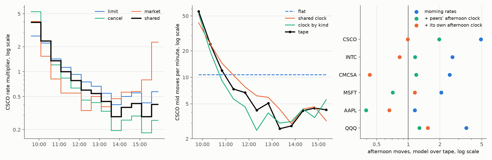

CSCO's activity falls by a factor of 14 from the first slot (multiplier 3.95) to the
13:35 slot (0.29). Kinds do not move together. Cancels swing the most, 5.3 at the open
and 0.18 in the afternoon. Market orders come back for the close, 2.27 in the last
slot while cancels stay at 0.26.

Fit on the whole day, mean mid moves per minute over 8 seeds in each 30-minute
session:

| start | tape  | flat  | shared clock | clock by kind |
|-------|-------|-------|--------------|---------------|
| 9:35  | 56.30 | 10.72 | 41.91        | 52.69         |
| 10:05 | 23.90 | 10.72 | 23.96        | 19.73         |
| 10:35 | 12.00 | 10.72 | 14.53        | 9.21          |
| 11:05 | 7.37  | 10.72 | 10.59        | 5.67          |
| 11:35 | 6.70  | 10.72 | 7.77         | 4.62          |
| 12:05 | 4.23  | 10.72 | 6.16         | 2.49          |
| 12:35 | 5.07  | 10.72 | 5.92         | 3.93          |
| 13:05 | 2.60  | 10.72 | 4.31         | 3.01          |
| 13:35 | 2.80  | 10.72 | 2.96         | 3.14          |
| 14:05 | 4.17  | 10.72 | 4.37         | 4.35          |
| 14:35 | 4.47  | 10.72 | 4.61         | 3.48          |
| 15:05 | 4.27  | 10.72 | 3.20         | 5.55          |

The flat model gets the day's average and nothing else. Both clocks follow the
twentyfold fall in moves.

The harder test is the one that failed before: rates fitted on the morning, run on
the afternoon. `qr.rescale(params, later_fit)` holds the morning's lambda fixed and
solves only the s equation on the afternoon's tape. That uses the afternoon's event
counts, so it measures how much the model is missing and forecasts nothing. With one
day of data I cannot test a forecast from earlier days. The closest thing is the
median afternoon clock of the five other symbols, which asks whether the shape of the
day carries across stocks.

| CSCO, fit before 12:45     | P&L (se)       | adverse | shares/session | moves/min | median touch queue |
|----------------------------|----------------|---------|----------------|-----------|--------------------|
| real, afternoon            | 0.170 (0.161)  | -0.653  | 5,935          | 3.66      | 3,300              |
| fit on morning             | -0.401 (0.046) | -0.743  | 23,934         | 16.82     | 2,043              |
| + afternoon clock, shared  | -0.406 (0.103) | -0.560  | 5,137          | 3.48      | 2,050              |
| + afternoon clock, by kind | -0.114 (0.067) | -0.481  | 9,151          | 4.64      | 2,950              |
| + peers' afternoon clock   | -0.131 (0.066) | -0.635  | 10,270         | 7.15      | 2,022              |

The shared clock gets moves and volume right and leaves the queue too short. The clock
by kind cuts cancels harder than adds (0.15 to 0.24 against 0.23 to 0.49), so queues
grow back toward the real 3,300 shares, at the cost of 1.5 times the volume. None of
the rows gets the sign of the real P&L, though the real one is only one standard error
from zero.

The same on all six symbols, afternoon moves per minute, 24 sessions a row:

| symbol | tape   | flat   | own clock | peers' clock | adverse tape | own clock | peers' clock |
|--------|--------|--------|-----------|--------------|--------------|-----------|--------------|
| CSCO   | 3.66   | 17.92  | 3.62      | 7.20         | -0.653       | -0.565    | -0.678       |
| INTC   | 7.59   | 19.98  | 6.26      | 8.80         | -0.752       | -0.485    | -0.503       |
| CMCSA  | 5.13   | 12.70  | 2.21      | 6.09         | -0.529       | -0.459    | -0.555       |
| MSFT   | 55.19  | 113.32 | 63.63     | 39.20        | -0.613       | -0.599    | -0.463       |
| AAPL   | 220.58 | 254.81 | 145.22    | 87.34        | -1.976       | -1.644    | -1.354       |
| QQQ    | 119.84 | 427.53 | 183.85    | 152.87       | -0.430       | -0.447    | -0.363       |

The flat morning rates run 1.2 (AAPL) to 3.6 (QQQ) times too fast. Each symbol's own
clock lands within 20% on CSCO, INTC and MSFT and misses CMCSA by half. That miss is
structural. The clock is fitted to the number of events in each slot, and a shared
multiplier scales adds and removals alike, so it cannot change the balance between
them at the touch, which is what sets how often a queue runs out. Where the afternoon
changes that balance, matching event counts does not match moves. The peers' clock is
within 20% on INTC and CMCSA and off by two on CSCO, so the shape of the day is only
partly common across stocks.

`examples/activity_clock.py` prints all of this and draws the chart in about 15
minutes.

The tests check the estimator on data with a known answer. Counts drawn from known
rates and multipliers come back within 4 standard errors, and at the solution the
expected count in every slot equals the observed count to 1e-8. A feed generated by a
flow with a three-slot clock is fitted back to that clock's ratios. The flow's event
counts per slot match rate times length, and a draw started in a nearly silent slot
lands just past the edge at the next slot's rate. A clock of all ones gives exactly
the tape of the flat model. Nine injected bugs (no normalization, a draw
allowed to jump an edge, the wrong multiplier column, the slot index off by one, and
others) all fail a test.

## Latency and rebates on the real tape

The replay's zero latency is impossible, so here is the six-symbol table with
latency and rebates. Feed and entry each take the same one-way delay. The rebate
columns are scenarios: 0.18 and 0.305 cents a share, the range a 2024 IEX filing
gives for Nasdaq's displayed-add tiers. I could not confirm the December 2019
schedule, and a bot this small would not reach the top tier. The bot only posts,
so the net is exact arithmetic on the same run. Cents per share, twelve 30-minute
sessions:

| symbol | one way | gross (se)     | spread | adverse | shares  | $/session | net, 0.18 | net, 0.305 |
|--------|---------|----------------|--------|---------|---------|-----------|-----------|------------|
| CSCO   | 0       | -0.117 (0.112) | 0.514  | -0.727  | 11,550  | -13.5     | 0.063     | 0.188      |
| CSCO   | 100 us  | -0.228 (0.065) | 0.357  | -0.577  | 14,029  | -32.0     | -0.048    | 0.077      |
| CSCO   | 1 ms    | -0.296 (0.071) | 0.350  | -0.593  | 13,290  | -39.3     | -0.116    | 0.009      |
| CSCO   | 10 ms   | -0.276 (0.060) | 0.346  | -0.588  | 12,684  | -35.1     | -0.096    | 0.029      |
| INTC   | 0       | -0.256 (0.055) | 0.509  | -0.718  | 20,668  | -53.0     | -0.076    | 0.049      |
| INTC   | 100 us  | -0.284 (0.057) | 0.331  | -0.699  | 23,909  | -67.8     | -0.104    | 0.021      |
| INTC   | 1 ms    | -0.271 (0.054) | 0.310  | -0.666  | 23,448  | -63.5     | -0.091    | 0.034      |
| INTC   | 10 ms   | -0.305 (0.052) | 0.299  | -0.680  | 21,966  | -66.9     | -0.125    | 0.000      |
| CMCSA  | 0       | 0.112 (0.062)  | 0.514  | -0.658  | 14,003  | 15.6      | 0.292     | 0.417      |
| CMCSA  | 100 us  | 0.061 (0.053)  | 0.362  | -0.572  | 14,743  | 9.0       | 0.241     | 0.366      |
| CMCSA  | 1 ms    | -0.089 (0.071) | 0.325  | -0.582  | 14,418  | -12.8     | 0.091     | 0.216      |
| CMCSA  | 10 ms   | -0.097 (0.086) | 0.326  | -0.599  | 13,591  | -13.2     | 0.083     | 0.208      |
| MSFT   | 0       | -0.361 (0.095) | 0.537  | -0.765  | 41,181  | -148.7    | -0.181    | -0.056     |
| MSFT   | 100 us  | -0.369 (0.115) | 0.278  | -0.585  | 52,901  | -195.2    | -0.189    | -0.064     |
| MSFT   | 1 ms    | -0.436 (0.073) | 0.220  | -0.581  | 56,323  | -245.5    | -0.256    | -0.131     |
| MSFT   | 10 ms   | -0.436 (0.076) | 0.206  | -0.600  | 54,152  | -236.2    | -0.256    | -0.131     |
| AAPL   | 0       | -0.962 (0.254) | 0.674  | -1.962  | 84,215  | -810.3    | -0.782    | -0.657     |
| AAPL   | 100 us  | -1.288 (0.156) | 0.428  | -1.742  | 99,409  | -1280.6   | -1.108    | -0.983     |
| AAPL   | 1 ms    | -1.435 (0.153) | 0.276  | -1.662  | 104,667 | -1501.6   | -1.255    | -1.130     |
| AAPL   | 10 ms   | -1.535 (0.201) | 0.175  | -1.734  | 96,385  | -1479.5   | -1.355    | -1.230     |
| QQQ    | 0       | -0.353 (0.198) | 0.529  | -0.661  | 33,529  | -118.3    | -0.173    | -0.048     |
| QQQ    | 100 us  | -0.164 (0.060) | 0.132  | -0.303  | 87,404  | -143.5    | 0.016     | 0.141      |
| QQQ    | 1 ms    | -0.184 (0.063) | 0.083  | -0.260  | 125,228 | -230.9    | -0.004    | 0.121      |
| QQQ    | 10 ms   | -0.178 (0.039) | 0.075  | -0.278  | 124,636 | -221.9    | 0.002     | 0.127      |

Read the dollars, because the cents mislead. Latency makes adverse selection look
better on every row, and QQQ's loss per share halves while its fills go up almost
fourfold. Both are accounting. A slow quote sits at a price the market has left, a
real order crosses it, and the fill is already through the mid when it happens, so
the loss lands in the spread term (0.529 down to 0.075 on QQQ) and never reaches
the markout. Dollars per session are worse at every latency on all six symbols.

On CSCO, INTC and AAPL most of the damage is done by 100 microseconds, and on MSFT,
CMCSA and QQQ by 1 ms. Going from 1 ms to 10 ms changes little anywhere. That fits
the gap measurement: a gap closes in a median of 71 microseconds, so a zero-latency
bot reprices inside the gap and anything slower reacts after the fact.

The rebate is about as large as what the bot loses. At 0.18 cents only CMCSA is
clearly positive across latencies. At 0.305 CSCO, INTC, CMCSA and, once it is slow,
QQQ are at or above zero, while MSFT and AAPL lose at every latency.
`examples/replay_costs.py` prints the table in about 4 minutes.

## Fills the replay hides

The no-impact rules have a blind spot. Say the bid is 99 with 500 real shares and
the bot's 100 behind them, and an aggressor sells exactly 500. On the tape the
level is gone and the bot was never touched. That aggressor was probably sized to
what it saw (take the whole bid), and with the bot's quote displayed it would have
taken 600. Those are the fills a market maker fears most: a level cleared and the
price moving right after. The feed cannot say what size the aggressor would have
sent, so the replay now has two rules that bound the answer. `no impact` assumes
every level-clearing aggressor was sized to the real queue alone. `sweep`
assumes every one was sized to the whole displayed level, bot included, and fills
the bot's resting shares at that price as part of the same print. A level emptied
by a cancel, or only partly executed, fills nobody.

Each fill also gets a cause. `ReplayBook` keeps a log of every bot maker fill in
the order it emits them, and `label(book, fills)` lines it up with the account:
`queue` (a real execution behind the bot), `add` (a real order added through the
quote), `sweep`, `cross` (another bot took it) and `take` (the bot crossed).
Markouts by cause use `markout.totals` per session and `markout.clustered`, the
ratio estimator with a standard error clustered by session, since fills in one
burst are not independent.

Twelve 30-minute sessions per symbol, 100-share quotes, cents per share traded.
The last two columns are 1-minute markouts of the swept fills and the queue fills
under the sweep rule (the queue column is for the same rule as its row):

| symbol | bot            | rule      | shares  | swept | gross (se)     | $/session | swept 1m | queue 1m |
|--------|----------------|-----------|---------|-------|----------------|-----------|----------|----------|
| CSCO   | join the touch | no impact | 11,550  |       | -0.117 (0.112) | -13.5     |          | -0.213   |
| CSCO   | join the touch | sweep     | 16,034  | 28.4% | -0.230 (0.118) | -36.9     | -0.434   | -0.200   |
| CSCO   | keep priority  | no impact | 6,901   |       | -0.047 (0.190) | -3.2      |          | -0.192   |
| CSCO   | keep priority  | sweep     | 8,635   | 21.3% | -0.247 (0.118) | -21.3     | -0.593   | -0.118   |
| INTC   | join the touch | no impact | 20,668  |       | -0.256 (0.055) | -53.0     |          | -0.214   |
| INTC   | join the touch | sweep     | 28,799  | 28.0% | -0.317 (0.040) | -91.3     | -0.489   | -0.204   |
| INTC   | keep priority  | no impact | 11,912  |       | -0.282 (0.096) | -33.6     |          | -0.233   |
| INTC   | keep priority  | sweep     | 15,728  | 23.6% | -0.251 (0.085) | -39.5     | -0.567   | -0.237   |
| CMCSA  | join the touch | no impact | 14,003  |       | 0.112 (0.062)  | 15.6      |          | -0.136   |
| CMCSA  | join the touch | sweep     | 18,338  | 23.0% | -0.033 (0.087) | -6.1      | -0.378   | -0.155   |
| CMCSA  | keep priority  | no impact | 6,876   |       | 0.093 (0.082)  | 6.4       |          | -0.156   |
| CMCSA  | keep priority  | sweep     | 8,852   | 22.0% | -0.030 (0.108) | -2.6      | -0.411   | -0.193   |
| MSFT   | join the touch | no impact | 41,181  |       | -0.361 (0.095) | -148.7    |          | -0.209   |
| MSFT   | join the touch | sweep     | 73,073  | 43.3% | -0.335 (0.060) | -244.6    | -0.459   | -0.208   |
| MSFT   | keep priority  | no impact | 24,175  |       | -0.472 (0.149) | -114.2    |          | -0.254   |
| MSFT   | keep priority  | sweep     | 39,660  | 39.5% | -0.385 (0.122) | -152.6    | -0.386   | -0.156   |
| AAPL   | join the touch | no impact | 84,215  |       | -0.962 (0.254) | -810.3    |          | -1.486   |
| AAPL   | join the touch | sweep     | 161,479 | 48.8% | -1.229 (0.127) | -1984.9   | -1.040   | -1.546   |
| AAPL   | keep priority  | no impact | 75,350  |       | -0.897 (0.291) | -675.6    |          | -1.331   |
| AAPL   | keep priority  | sweep     | 135,006 | 45.7% | -1.198 (0.153) | -1616.8   | -1.008   | -1.580   |
| QQQ    | join the touch | no impact | 33,529  |       | -0.353 (0.198) | -118.3    |          | -0.123   |
| QQQ    | join the touch | sweep     | 56,513  | 40.9% | -0.334 (0.097) | -188.8    | -0.204   | -0.219   |
| QQQ    | keep priority  | no impact | 18,704  |       | -0.513 (0.347) | -95.9     |          | -0.363   |
| QQQ    | keep priority  | sweep     | 29,765  | 36.9% | -0.561 (0.201) | -167.0    | -0.603   | -0.475   |

The no-impact rows are the same numbers as the earlier tables, so routing the
feed through the new batch code changed nothing. Under the sweep rule 21% to 49%
of the bot's volume is fills the no-impact replay never shows, and dollars per
session are worse on all twelve rows. CMCSA, the one symbol that made money,
loses on both bots. On CSCO, INTC, CMCSA and MSFT a swept fill marks out two to
five times as badly at one minute as a queue fill, on both bots. QQQ is mixed
(equal for one bot, 27% worse for the other), and AAPL goes the other way: its
queue fills are already the worst on the table.

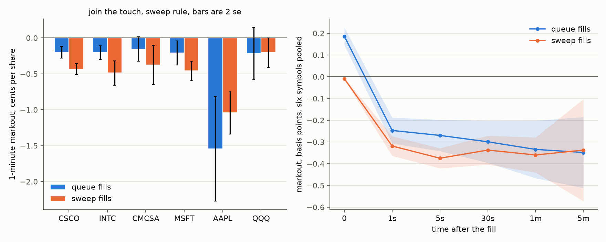

The right panel pools the six symbols in basis points, weighted by shares, so
AAPL and MSFT carry it. The shape is the useful part. A queue fill starts at
+0.19 bps, half a spread, because the level is still there when the bot fills.
A swept fill starts at zero: the level vanished in the same instant, and on a
one-tick spread the new mid is exactly the price the bot paid. By one second the
two are 0.07 bps apart and by a minute they have merged, so the swept fills lose
the half spread at once and the queue fills lose it over the next second. `add`
fills (3% of shares) start at -0.21 bps, a real order crossing a quote the market
had already left, and are too few to say much after that.

So the replay's P&L for a passive quoter is an upper bound, and the gap is large:
on CSCO the join-the-touch bot loses $13.50 a session under one rule and $36.90
under the other. A real answer needs the aggressor's order size, which ITCH does
not carry. `examples/fill_quality.py` prints both tables and draws the chart in
about 4.5 minutes.

## Order-flow memory

The queue-reactive model remembers one bit, the direction of the last mid move.
The tape remembers a lot more. On CSCO the aggressor sign of one print predicts
the next with an autocorrelation of 0.43, and counts of prints in 10-second
windows have a variance 4.3 times their mean. The model gives 0.26 and 2.3. Market
orders on the tape come in bursts, mostly on one side, and a quote that gets hit
at the start of a burst is about to be hit again.

`Fit.excite(params, kernels)` adds a Hawkes term to the market-order rates, the
first model of Wu, Rambaldi, Muzy and Bacry (2019). On side s the rate is

    lambda_s(t) = mu_s(q(t)) + sum_k beta_k * sum over earlier market orders l of
                  a_k(s, s_l) * exp(-beta_k (t - t_l))

where `mu_s(q)` is the queue-reactive rate for the book state, `a_k` is `own` when
order l hit the same side and `cross` otherwise, and `own + cross` summed over
kernels is the branching ratio. Everything is fitted together by maximum
likelihood: the kernels and one baseline per book state with at least 30 market
orders (the rarer states share one scale). Refitting the baselines matters.
Scaling the old rates by one number makes the fit blame the state for clustering:
right after a market order the touch queue is small, so the old rate at small
queues already contains the burst. Two details make the likelihood match what the
simulator can do. A side can only be hit while it has a touch inside the modelled
depth, so the excitation is integrated only over that time, and a state where the
table says no market order can happen but one did gets the level's pooled rate.
`QueueReactive` samples the new rates by thinning: draw from the rate now, which
only decays until the next event, and accept with the ratio of the rate at the
drawn time.

On a simulated feed with own 0.4, cross 0.1 and beta 30 per minute, twelve runs of
600 minutes recover 0.397, 0.0996 and 30.2 (standard errors 0.003, 0.002, 0.4).
On CSCO the time-rescaled waits between market orders show how much was missing.
They should be unit exponential:

| model | branching | kernel timescales | residual variance | KS distance |
| --- | ---: | --- | ---: | ---: |
| queue-reactive | | | 5.09 | 0.418 |
| + 1 kernel | 0.40 | 0.33 ms | 1.73 | 0.086 |
| + 2 kernels | 0.47 | 0.23 ms, 27 ms | 1.50 | 0.061 |
| + 3 kernels | 0.51 | 0.20 ms, 5.6 ms, 0.60 s | 1.40 | 0.048 |

The 5% critical KS distance for 4,008 orders is 0.021, so even three kernels are
rejected, but the distance shrinks almost ninefold. Most of the excitation lives
below a millisecond: another market order on the same side, typically within a
third of a millisecond. The other five symbols agree (one-kernel timescales from 0.22 to 0.66 ms,
three-kernel branching ratios from 0.47 to 0.71).

Forty-eight 30-minute sessions of CSCO with the join-the-touch bot, cents per share:

| | pnl (se) | adverse | shares | moves/min | prints | Fano 10 s | sign acf, lag 1 | lag 2 |
| --- | ---: | ---: | ---: | ---: | ---: | ---: | ---: | ---: |
| tape | -0.117 (0.112) | -0.727 | 11,550 | 11.16 | 304 | 4.31 | 0.428 | 0.240 |
| queue-reactive | -0.155 (0.052) | -0.606 | 16,610 | 10.26 | 343 | 2.26 | 0.260 | 0.130 |
| + 1 kernel | -0.229 (0.062) | -0.628 | 13,563 | 9.30 | 327 | 3.74 | 0.410 | 0.212 |
| + 2 kernels | -0.161 (0.057) | -0.686 | 12,850 | 9.11 | 319 | 4.31 | 0.410 | 0.208 |
| + 3 kernels | -0.258 (0.080) | -0.666 | 12,342 | 9.08 | 312 | 5.03 | 0.432 | 0.240 |

The sign autocorrelation now matches the tape at lags 1 and 2, and so does the
clustering with two kernels. The bot's volume, 44% too high before, is 7% too
high. Nothing in the fit looked at the bot. Adverse selection moves toward the
tape. Mid moves fall a little further short (9.1 against 11.2), because the same
number of market orders now arrives in fewer, tighter bursts.

The other symbols, twelve sessions each, three kernels:

| | adverse: tape | queue-reactive | + 3 kernels | shares: tape | queue-reactive | + 3 kernels |
| --- | ---: | ---: | ---: | ---: | ---: | ---: |
| CSCO | -0.727 | -0.598 | -0.620 | 11,550 | 17,093 | 12,037 |
| INTC | -0.718 | -0.441 | -0.650 | 20,668 | 29,364 | 21,556 |
| CMCSA | -0.658 | -0.472 | -0.614 | 14,003 | 18,308 | 13,862 |
| MSFT | -0.765 | -0.526 | -0.633 | 41,181 | 67,066 | 56,426 |
| AAPL | -1.962 | -1.499 | -2.398 | 84,215 | 135,003 | 106,987 |
| QQQ | -0.661 | -0.424 | -0.465 | 33,529 | 43,244 | 34,650 |

Adverse selection moves toward the tape on all six. It closes three quarters of
the gap on INTC and CMCSA, under half on MSFT, about a sixth on CSCO and QQQ, and
overshoots on AAPL by almost as much again as the gap was. The volume excess is
gone on CSCO, INTC, CMCSA and QQQ, down from 63% to 37% on MSFT and from 60% to
27% on AAPL. The bot's P&L got
worse rather than closer: on CSCO it loses 0.258 cents a share against 0.117 on
the tape, mostly through the inventory term, because a burst now leaves it holding
a position into a move.

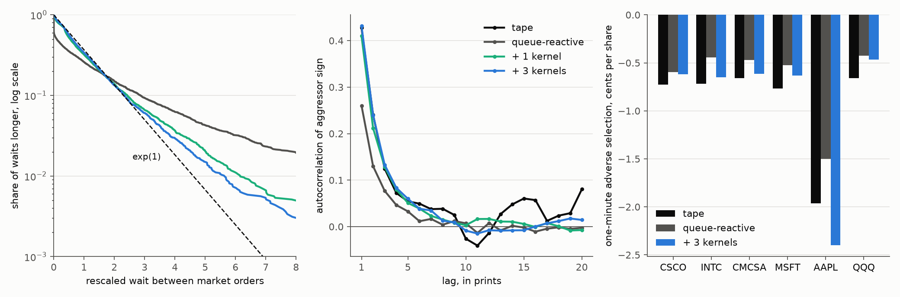

The left panel is the rescaled waits on a log scale, coloured as in the middle
panel; a perfect model sits on the dashed exp(1) line. The queue-reactive model has too many short waits and a fat
tail of long ones, which is what clustering looks like through a Poisson lens. The
middle panel is the sign autocorrelation by lag in prints.

Two limits. Only the flow's own market orders excite it, so a bot that crosses the
spread does not start a burst, and the kernels are fitted on one day. The excess
mid moves and the AAPL overshoot both point at the same next step: the excitation
should probably reach cancels at the touch too, which this model leaves alone. `examples/order_memory.py` prints the tables and
draws the chart in about 22 minutes.

## The cancel race

A market order on the tape is followed by a storm at the touch. In the first tenth
of a millisecond after one, CSCO's touch cancels arrive at 2,350 times their
average rate on the side that was hit and 16,000 times on the other side; touch
limit orders at 950 and 26,000 times. Market makers pull and repost their quotes
the moment they see a print. The model from the last section only lets market
orders excite market orders, so it shows 86 and 524 for cancels: what is left
comes from the queue-reactive states alone.

`Fit.react(params)` adds the same kind of Hawkes term to the cancels and limit
orders at the best queue of each side (Bacry, Jaisson and Muzy model the first
level the same way, with market, limit and cancel events per side). The sources
are the flow's market orders and the timescales are the ones already fitted for
them, so with the betas fixed the log-likelihood is

    sum over events of log(psi_g * mu(q) + X theta) - psi . M - C . theta

which is concave in the baseline scales `psi` and the kernel weights `theta`. `X`
holds the decayed counts of earlier market orders at each event and `C` their
integrals over the time the touch could actually fire, both computed once. L-BFGS
with nonnegative bounds finishes in 1.5 s for both kinds on CSCO's 129,000 touch cancels and
139,000 touch limits. One rule keeps
the fit and the simulator honest with each other: a touch state whose table rate
is zero is dead, its events drop out of the likelihood and the flow never fires an
excited event there. `QueueReactive` adds the excitation to the touch actions and
samples everything with the same thinning step as before.

On a simulated feed with known kernels (cancels own 0.3, cross 0.05; limits 0.2,
0.1) twelve 600-minute runs recover 0.295, 0.0445, 0.1995 and 0.1017, with
standard errors near 0.003, 0.0016, 0.004 and 0.004. The cross term on cancels
comes back about 11% low, three standard errors; each kernel alone is recovered
without bias, and I have not found where the joint fit loses it.

On CSCO, per market order:

| touch | side | 0.20 ms | 5.6 ms | 0.60 s | total |
| --- | --- | ---: | ---: | ---: | ---: |
| cancels | hit | 1.00 | 1.24 | 1.36 | 3.60 |
| cancels | other | 4.69 | 3.08 | 2.95 | 10.71 |
| limits | hit | 0.49 | 0.92 | 1.42 | 2.83 |
| limits | other | 13.68 | 1.20 | 1.37 | 16.25 |

Each market order sets off about 14 cancels and 19 limit orders at the touch, most
of them on the side that was not hit. That is about 44% of all touch cancels and
55% of touch limits. These are not ITCH replace messages; replaces are 27,000 of
the 250,000 removals. The fit improves a lot and is still rejected:

| touch | model | residual variance | KS distance | log-likelihood gain per event |
| --- | --- | ---: | ---: | ---: |
| cancels | market kernels | 9.38 | 0.541 | |
| cancels | + touch reaction | 4.25 | 0.362 | 1.65 |
| limits | market kernels | 15.25 | 0.614 | |
| limits | + touch reaction | 6.51 | 0.434 | 2.52 |

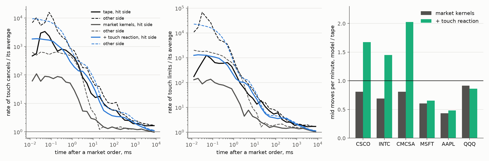

The left two panels are the same event study on the tape and on six 120-minute
runs of each model, fitted back with `qr.fit` from `qr.messages`. The reaction
puts the model within about a factor of two of the tape below a millisecond,
where the market kernels alone were off by up to thirty times. Three exponentials give a bump around
10 ms that the tape does not have and too little at 100 ms.

Then the sessions. Forty-eight of CSCO with the join-the-touch bot:

| | pnl (se) | adverse | inventory | shares | moves/min | eta |
| --- | ---: | ---: | ---: | ---: | ---: | ---: |
| tape | -0.117 (0.112) | -0.727 | 0.096 | 11,550 | 11.16 | 0.598 |
| market kernels | -0.258 (0.080) | -0.666 | -0.103 | 12,342 | 9.08 | 0.619 |
| + touch reaction | -0.088 (0.046) | -0.615 | 0.003 | 14,274 | 18.16 | 0.323 |

The bot's P&L lands on the tape's, but for the wrong reason. Mid moves were 19%
short and are now 63% over, and eta halves (continuations over twice the
reversals, the Robert-Rosenbaum measure; below 0.5 means the mid mean-reverts). The book flickers. On the tape a reaction is mostly a quote being
pulled and put back, so the queue barely changes. The model draws the cancel and
the new limit independently, each from its own size distribution, so a burst can
empty a thin touch and refill it a tick away a moment later. Adverse selection
moves away from the tape.

Across symbols (twelve sessions each), the moves panel on the right: the three
large-tick names go from short to far over (CSCO 18.7, INTC 27.0, CMCSA 23.1
against 11.2, 18.6, 11.4), MSFT and AAPL get a little closer (77 against 118, 180
against 373) and QQQ moves away (257 against 297). The AAPL adverse overshoot that
motivated this gets worse, -3.03 against -1.96 on the tape. So the cancel
excitation is real and large, and the right way to put it in a simulator is a
paired event (pull and repost) that conserves the queue, not two independent
streams. `examples/cancel_race.py` prints the tables and draws the chart in about
25 minutes.

## The microprice

The mid is a poor fair value on a large-tick stock. When the bid queue holds
9000 shares and the ask 1000, the next move is much more likely up, and a quoter
centred on the mid is selling to people who know that. `micro.py` estimates
Stoikov's microprice (2018), the limit of expected future mids given the
current imbalance I = bid size / (bid size + ask size) and spread, as a Markov
chain on the replayed top of book.

The state is the spread (1 or 2 ticks, more for AAPL) and I in 11 buckets. Each
change of the best quotes is one step. Steps that keep the mid fill Q, steps
that move it by half a tick or a tick fill T (by size of move) and R (by the
state they land in). Then G1 = (1 - Q)^-1 T K is the expected size of the next
mid move, B = (1 - Q)^-1 R is where the chain is after it, and the microprice
adjustment is g* = G1 + B G1 + B^2 G1 + ... The data is symmetrized first (every
step is also added mirrored, I to 1 - I and the move negated), so the
stationary distribution pi of B puts zero weight on G1 and the series converges.
Instead of truncating it, `Chain.gstar` sums it in closed form with the
fundamental matrix: g* = (1 - B + 1 pi)^-1 G1. The bucket count is odd so a
balanced book (11% of AAPL's quote updates have equal sizes) is its own mirror and gets exactly
zero. With an even count it falls on a bucket edge and picks up the drift of
one side.

Tests check two two-state chains against closed forms (with and without
persistent imbalance after a move, g* = G1 / (1 - rho)), a random symmetric
5-state chain against the average drift of 40,000 simulated paths of 150 steps
per state (all within 4 standard errors), and that `fit` recovers the g* of a
known chain from 200,000 simulated quotes (0.0559 against 0.0551).

CSCO, fitted on 09:35 to 12:35, in ticks above the mid:

| imbalance  | 0.05   | 0.14   | 0.23   | 0.32   | 0.41   | 0.50 | 0.59  | 0.68  | 0.77  | 0.86  | 0.95  |
|------------|--------|--------|--------|--------|--------|------|-------|-------|-------|-------|-------|
| g*, 1 tick | -0.383 | -0.276 | -0.202 | -0.134 | -0.068 | 0    | 0.068 | 0.134 | 0.202 | 0.276 | 0.383 |
| g*, 2 ticks| -0.275 | -0.209 | -0.180 | -0.134 | -0.076 | 0    | 0.076 | 0.134 | 0.180 | 0.209 | 0.275 |
| G1, 1 tick | -0.323 | -0.236 | -0.174 | -0.116 | -0.059 | 0    | 0.059 | 0.116 | 0.174 | 0.236 | 0.323 |

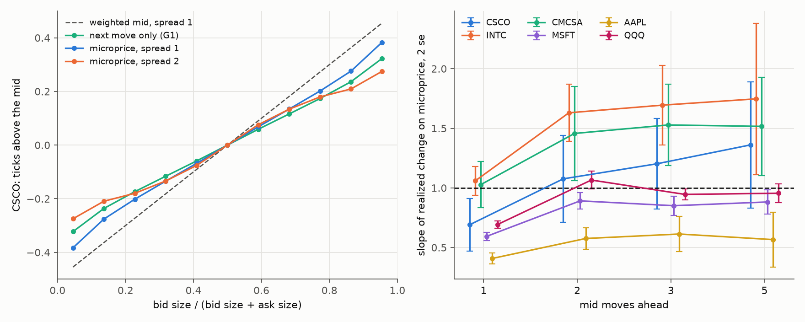

The weighted mid, I times the ask plus (1 - I) times the bid, would put a 95%
bid queue 0.45 ticks above the mid. The microprice says 0.38, and INTC, CMCSA,
MSFT and QQQ land between 0.37 and 0.39. AAPL says 0.53.

Is it a better forecast? Fitted on one half of the day and tested on the other
(both ways round), sampled every second, out-of-sample R^2 against predicting no
change:

| symbol | spreads | 10 s: weighted mid | microprice | linear in I | after 2 moves: weighted mid | microprice | linear in I |
|--------|---------|--------------------|------------|-------------|-----------------------------|------------|-------------|
| CSCO   | 2       | 0.036              | 0.044      | 0.035       | 0.042                       | 0.044      | 0.019       |
| INTC   | 2       | 0.033              | 0.033      | 0.035       | 0.083                       | 0.067      | 0.093       |
| CMCSA  | 2       | 0.022              | 0.037      | 0.036       | 0.057                       | 0.048      | 0.036       |
| MSFT   | 2       | 0.009              | 0.010      | 0.010       | 0.034                       | 0.057      | 0.063       |
| AAPL   | 4       | -0.009             | -0.001     | -0.002      | -0.277                      | 0.010      | 0.018       |
| QQQ    | 2       | 0.010              | 0.012      | 0.013       | 0.102                       | 0.119      | 0.117       |

Imbalance explains a few percent of the next moves, and the microprice is about
as good as a straight line in I fitted by least squares. On this day g* is
nearly linear in I, so the line has little to lose. The weighted mid falls apart
on AAPL, where the spread is often 3 or 4 ticks and I times the spread is a
large number with no information in it.

The right panel is the more useful test. If g* is the expected change of the
mid, the realized change after k mid moves regressed on g* should have slope 1
for large k (standard errors clustered by 30-minute block, since one-second
samples overlap):

| symbol | k = 1       | k = 2       | k = 5       | k = 20       | G1 at k = 1 |
|--------|-------------|-------------|-------------|--------------|-------------|
| CSCO   | 0.69 (0.11) | 1.08 (0.18) | 1.36 (0.27) | 1.41 (0.59)  | 0.82 (0.13) |
| INTC   | 1.06 (0.06) | 1.63 (0.12) | 1.75 (0.32) | 1.55 (0.74)  | 1.24 (0.07) |
| CMCSA  | 1.03 (0.10) | 1.46 (0.20) | 1.52 (0.21) | 0.03 (0.85)  | 1.13 (0.11) |
| MSFT   | 0.59 (0.02) | 0.89 (0.03) | 0.88 (0.05) | 0.94 (0.08)  | 0.59 (0.02) |
| AAPL   | 0.41 (0.02) | 0.58 (0.04) | 0.57 (0.11) | 0.06 (0.18)  | 0.61 (0.04) |
| QQQ    | 0.69 (0.02) | 1.07 (0.04) | 0.96 (0.04) | 0.92 (0.05)  | 0.68 (0.02) |

QQQ and MSFT are close to calibrated from two moves on. On INTC and CMCSA the
mid keeps going: after five moves it has travelled 1.5 to 1.75 times what the
microprice expected. That looks like the order-flow memory from the Hawkes
section: the chain only knows the current imbalance and spread, and nothing in
its state says the last move was up. AAPL goes the other way, with slopes of 0.4
to 0.6 at every horizon. Its queues at the touch average 220 to 245 shares, so
the imbalance at one instant says less than the chain, fitted on the other half
of the day, expects.

### Adding the last move to the state

`fit(..., memory=k)` adds a flag to every state: down, up, or neither, where the
flag remembers the last mid move for k top-of-book updates (`memory=math.inf`
never forgets). The mirror maps down to up, so the symmetrized fit stays
antisymmetric. On a simulated chain with momentum built in, the fit recovers g*
within 0.03 of the closed form.

On the tape it does not fix the slopes. Out of sample, on the same one-second
grid, slope of the change after k moves on g* (se):

| symbol | memory      | k = 2       | k = 5       |
|--------|-------------|-------------|-------------|
| CSCO   | none        | 1.08 (0.18) | 1.36 (0.27) |
| CSCO   | 1 update    | 0.96 (0.17) | 1.22 (0.24) |
| CSCO   | 10 updates  | 0.70 (0.13) | 0.91 (0.18) |
| CSCO   | forever     | 0.52 (0.17) | 0.66 (0.24) |
| INTC   | none        | 1.63 (0.12) | 1.75 (0.32) |
| INTC   | 1 update    | 1.37 (0.10) | 1.47 (0.27) |
| INTC   | 10 updates  | 0.95 (0.07) | 1.02 (0.20) |
| INTC   | forever     | 0.63 (0.18) | 0.86 (0.30) |
| MSFT   | none        | 0.89 (0.03) | 0.88 (0.05) |
| MSFT   | 10 updates  | 0.69 (0.03) | 0.68 (0.04) |
| AAPL   | none        | 0.58 (0.04) | 0.57 (0.11) |
| AAPL   | 10 updates  | 0.46 (0.03) | 0.53 (0.09) |

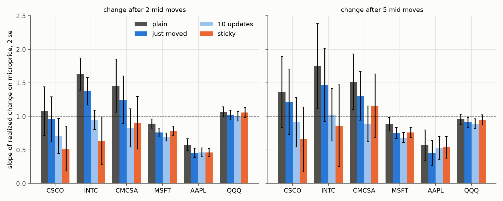

The chain with a permanent flag believes in momentum: on CSCO a balanced book
right after an up move is worth +0.20 ticks. The tape disagrees. From balanced
one-tick CSCO states in the morning, the next mid move averages +0.04 ticks after
a down move and 0.00 after an up move, while the chain fitted on that same
morning predicts -0.13 after a down move. The unsymmetrized chain gives the same
numbers, so it is not the mirror. The flag breaks the Markov property: a state
seen right after a move and the same state seen a hundred updates later behave
differently, and a chain that lumps them together extrapolates the first into
the second. Remembering only the move that led into the current state (k = 1)
keeps the chain Markov and gives g* = -0.05 for that state; the INTC and CMCSA
slopes at k = 2 fall from 1.63 and 1.46 to 1.37 and 1.25. Ten updates bring them
to 0.95 and 0.83, but by overshooting the names that were calibrated before (MSFT 0.89 to 0.69), and no
version improves out-of-sample R^2 by more than 0.02 anywhere. The last move is
not what the chain is missing. `examples/micro_memory.py` prints all six symbols
and four memory lengths in a few seconds.

## Order-flow imbalance

Cont, Kukanov and Stoikov (2014) explain price changes with one number: the
order-flow imbalance, the net of what arrives at the best bid minus what arrives
at the best ask. For consecutive top-of-book states n - 1 and n,

    e_n = q_b(n) 1{P_b(n) >= P_b(n-1)} - q_b(n-1) 1{P_b(n) <= P_b(n-1)}
        - q_a(n) 1{P_a(n) <= P_a(n-1)} + q_a(n-1) 1{P_a(n) >= P_a(n-1)}

and the mid change over an interval is close to OFI / (2 depth) in their
stylized book. `ofi.py` computes e_n from the same top-of-book series, sums it
over 10-second intervals and regresses the mid change on it in each 30-minute
window, with White standard errors. Tests check each of the six cases of the
definition, that with fixed prices OFI telescopes to the change in bid size minus
the change in ask size, that a mirrored book has the opposite flow, and the
time-weighted depth integral against brute force.

| symbol | mean R^2 | median t | beta x depth | log-slope on depth (se) | afternoon R^2, morning beta | morning beta / depth | next 10 s |
|--------|----------|----------|--------------|-------------------------|-----------------------------|----------------------|-----------|
| CSCO   | 0.77     | 14.0     | 0.21         | -0.91 (0.07)            | -0.49                       | 0.79                 | 0.002     |
| INTC   | 0.75     | 17.4     | 0.23         | -0.31 (0.59)            | 0.76                        | 0.76                 | -0.000    |
| CMCSA  | 0.80     | 16.4     | 0.23         | -0.89 (0.09)            | 0.30                        | 0.79                 | 0.002     |
| MSFT   | 0.84     | 24.5     | 0.27         | -0.74 (0.20)            | 0.61                        | 0.84                 | -0.012    |
| AAPL   | 0.73     | 10.7     | 0.34         | -1.55 (0.34)            | 0.66                        | 0.79                 | -0.003    |
| QQQ    | 0.82     | 25.0     | 0.24         | -1.00 (0.05)            | 0.57                        | 0.75                 | -0.001    |

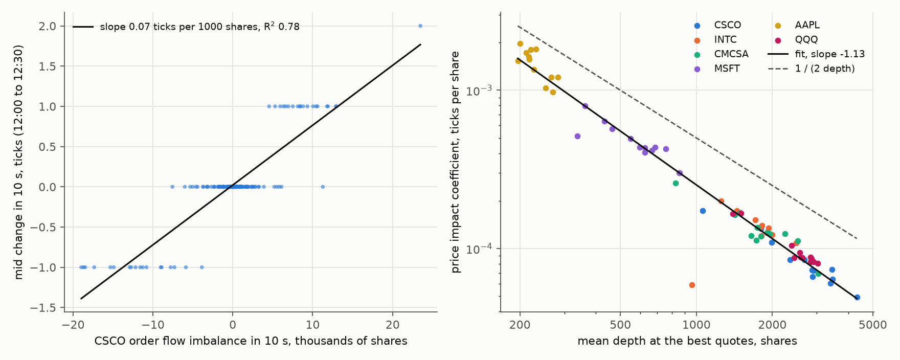

One number explains 73 to 84% of the variance of 10-second mid changes, a bit
more than the 65% average the paper found on 50 stocks in 2010. Across all 72
windows the impact coefficient falls with depth with a log-log slope of -1.13
(se 0.02), close to the inverse proportionality the paper reports, and beta times
depth sits between 0.21 and 0.34 against the 0.5 of the stylized model. The
depth dependence matters out of sample: CSCO's book is thicker in the afternoon,
so a morning beta applied to the afternoon is worse than no model (R^2 -0.49),
while a morning fit of the mid change on OFI / depth gives 0.79. And it is a
contemporaneous relation. OFI over the last 10 seconds predicts nothing about
the next 10 (R^2 between -0.012 and 0.002), as the paper also found.

## Quoting around the microprice

`Microprice` plugs into any quoter as its signal: `fair` becomes the mid plus
g* for the current state of everyone else's quotes (the bot's own shares are
left out of the imbalance). With `SymmetricQuoter(0.5 - c)` the bid is
floor(microprice - 0.5 + c) and the ask ceil(microprice + 0.5 - c), so on a
one-tick spread the bot stays at the touch on a side unless g* points against it
by more than c ticks, and then waits one tick back. c = 0 steps back on one
side whenever the book is not exactly balanced.

Same replay as the tables above: twelve 30-minute sessions, 100 shares a side,
1000 share limit, no latency or fees, P&L split at one minute. The microprice for
morning sessions is fitted on the afternoon and the other way round, so nothing
is in sample.

| symbol | quotes    | P&L (se)      | spread | adverse | inventory | $/session | shares/session |
|--------|-----------|---------------|--------|---------|-----------|-----------|----------------|
| CSCO   | mid       | -0.117 (0.112) | 0.514 | -0.727  | 0.096     | -13.5     | 11,550         |
| CSCO   | micro 0.0 | 0.569 (0.556)  | 0.652 | 0.029   | -0.112    | 7.6       | 1,327          |
| INTC   | mid       | -0.256 (0.055) | 0.509 | -0.718  | -0.047    | -53.0     | 20,668         |
| INTC   | micro 0.0 | 0.608 (0.590)  | 0.614 | -0.388  | 0.383     | 12.2      | 2,007          |
| CMCSA  | mid       | 0.112 (0.062)  | 0.514 | -0.658  | 0.255     | 15.6      | 14,003         |
| CMCSA  | micro 0.0 | 0.723 (0.534)  | 0.601 | -0.233  | 0.355     | 14.5      | 1,999          |
| MSFT   | mid       | -0.361 (0.095) | 0.537 | -0.765  | -0.133    | -148.7    | 41,181         |
| MSFT   | micro 0.0 | 0.087 (0.301)  | 0.685 | -0.562  | -0.035    | 8.5       | 9,752          |
| AAPL   | mid       | -0.962 (0.254) | 0.674 | -1.962  | 0.326     | -810.3    | 84,215         |
| AAPL   | micro 0.0 | -0.867 (0.342) | 0.781 | -1.995  | 0.348     | -553.8    | 63,896         |
| QQQ    | mid       | -0.353 (0.198) | 0.529 | -0.661  | -0.221    | -118.3    | 33,529         |
| QQQ    | micro 0.0 | -0.127 (0.762) | 0.715 | 0.108   | -0.950    | -7.0      | 5,511          |

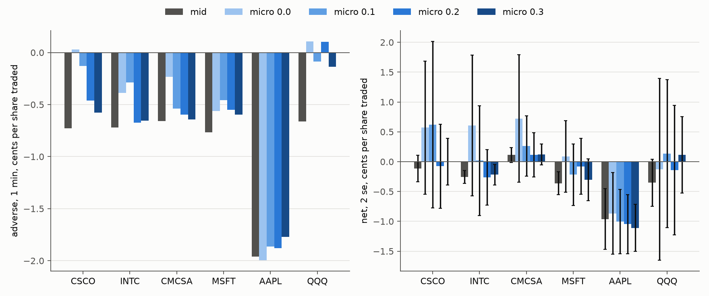

On the three large-tick names the adverse term drops from about -0.7 cents a
share to between +0.03 and -0.39, and on CSCO and QQQ it is gone. The fills that
are left are the ones where the queue on the bot's side was the strong one. The
cost is volume: the bot trades 86 to 90% fewer shares on the large-tick names,
because most of the time it is one tick behind on one side. Five of the six
symbols lose less or make a little in dollars (MSFT from -149 to +9 a session).
The per-share P&L looks large but its standard errors are as large: twelve
sessions of a bot that trades 1300 shares each cannot tell 0.57 cents from zero.
What the table does show is that quoting around the microprice removes most of
the adverse selection that made joining the touch lose, at the price of most of
the volume.

Raising c brings the volume back and most of the adverse selection with it; by
c = 0.3 the rows are close to the mid-quoter's (the chart; the example prints
all five rows per symbol). AAPL barely changes at any c, which fits the
calibration slopes above: the imbalance at its touch carries less than the chain
thinks. `examples/microprice.py` and `examples/ofi.py` take a few seconds
once the top-of-book series is cached in `data/` (25 s for six symbols the first
time); `examples/micro_quotes.py` runs 360 sessions in about 6 minutes.

## Market making with a short-term alpha

The microprice quoter above uses a hard rule. Cartea, Jaimungal and Penalva
(*Algorithmic and High-Frequency Trading*, 2015, section 10.4.2, after Cartea,
Jaimungal and Ricci 2014) derive the rule instead. The mid drifts at a rate
alpha that mean-reverts and jumps when market orders arrive:

```
dS = alpha dt + sigma dW
d alpha = -zeta alpha dt + eta dB + eps dM+ - eps dM-
```

The bot either posts one lot at the touch or does not, and a posted order is
filled by the next market order on its side, which arrives at rate lambda. It
maximizes E[X_T + Q_T S_T - (spread/2)|Q_T| - phi * integral of Q^2 dt]. I added
one term to the book's model: the mid jumps by `impact` against the bot at each
fill. On the replay most of the adverse selection happens within half a second
of the fill (the queue the bot was in gets eaten and the price ticks through),
and without that term the model cannot see it. Writing the value function as
x + qS + h(t, alpha, q):

```
0 = h_t - zeta alpha h_alpha + eta^2/2 h_alpha,alpha + alpha q - phi q^2
    + lambda [h(alpha + eps, q) - h + max(0, spread/2 - impact + h(alpha + eps, q - 1) - h(alpha + eps, q))]
    + lambda [h(alpha - eps, q) - h + max(0, spread/2 - impact + h(alpha - eps, q + 1) - h(alpha - eps, q))]
```

`alpha.solve` steps this backward on a 201 x 21 grid in (alpha, q). The drift and
diffusion in alpha are implicit (upwind differences give a tridiagonal M-matrix)
and the jumps and the max are explicit with lambda dt at most 0.05, so the scheme
is monotone. A fully explicit version needed over a million steps for QQQ, whose
signal decays at zeta = 338 a minute; this one takes 70k steps and 10 seconds.
The policy at 20 minutes to go equals the one at 40, so the bot uses it as the
stationary rule.

Checks in `tests/test_alpha.py`:

- Posting on every arrival has a closed form. With K a Skellam(lambda T,
  lambda T) variable, h(0, a, q) = lambda spread T + a q (1 - e^-zeta T)/zeta -
  (2 lambda eps / zeta)(T - (1 - e^-zeta T)/zeta) - (spread/2) E|q + K|. The last
  part of the drift term is the adverse selection: every fill moves alpha
  against the new inventory. The solver matches it within 0.02 on values between
  1.9 and 7.4.
- The solver's value of its own policy against 80,000 simulated paths of the
  model (exact OU steps between Poisson arrivals): the gap is 0.049, 0.020 and
  0.007 at 30, 60 and 120 grid nodes per side,
  against a Monte Carlo standard error of 0.009.
- The optimal value is at least the value of any fixed policy everywhere, the
  solution is symmetric under (alpha, q) -> (-alpha, -q), and posting on the ask
  is monotone in alpha. Four injected bugs (jump direction, dropped impact in the
  solver or in the simulator, a shifted band in the implicit matrix) each fail
  at least one test.

Calibration uses only the other half of the day, like the microprice. The slope
of the mid change h later on g* is fitted to c (1 - e^-zeta h) over 0.1 s to 60 s,
weighted by 1/h, and the bot's alpha is zeta c g*. Then a bot that always posts
at the touch is replayed on that half, and its fills give lambda (lots filled
per side per minute), `impact` (the mid move against it within one second, net
of what alpha already predicted) and eps (alpha one second after the fill minus
the decayed alpha before it). eta comes from the stationary variance,
Var(alpha) = (eta^2 + 2 lambda eps^2) / (2 zeta). My first version fitted
`impact` and eps together on the markout curve, which breaks when the signal's
half-life is under a second: (1 - e^-zeta h)/zeta is flat over the horizons, the
two are collinear, and AAPL came out with impact -0.55 and eps +502.

| symbol | half | c    | half-life | lambda /min | impact | spread |
|--------|------|------|-----------|-------------|--------|--------|
| CSCO   | am   | 1.09 | 1.4 s     | 2.82        | 0.645  | 1.01   |
| CSCO   | pm   | 1.09 | 4.8 s     | 1.03        | 0.607  | 1.00   |
| INTC   | am   | 1.16 | 0.7 s     | 4.85        | 0.573  | 1.01   |
| CMCSA  | pm   | 1.07 | 2.5 s     | 1.49        | 0.454  | 1.00   |
| MSFT   | pm   | 0.85 | 0.7 s     | 4.38        | 0.483  | 1.15   |
| AAPL   | am   | 0.56 | 0.16 s    | 7.54        | 1.851  | 2.93   |
| QQQ    | am   | 0.76 | 0.12 s    | 7.48        | 0.464  | 1.21   |

(`examples/alpha_quotes.py` prints all twelve fits.) The fill impact is 0.40 to
0.67 ticks on the one-tick names, close to the whole half spread, and on CSCO,
INTC and AAPL it is larger than half the spread in both halves. There the model
without alpha ("cjp flat") never posts at all, which is its way of saying what
the mid rows already show: joining the touch on those names loses money.

Same twelve sessions, parameters from the other half, phi = 0.01:

| symbol | quotes    | P&L (se)       | adverse | $/session | shares/session |
|--------|-----------|----------------|---------|-----------|----------------|
| CSCO   | mid       | -0.117 (0.112) | -0.727  | -13.5     | 11,550         |
| CSCO   | micro 0.0 | 0.569 (0.556)  | 0.029   | 7.6       | 1,327          |
| CSCO   | cjp alpha | 0.594 (0.468)  | 0.159   | 4.2       | 710            |
| INTC   | mid       | -0.256 (0.055) | -0.718  | -53.0     | 20,668         |
| INTC   | micro 0.0 | 0.608 (0.590)  | -0.388  | 12.2      | 2,007          |
| INTC   | cjp alpha | 0.102 (0.109)  | -0.510  | 1.7       | 1,647          |
| CMCSA  | mid       | 0.112 (0.062)  | -0.658  | 15.6      | 14,003         |
| CMCSA  | micro 0.0 | 0.723 (0.534)  | -0.233  | 14.5      | 1,999          |
| CMCSA  | cjp flat  | -0.146 (0.048) | -0.685  | -12.4     | 8,461          |
| CMCSA  | cjp alpha | 0.029 (0.133)  | -0.496  | 0.7       | 2,485          |
| MSFT   | mid       | -0.361 (0.095) | -0.765  | -148.7    | 41,181         |
| MSFT   | micro 0.0 | 0.087 (0.301)  | -0.562  | 8.5       | 9,752          |
| MSFT   | cjp flat  | -0.270 (0.050) | -0.737  | -66.7     | 24,750         |
| MSFT   | cjp alpha | -0.009 (0.117) | -0.633  | -0.9      | 9,631          |
| AAPL   | mid       | -0.962 (0.254) | -1.962  | -810.3    | 84,215         |
| AAPL   | micro 0.0 | -0.867 (0.342) | -1.995  | -553.8    | 63,896         |
| AAPL   | cjp alpha | no fills       |         | 0         | 0              |
| QQQ    | mid       | -0.353 (0.198) | -0.661  | -118.3    | 33,529         |
| QQQ    | micro 0.0 | -0.127 (0.762) | 0.108   | -7.0      | 5,511          |
| QQQ    | cjp flat  | -0.188 (0.133) | -0.623  | -58.5     | 31,089         |
| QQQ    | cjp alpha | 0.046 (0.199)  | -0.530  | 4.0       | 8,688          |

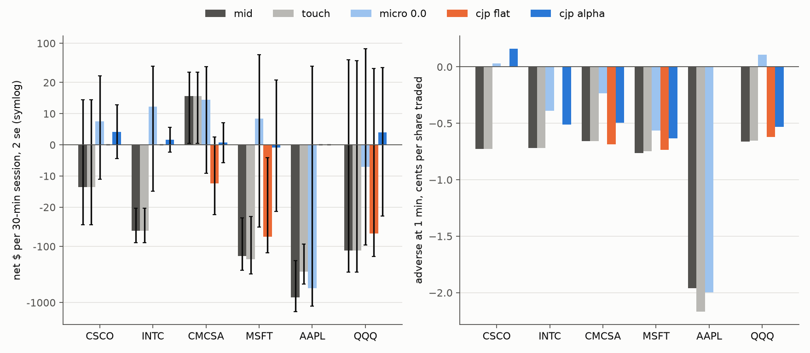

The model gets the large decisions right. It stays out of AAPL entirely, where
every other quoter loses hundreds of dollars a session, and it is the only
quoter with a positive mean on QQQ. Against the hard microprice rule on the four
large-tick names it does worse in dollars (4.2 against 7.6 on CSCO, 1.7 against
12.2 on INTC, 0.7 against 14.5 on CMCSA, -0.9 against 8.5 on MSFT), though
every one of those gaps is inside two standard errors. I think the reason is
that the two bots have different controls. The CJP bot can only post at the
touch or pull, and a pulled order rejoins at the back of the queue. The
microprice rule steps one tick back instead, so its order is already in the
queue when the price comes to it, and those fills are much less toxic (adverse
-0.39 against -0.51 on INTC). The fill rate and impact the model was calibrated
with also come from a bot that never pulls and so sits near the front. Letting
the model choose between the touch and one tick back is the next step.

eps is negative on most fits: right after the tick-through the new touch is
thin and the microprice expects part of the move back. The move itself is in
`impact`. The example runs 432 sessions and 24 solves in about 6 minutes.

## How fast the signal goes stale

Both quoters above react the instant the book changes. `examples/signal_latency.py`
asks how much of the signal is left for a bot that sees it L later. With b(h) the
slope of the mid change over h on the signal, the share of the 10 s move still
ahead after a delay L is 1 - b(L)/b(10 s). The answer depends on when you look.
Sampled at the moment the top of book changes (when a fast bot would act), the
microprice on the six names fitted on the other half gives:

| delay  | 10 us        | 100 us       | 1 ms         | 10 ms        | 100 ms       |
|--------|--------------|--------------|--------------|--------------|--------------|
| ahead  | 0.97 to 0.99 | 0.79 to 0.88 | 0.52 to 0.69 | 0.42 to 0.59 | 0.34 to 0.48 |

Sampled once a second instead, at least 98% of the move is still ahead at 1 ms
and 74 to 95% at 100 ms on five of the six (AAPL 0.77 at 10 ms). The once a
second view sees mostly old states whose information has already been used; the
states that carry the move are the ones that just changed, and a third to a half
of their move is gone within a millisecond. The plain imbalance I - 1/2 gives the
same numbers within 0.02. AAPL's once a second response at 10 s is close to zero,
so its ratio is meaningless and the chart leaves that line out.

The replay says the same thing in dollars. Feed and entry each take the
one-way latency, twelve sessions per cell, parameters fitted on the other half:

| quoters, sum of five symbols | 0      | 10 us  | 100 us | 1 ms   | 10 ms  |
|------------------------------|--------|--------|--------|--------|--------|
| mid                          | -317.7 | -347.1 | -429.4 | -591.9 | -573.3 |
| micro 0.0                    | 35.7   | 12.6   | 40.5   | -64.8  | -152.0 |
| cjp alpha                    | 9.8    | -1.7   | -32.0  | -136.9 | -188.5 |

($ per 30-minute session, summed over CSCO, INTC, CMCSA, MSFT and QQQ; AAPL loses
hundreds a session for the first two at every latency and the third never
trades it.)

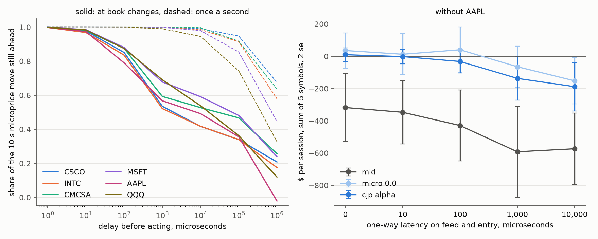

The microprice quoter stays positive up to 100 us, the CJP bot only at zero, and
both are negative from 1 ms. They also
trade more as they get slower: at 10 ms the microprice quoter trades 26,586 QQQ
shares a session instead of 5,511, and the CJP bot 54,901 instead of 8,688. A
slow bot decides to pull on a book that has already moved, the cancel arrives
after the market order that fills it, and those fills are the toxic ones (the
microprice quoter's adverse term on CSCO goes from +0.03 to -0.31 cents a share
at 1 ms). The mid quoter has no signal to lose; its losses grow from 0 to 1 ms
for the queue reasons in the latency section above. The 100 us microprice cell
looks better than zero latency only because of MSFT (+43.8, se 32.6). The run
takes about 15 minutes for 1,152 sessions.

## A learned market maker

`env.MarketMakingEnv` wraps the simulator as a Gymnasium environment. Once a
minute the agent picks a bid depth and an ask depth, each from {join the touch,
one tick back, two back, off}, so 16 actions. Between decisions a `Quoter` keeps
those quotes in place and chases the touch when it moves. The agent sees six
numbers: inventory over the limit, the fraction of the session left, the spread,
queue imbalance at the touch with its own orders taken out, the last minute's
mid move, and the last minute's signed market volume. The reward is the change
in mark-to-market P&L minus phi q^2 for every minute spent holding q, and the
last step also pays TERM q^2 for whatever is left:

```
score = P&L - phi * integral of q(t)^2 dt - TERM * q_T^2,    phi = 0.02, TERM = 0.25
```

The running penalty is the one in Cartea and Jaimungal's book, and it is what
GLFT optimizes too, with phi = gamma sigma^2 / 2. So all the bots below are
scored on the same number the agent was trained on, from the same
`tournament.session` runs. The integral is exact, from the fill times.

PPO is written from scratch in numpy (`nn.py`, `ppo.py`): two tanh MLPs with
64x64 hidden layers for the policy and the value, orthogonal initialization
(gain sqrt 2, 0.01 on the policy head), GAE with lambda 0.9 and gamma 1 (the
time left is in the state, so the episode end is a real terminal), the clipped
surrogate at 0.2, advantages normalized per minibatch, no value clipping, global
gradient-norm clipping at 0.5, Adam with a linearly annealed learning rate. Those
choices follow the CleanRL and "37 implementation details" defaults, except the
value loss, where Andrychowicz et al. (2021) found clipping does not help. The
backward pass is hand-written and checked against finite differences, including
the clipped and entropy terms.

`examples/rl_market_maker.py` trains three seeds for 400 iterations of 48
one-hour sessions (1.15 million decisions each, 3.4 minutes per seed on 16
cores). The comparison bots are tuned on 300 separate sessions: the best of the
16 fixed actions, Avellaneda-Stoikov over gamma from 0.0003 to 0.3, and GLFT over
the same gammas with and without keep-priority quoting (sigma 1 tick per
sqrt(minute), A = 2.1, k = 3.6, as measured earlier). Everything is then scored
on 1000 held-out sessions:

| bot                          | score (se)   | P&L   | fills | int q^2 dt | minus GLFT, paired (se) |
| ---------------------------- | ------------ | ----- | ----- | ---------- | ----------------------- |
| join the touch               | 5.57 (0.62)  | 15.94 | 39.9  | 408.9      | -4.10 (0.67)            |
| best fixed (join both sides) | 5.42 (0.57)  | 13.85 | 31.2  | 322.7      | -4.26 (0.66)            |
| AS, gamma 0.003              | 9.76 (0.42)  | 15.52 | 37.0  | 192.7      | +0.08 (0.53)            |
| GLFT, gamma 0.08             | 9.67 (0.34)  | 12.30 | 36.2  | 107.6      | 0                       |
| PPO seed 0                   | 9.58 (0.29)  | 11.87 | 27.5  | 99.7       | -0.10 (0.44)            |
| PPO seed 1                   | 10.22 (0.30) | 12.48 | 27.9  | 95.9       | +0.54 (0.45)            |
| PPO seed 2                   | 10.30 (0.28) | 12.22 | 27.6  | 81.3       | +0.63 (0.44)            |

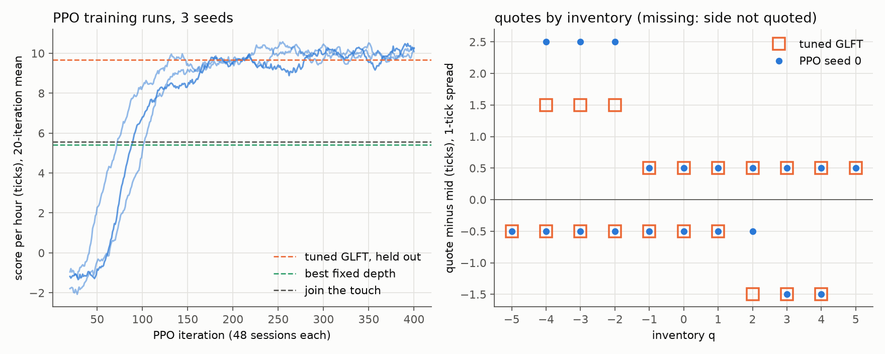

PPO matches the tuned inventory models and does not beat them: every paired
difference is within 1.5 standard errors. It gets there from a policy that knows
nothing about inventory risk, and all three seeds land in the same place. What it
learned is on the right: join both sides when flat, and once the position gets
large pull the side that would add to it back from the touch. The shape is
GLFT's, with two differences. PPO starts leaning at |q| = 2 when short but only
at 3 when long (GLFT leans at 2 on both sides), and on the short side it steps
the ask two ticks back where GLFT steps one (seed 1 drops the ask at q = -5 and
seed 2 from q = -2). It also holds less inventory than any other bot (81 to 100
against GLFT's 108) at the price of 25% fewer fills.

The market is symmetric, so the asymmetry is suspicious. All three seeds have
it, so it is not one unlucky run. The test is to flip the policy: negate q,
imbalance, mid move and flow, swap the bid and ask decisions, and score the
mirrored policy on the same 1000 sessions. The paired differences are -0.25
(0.32), +0.25 (0.32) and +0.17 (0.16) for the three seeds, so the lean on the
short side is worth nothing either way. The objective is flat over these
choices and the seeds happen to fall on the same side of it. The imbalance
feature barely matters too: across imbalance -0.6 to +0.6 the greedy action
changes in one cell (q = 2), which fits the earlier finding that queue imbalance
predicts a few seconds ahead, far below a one-minute decision.

Putting PPO (seed 0), the tuned GLFT and AS and the touch quoter in one market
for 300 sessions, with the scores each got alone on the same seeds:

| bot            | score together (se) | alone | P&L together | fills |
| -------------- | ------------------- | ----- | ------------ | ----- |
| GLFT           | 9.35 (0.23)         | 9.13  | 11.01        | 24.1  |
| PPO            | 9.07 (0.23)         | 10.01 | 10.74        | 23.6  |
| AS             | 6.84 (0.42)         | 9.01  | 10.72        | 24.6  |
| join the touch | 3.68 (0.65)         | 3.59  | 10.65        | 25.9  |

The agent was trained alone and still holds up in company: it loses about 1 tick
per hour to crowding and AS loses 2.2. AS also carries the most inventory of the
three model-based bots when alone (193 against 108 for GLFT), and it is the one
that pays most for sharing the flow.

The checks behind this: the environment passes Gymnasium's `check_env`; its
rewards over an episode add up to the penalized P&L computed from the account;
and the `Learned` bot, which observes and decides on a timer inside an ordinary
session, reproduces an environment episode fill for fill when fed the same
actions, so the agent is evaluated in exactly the world it was trained in. One
difference remains: the environment marks inventory at the other participants'
mid, the session at the tape's mid, which includes the bot's own quotes. On the
PPO side, GAE is checked against the explicit lambda-weighted sum of n-step
advantages, and PPO solves a contextual bandit and a task where only the first
action of six decides the final reward.

## Stress tests

`flow.RegimeFlow` switches the Cont-Stoikov-Talreja rates at fixed times, and
it does so exactly: an exponential clock that would run past a switch is cut at
the switch and redrawn with the new rates, which is legitimate because the
clock is memoryless. `examples/stress.py` runs every bot through four one-hour
markets:

| scenario         | what changes                                          | 1-min mid move sd | moves over 3 ticks |
| ---------------- | ----------------------------------------------------- | ----------------- | ------------------ |
| calm             | nothing                                               | 1.03              | 1.4%               |
| volatility spike | minutes 20 to 40: market orders x3, cancels x2        | 2.67              | 13.5%              |
| thin book        | from minute 30: limit orders x0.5                     | 1.80              | 7.5%               |
| informed flow    | an informed trader with a private random-walk value  | 1.16              | 2.1%               |

The informed trader sends a market order at rate 0.5 per minute whenever its
value (sigma 1 tick per sqrt(minute)) is through the touch. The bots are the
tuned ones from above, PPO seed 0 trained on calm sessions only, a PPO trained
on an even mixture of the four scenarios with the same settings, and one more:
the same GLFT with `inside=False`, which never quotes inside the other
participants' spread. Scores per hour over 600 held-out sessions per cell:

| bot                | calm         | volatility spike | thin book    | informed flow |
| ------------------ | ------------ | ---------------- | ------------ | ------------- |
| join the touch     | 4.66 (0.84)  | 7.09 (2.11)      | -2.18 (1.53) | -3.24 (0.95)  |
| best fixed         | 5.02 (0.73)  | 8.01 (1.99)      | 1.50 (1.44)  | -2.80 (0.86)  |
| AS                 | 9.60 (0.53)  | 8.67 (1.69)      | 2.74 (1.27)  | 3.50 (0.67)   |
| GLFT               | 9.17 (0.43)  | 5.02 (1.43)      | 1.25 (1.06)  | 7.80 (0.46)   |
| GLFT, no improving | 10.45 (0.40) | 10.51 (1.34)     | 7.98 (0.75)  | 6.84 (0.45)   |
| PPO, calm          | 9.82 (0.38)  | 10.01 (1.16)     | 6.60 (0.70)  | 7.17 (0.43)   |
| PPO, mixture       | 9.74 (0.35)  | 11.00 (1.04)     | 6.87 (0.60)  | 7.51 (0.39)   |

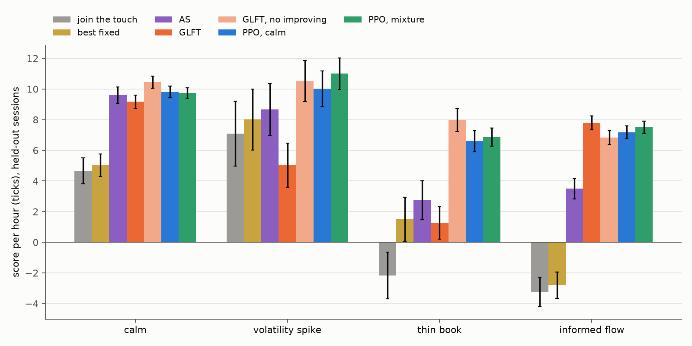

The first version of this table had no "no improving" row, and it looked like a
win for learning: PPO beat the tuned GLFT by 5.0 (1.85) in the spike and 5.3
(1.27) in the thin book, paired. The adverse-selection term gave the reason away.
GLFT lost 25 ticks per hour to adverse selection in the spike and PPO lost 1.4.
GLFT quotes around the mid, so when the spread opens it posts inside it. Over 40
sessions, 70% of its fills in the spike and 61% in the thin book came from orders
that started a new price level, against 30% when calm, and none of PPO's did. Those are the orders that get hit just
before the mid moves through them. PPO cannot do that, because its actions are
depths measured from the other participants' best bid and ask. Clamping GLFT the same way recovers
everything: +5.5 (2.0) in the spike, +6.7 (1.3) in the thin book, and +1.3
(0.6) even in calm markets, with adverse selection down to PPO's level. So the
edge came from the action space, not from anything the agent learned.

The informed trader is the one scenario where clamping costs a little (-1.0,
0.6). There the bots that skew for inventory (AS, GLFT, both PPOs) stay positive
and the two that do not lose money. Training on the mixture moves PPO by less
than one standard error of the difference in every scenario. The calm policy already generalizes as far as this action space lets
it.

## A pool next to the book: loss-versus-rebalancing

`amm.py` is a Uniswap v3 style position: liquidity L on a price range
[pa, pb], holding x = L(1/sqrt(p) - 1/sqrt(pb)) of the risky asset and
y = L(sqrt(p) - sqrt(pa)) of cash at pool price p. Fees are charged on the cash
leg the way Milionis, Moallemi and Roughgarden model them: a buyer pays e^gamma
times the cash leg and a seller receives e^-gamma times it, so an arbitrageur
trades only once the outside price leaves [p e^-gamma, p e^gamma], and then
pushes the pool to the edge of that band, not all the way to the market. The
pool reproduces the worked example in the Uniswap v3 book (1 ETH and 5000 USDC
on 4545 to 5500 give L = 1517.88 and use 0.998977 ETH) to twelve digits, and
every operation is vectorized over paths.

Loss-versus-rebalancing (Milionis, Moallemi, Roughgarden and Zhang 2022) is
what the LP loses against a portfolio that holds the same x(P) but trades at
the market price. For a Black-Scholes price it accrues at
sigma^2 P^2 / 2 |x'(P)|, which is sigma^2/4 L sqrt(P) inside the range and
sigma^2/8 of the pool value for a full-range pool. With a fee and blocks at
Poisson rate lambda, the log mispricing z = log(P/p) diffuses between blocks
and is clipped to [-gamma, gamma] at each one. Its stationary law is uniform on
the band with exponential tails, a block trades with probability
P_trade = 1/(1 + eta) with eta = gamma / (sigma sqrt(dt/2)), and for a constant
product pool the arbitrage profit is exactly (their 2023 paper, Corollary 2)

```
ARB / V = sigma^2/8 * P_trade * cosh(gamma/2) / (1 - sigma^2 / (8 lambda))
```

The paper leaves fee income as an integral over the tails. For the constant
product pool the fee paid in a block, over V, is
sinh(gamma/2)(1 - e^-(z - gamma)/2) above the band and the mirror image below,
and integrating against the tail gives

```
FEE / V = lambda * P_trade * sinh(gamma/2) * 2 zeta / (4 zeta^2 - 1),   zeta = sqrt(2 lambda) / sigma
```

As blocks get faster this tends to LVR (1 - P_trade): the arbitrageurs keep
P_trade of the LVR and hand the rest back as fees. `lvr.mispricing` simulates
the chain exactly (exponential gaps, Gaussian steps, clip) on 2000 chains at
once. `examples/amm_lvr.py`, rates over the frictionless LVR:

| eta | P_trade | ARB exact | ARB Poisson MC | ARB fixed blocks | FEE exact | FEE Poisson MC |
| --- | ------- | --------- | -------------- | ---------------- | --------- | -------------- |
| 0.1 | 0.9091  | 0.9091    | 0.9099         | 0.8970           | 0.0909    | 0.0910         |
| 0.3 | 0.7692  | 0.7693    | 0.7699         | 0.7377           | 0.2308    | 0.2310         |
| 1   | 0.5000  | 0.5000    | 0.5000         | 0.4519           | 0.5000    | 0.5004         |
| 3   | 0.2500  | 0.2500    | 0.2498         | 0.2156           | 0.7500    | 0.7499         |
| 10  | 0.0909  | 0.0910    | 0.0904         | 0.0761           | 0.9095    | 0.9078         |
| 30  | 0.0323  | 0.0326    | 0.0321         | 0.0270           | 0.9714    | 0.9641         |

Blocks on a fixed clock instead of a Poisson one, at the same mean gap, leave
the arbitrageurs 1% less at eta = 0.1 and 16% less from eta = 10 on: the long
gaps of an exponential clock are where the big mispricings come from.

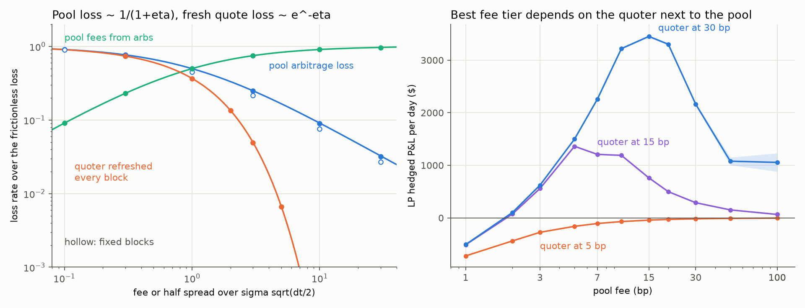

### The same price path through an order book quoter

`venues.run` puts the pool and a quoter on one geometric Brownian price
(ETH-like: 2000, 60% a year, 12-second blocks, 60 noise trades of 1 ETH an
hour). Block events and noise events share one Poisson clock. At a block the
arbitrageur trades the pool to its band and takes any quote that the new price
has gone through, then the quoter requotes around the new price with the
Avellaneda-Stoikov reservation price and a fixed half spread h. A noise trader
goes to whichever venue fills it cheaper, the pool's price including its impact
and fee. Both venues keep the same ledger: the edge of every trade against the
price at that moment, fees, and the inventory term (x or q times dP), and the
four add up to the marked P&L to 1e-9 of capital. "Hedged" below is P&L
without the inventory term, what is left after delta-hedging.

The quoter's loss to stale quotes has its own closed form. A Brownian increment
over an exponential gap is Laplace with scale b = sigma sqrt(dt/2), so with
c = log(1 + h) and d = log(1 - h) the loss per block per unit notional is
b/2 (e^(c(1 - 1/b))/(1 - b) + e^(d(1 + 1/b))/(1 + b)), which is about
b e^(-h/b). It matches the simulator within 2% at h/b from 0.3 to 5. The scale b is
the same one that sets the pool's eta, so the chart puts both on one axis: a
quote that is refreshed every block loses e^-eta of its zero-spread loss, a pool
loses 1/(1 + eta). The pool's mispricing carries over from block to block,
while the quoter starts from zero at every block, and that difference is a
polynomial tail against an exponential one.

The pool's edge against noise trades plus its edge against arbitrageurs comes
to minus LVR in every one of the 44 runs (between -1226 and -1299 against an
LVR of 1294 a day), however much noise flow it gets. The argument is short:
hedged P&L is V_T - V_0 minus the sum of x dP, the rebalancing portfolio earns
the sum of x*(P) dP minus LVR, and what separates the two is the terminal
mispricing plus a sum of (x*(P) - x) dP, which has almost no drift because x is
known before each price step. What noise trades pay the pool, the
arbitrageurs take back when they re-center it, so LP hedged P&L is fees minus
LVR whatever the flow. On a $1M pool on +-20%:

| pool fee | quoter half spread | LP fees | LVR  | LP hedged | pool share of noise | quoter hedged |
| -------- | ------------------ | ------- | ---- | --------- | ------------------- | ------------- |
| 30 bp    | none               | 10710   | 1294 | 9428      | 1.00                |               |
| 1 bp     | 5 bp               | 570     | 1294 | -724      | 0.53                | 81            |
| 30 bp    | 5 bp               | 1271    | 1294 | -18       | 0.05                | 781           |
| 5 bp     | 15 bp              | 2657    | 1294 | 1361      | 0.95                | 203           |
| 15 bp    | 15 bp              | 2060    | 1294 | 762       | 0.32                | 2901          |
| 15 bp    | 30 bp              | 4750    | 1294 | 3452      | 0.82                | 1572          |
| 30 bp    | 30 bp              | 3456    | 1294 | 2161      | 0.36                | 5525          |

Alone, the pool earns more at every higher fee, since noise demand here does
not react to price. Next to a quoter at 5 bp it loses money at every fee tier:
it wins flow only when its stale price happens to sit on the right side of the
band or the quoter is at its inventory limit, and it pays the arbitrageurs
either way. The best tier sits below the quoter's half spread (5 bp against 15,
15 against 30). At equal fee and half
spread the pool still gets a third of the flow, from the times its stale price
is better than the market.

### Arbitrageurs who hedge on a quoter

The arbitrageur so far closes its position at a frictionless outside price. If
it has to hedge on a quoter with half spread h, it sells what it took from the
pool at P e^-h (or buys at P e^h), which makes it the frictionless arbitrageur
against a shifted price. Its trigger widens to |z| > gamma + h, the chain is the
same one with band gamma + h, and the closed forms carry over with the overshoot
still exponential with rate zeta:

```
ARB   / V = sigma^2/8 * P_trade(gamma + h) * cosh((gamma - h)/2) / (1 - sigma^2 / (8 lambda))
FEE   / V = lambda * P_trade(gamma + h) * sinh(gamma/2) * (e^(h/2)/(2 zeta - 1) + e^(-h/2)/(2 zeta + 1)) / 2
QUOTE / V = lambda * P_trade(gamma + h) * sinh(h/2) * (e^(gamma/2)/(2 zeta - 1) + e^(-gamma/2)/(2 zeta + 1)) / 2
```

The pool's fee and the quoter's take are the same function with gamma and h
swapped, since each is a proportional charge on one leg of the same trade. On a
real swap the arbitrage profit, the fee and the quoter's edge over V match the
per-block functions to 1e-14 and sum with the LP's edge to zero, the three
rates match quad integrals over the stationary tails to 1e-8, and the simulated
chain lands within 4 standard errors. `examples/hedged_arb.py`, an ETH-like
market (60% a year, 12 s blocks, so sigma_b = 3.70 bp) and a 30 bp pool, rates
over LVR:

| h (bp) | band (bp) | P_trade | ARB   | FEE   | quoter | sum   | chain ARB, FEE, quoter |
| ------ | --------- | ------- | ----- | ----- | ------ | ----- | ---------------------- |
| 0      | 30        | 0.0802  | 0.080 | 0.920 | 0      | 1.000 | 0.080, 0.915, 0        |
| 1      | 31        | 0.0779  | 0.078 | 0.892 | 0.030  | 1.000 |                        |
| 2      | 32        | 0.0756  | 0.076 | 0.867 | 0.058  | 1.000 |                        |
| 5      | 35        | 0.0696  | 0.070 | 0.798 | 0.133  | 1.000 | 0.069, 0.795, 0.132    |
| 10     | 40        | 0.0614  | 0.061 | 0.704 | 0.235  | 1.000 |                        |
| 20     | 50        | 0.0497  | 0.050 | 0.570 | 0.380  | 1.000 |                        |
| 30     | 60        | 0.0418  | 0.042 | 0.479 | 0.479  | 1.000 | 0.042, 0.479, 0.479    |

(The chain's FEE has a standard error of about 0.003.) With fast blocks the
three shares add up to the LVR, so the hedge is paid almost entirely out of the
LP's fees: a 5 bp quoter takes 13% of the LVR, the LP's fees drop from 92% to
80%, and the arbitrageur's own share only goes from 8.0% to 7.0%. When the
quoter's half spread equals the pool fee, the two split the LVR evenly.

Nezlobin and Tassy (2025) solve the fixed-clock case with random-walk ladder
height theory. In this repo's convention (their gamma is the width of the
whole band, 2 gamma here) the trade probability and arbitrage profit are

```
P_trade ~ 1 / (eta + |zeta(1/2)| / sqrt(pi)),     ARB ~ LVR / (1 + sqrt(pi) eta / |zeta(1/2)|)
```

up to terms that vanish like e^(-c eta), so for wide bands fixed blocks leave
the arbitrageurs |zeta(1/2)| / sqrt(pi) = 0.8239 of the Poisson amount, 17.6%
less. That is the 16% the simulation above found from eta = 10 on. Against the
exact fixed-block chain, 2000 chains:

| eta | ARB Poisson exact | ARB fixed, formula | ARB fixed, chain | P_trade formula | P_trade chain |
| --- | ----------------- | ------------------ | ---------------- | --------------- | ------------- |
| 0.3 | 0.7692            | 0.7331             | 0.7383           | 0.8897          | 0.8350        |
| 1   | 0.5000            | 0.4517             | 0.4527           | 0.5483          | 0.5494        |
| 3   | 0.2500            | 0.2155             | 0.2167           | 0.2615          | 0.2621        |
| 10  | 0.0909            | 0.0761             | 0.0773           | 0.0924          | 0.0937        |
| 30  | 0.0323            | 0.0267             | 0.0266           | 0.0324          | 0.0323        |

From eta = 1 on the formula is within 3 standard errors of the chain (the
standard errors run from 0.0006 down to 0.0002). At eta = 0.3 the exponential
error term is not small yet and the trade probability is 7% too high.

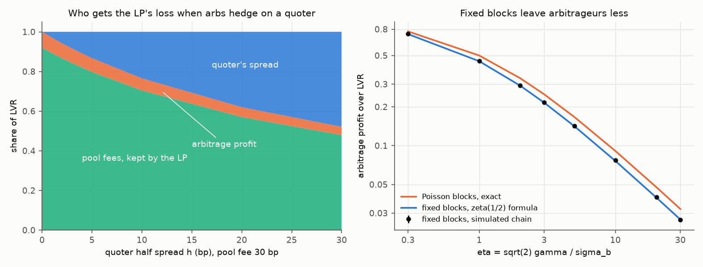

### Dynamic fees

One static fee has to serve calm hours and volatile ones. `fees.py` lets the
fee follow a volatility estimate. `venues.run` takes a fee rule in place of a
number, a two-state volatility regime (`Regimes`: a calm sigma and a spike at
3x, switching at Poisson rates) and the source of the estimate: the true
regime, an EWMA of squared returns of the market price (what a pool with a
price oracle can compute), or an EWMA of the pool's own price. The rules are
`Static`, `Threshold(low, high, cut)`, the two-level schedule that Campbell,
Bergault, Milionis and Nutz (2025) suggest, and `Power(base, k, p)`, which with
p = 2 has the shape of Liquidity Book's variable fee base + A (v s)^2. The
quoter can widen its half spread in proportion to the current vol, the way an
exchange market maker would.

The checks: with the true regime as input, the arbitrage profit and the
arbitrage fees are quasi-static, the per-regime closed forms from above
weighted by the LVR accrued in each regime (within 4 standard errors on 1000
paths). Time spent in the spike from a calm start matches
pi (1 - (1 - e^(-kT)) / (kT)) with k the sum of the two switching rates. The
ledgers still add up to the marked P&L, the edges still sum to minus LVR with
the fee moving, and the EWMA is unbiased for Poisson-spaced returns.

The pool's own price is a poor volatility source. It sits still between
arbitrage trades and jumps by the overshoot past the band at each one, and for
Poisson blocks the overshoot is exponential with mean square sigma^2/lambda.
Trades come at rate lambda P_trade, so the pool price's quadratic variation
grows at sigma^2 P_trade = sigma^2 / (1 + eta). A 30 bp pool on ETH with only
arbitrage flow sees 28% of the true vol. The tests check sigma sqrt(P_trade) to
2% at three fees. Noise trades add some variance back, by an amount that
depends on the flow, so the pool cannot undo the bias from its own price alone.

`examples/dynamic_fees.py` uses the ETH-like market and $1M pool from above, a
spike to 180% vol that starts at rate 1/20 per hour and lasts 4 hours on
average, and a quoter at 15 bp in calm hours and 45 bp in the spike. All rules
run on the same 200 price paths, so the gains below are paired. First, static
fees in each regime on its own:

| market           | best static fee | LP hedged per day | flat region          |
| ---------------- | --------------- | ----------------- | -------------------- |
| calm only        | 5 bp            | 1360 (5)          | 1190 to 1224, 6-10 bp |
| spike only       | 20 bp           | 2648 (28)         | 2311 to 2326, 22-30 bp |
| regime switching | 12 bp           | 851 (20)          | 807 to 850, 10-13 bp |

Both optima sit at a kink. The pool's price is within gamma of the market, so
its worst ask is about P e^(2 gamma), plus half the impact of the trade, and as
long as that is inside the quoter's half spread h the pool wins every noise
trade on both sides. One 1 ETH trade moves this pool 7.62 bp, so the kink is
at (h - 3.81 bp) / 2, which is 5.6 bp for the calm quoter and 20.6 bp in the
spike, against 5 and 20 from the sweeps. Below the kink the pool gives fees
away. Above it the pool starts losing the trades that arrive while its price
sits on the wrong side of the band. That is the result of
Campbell et al. (the best fee undercuts the exchange's cost, about half of it
with no volatility), with the impact term added.

Then the rules in the switching market, paired against the best static fee:

| rule                         | mean fee | noise fees | arb fees | LVR  | LP hedged | gain over static |
| ---------------------------- | -------- | ---------- | -------- | ---- | --------- | ---------------- |
| static 12 bp                 | 12.0     | 1826       | 1660     | 2637 | 851 (20)  |                  |
| threshold 5/20, true regime  | 6.9      | 1895       | 2268     | 2637 | 1517 (16) | 666 (32)         |
| threshold, EWMA 15 min       | 7.0      | 1864       | 2235     | 2637 | 1453 (14) | 602 (30)         |
| threshold, EWMA 1 h          | 7.1      | 1788       | 2149     | 2637 | 1290 (12) | 439 (24)         |
| proportional, EWMA 15 min    | 6.4      | 1707       | 2153     | 2637 | 1220 (11) | 369 (12)         |
| affine, EWMA 15 min          | 7.0      | 1821       | 2215     | 2637 | 1391 (13) | 539 (28)         |
| quadratic, EWMA 15 min       | 6.9      | 1824       | 2223     | 2637 | 1401 (11) | 550 (26)         |
| threshold, pool price 15 min | 6.5      | 1762       | 2092     | 2637 | 1213 (13) | 362 (12)         |

The spike is 13% of the time and 41% of the LVR. Knowing the regime is worth
78% more LP P&L than the best static fee, and a 15-minute EWMA of the oracle
price keeps 90% of that gain. With a one-hour half-life the estimate crosses the
cut about 45 minutes into the spike on the day in the chart, and the slower
switch costs a third of the gain.
The cut sits at twice the calm vol, so EWMA noise in calm hours never moves the
threshold fee, and the threshold beats the smooth rules for that reason: every
smooth rule passes estimation noise into the fee, and with a kink at the
optimum any wobble costs. The proportional rule (gamma / sigma fixed, so eta
fixed) reaches only 15 bp in the spike, far down the steep side of the spike
curve. The affine and quadratic rules go through both optima and land between.
The threshold on the pool's own price still gains 362, but it switches later
and less often (mean fee 6.5 bp). Tuning the two levels directly in the
switching market, on a 4 by 6 grid with the true regime, picks 5 and 20 bp
again, so the per-regime optima carry over.

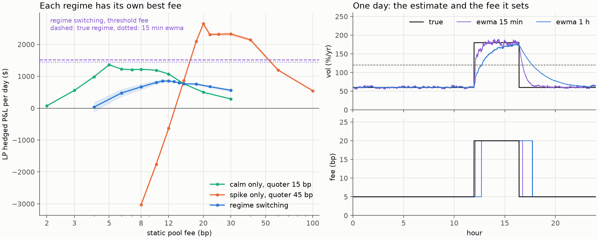

## Prediction markets: LMSR, a constant-product pool and a quoter

`prediction.py` runs a binary event, a share that pays 1 if it happens, with
three makers behind one interface (`price`, and `buy(yes)` for one share):
Hanson's logarithmic market scoring rule with cost
C(q) = b log(e^(q_yes/b) + e^(q_no/b)); the Gnosis fixed-product market maker,
which turns the buyer's cash into a complete YES/NO set, adds it to its pool
and pays out the token so that y n stays constant; and the Glosten-Milgrom
quoter from above, whose ask and bid are E[w | buy] and E[w | sell] for a known
informed share alpha. Traders arrive one at a time. Informed ones know the
outcome w and buy the winning token, noise traders pick a side at random. All
three are vectorized over markets.

Each maker's P&L has a closed form, and the tests check it to 1e-9 on every
simulated market:

- LMSR: P&L = -b ln(p_T(w) / p_0(w)), the log scoring rule of the final price,
  so the subsidy is at most b ln(1/p_0(w)), b ln 2 for an even prior.
- FPMM: the reserves at price p are y = F sqrt((1-p)/p) and n = F sqrt(p/(1-p)),
  so P&L is F (sqrt((1-p_T)/p_T) - sqrt((1-p_0)/p_0)) if YES wins. The subsidy
  is at most F for an even prior.
- Quoter: after k more YES buys than NO buys its belief is the Bayes posterior
  with likelihood ratio (1 + alpha)/(1 - alpha) per net trade, and its expected
  P&L is zero.

With b = F the two pools move the price by the same 1/(4b) per share at 1/2.
Away from 1/2 the FPMM moves 2 sqrt(p(1-p)) times as far as the LMSR, so it is
as responsive at the start and slower near 0 and 1, and its worst-case subsidy
is F against 0.69 b. `examples/prediction_markets.py`, informed share 0.2,
20,000 markets of 400 trades:

| maker                     | maker P&L | informed | noise | mean abs(p - w) after 25 | 50    | 100   | 200   |
| ------------------------- | --------- | -------- | ----- | ------------------------ | ----- | ----- | ----- |
| quoter, alpha known       | -0.01     | 2.74     | -2.73 | 0.220                    | 0.112 | 0.031 | 0.003 |
| quoter, assumes 0.1       | -1.94     | 4.35     | -2.41 | 0.301                    | 0.181 | 0.064 | 0.008 |
| quoter, assumes 0.4       | 1.10      | 2.02     | -3.13 | 0.175                    | 0.085 | 0.022 | 0.002 |
| LMSR b = 10               | -6.91     | 7.99     | -1.08 | 0.384                    | 0.288 | 0.153 | 0.039 |
| LMSR b = 14.4             | -9.86     | 10.90    | -1.03 | 0.416                    | 0.341 | 0.219 | 0.082 |
| FPMM F = 10               | -8.69     | 9.73     | -1.05 | 0.387                    | 0.298 | 0.177 | 0.070 |

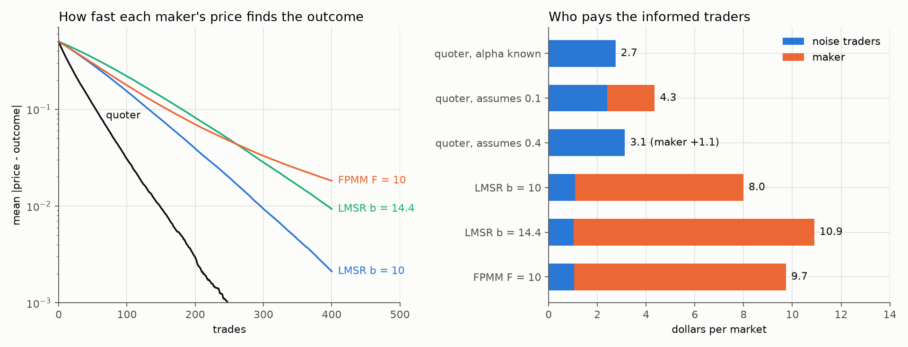

The quoter that knows alpha finds the outcome fastest and breaks even, and the
noise traders pay the informed traders' whole 2.74 through its spread. With a
pool the noise traders pay about 1 and the subsidy pays the rest. Informed
traders make three or four times as much against a pool (8 to 11 against
2.7), because a pool's price takes longer to get there and they trade at stale
prices the whole way.
LMSR b = 14.4 and FPMM F = 10 have the same worst case, 10: the LMSR is deeper
at the start and the FPMM near the end, and the curves cross at about 260
trades.

The case for a pool in a thin market is the two misspecified rows. A quoter
that thinks half as many traders are informed loses 1.94 a market. One that
thinks twice as many makes 1.10, out of the noise traders' pockets (they pay
3.13 instead of 2.73). The pool's loss is capped by b or F whatever the flow,
which is Hanson's original reason for subsidizing a scoring rule.

### Bettors with noisy signals

Perfectly informed traders are the easy case. In `run(..., rho=...)` a bettor
gets a private signal that matches the outcome with probability rho, takes the
market price as the prior, and so believes in odds
p/(1 - p) times (rho/(1 - rho))^(+-1). It buys one share of the side its signal
points to if its belief beats the maker's quote for that share and otherwise
stays out. Every maker now quotes both sides (`quote`) and takes a mask of who
trades. With rho = 1 the old results come out unchanged to the last digit.

Two exact results come out of this. To a Glosten-Milgrom quoter a buy from this
flow has likelihood ratio (alpha rho + (1 - alpha)/2) / (alpha (1 - rho) + (1 - alpha)/2)
= (1 + a)/(1 - a) with a = alpha (2 rho - 1), so the flow looks like a share a
of perfectly informed traders, and the quoter that assumes a is the Bayes
posterior on the public order flow. Bettors always trade with it, since their
own ratio rho/(1 - rho) is larger. A quoter that assumes 2 rho - 1 or more has
an ask above every bettor's belief and only noise trades with it (a test pins
the cutoff). Second, every LMSR share moves the price 1/b in log odds, so if
every bettor trades, the LMSR with b* = 1 / ln((1 + a)/(1 - a)) has exactly the
quoter's price after every trade. Over 10,000 markets of 400 trades the
largest gap is 1.7e-12. The quoter breaks even and the LMSR pays b* times the
log-score gain for the same price.

`LSLMSR` is the liquidity-sensitive LMSR of Othman, Pennock, Reeves and
Sandholm (2010): C(q) = b(q) ln(sum_i e^(q_i / b(q))) with b(q) = alpha sum_i q_i
and alpha = v / (n ln n). Differentiating gives

```
p_i = alpha ln S + (e^(q_i/b) sum_j q_j - sum_j q_j e^(q_j/b)) / (sum_j q_j S),   S = sum_j e^(q_j/b)
```

which the tests check against finite differences of C. C is homogeneous of
degree one, so prices depend only on the proportions of q, depth grows with
volume, and the prices add up to between 1 and 1 + v (exactly 1 + v at even
odds): v is the most the maker can charge for a complete set. Since
C(q) >= max_i q_i, the maker loses at most C(q0) - x = v x from a seed of x
shares on each side. Seeding with x = b0 / (2 alpha) starts it at LMSR depth b0
with the same worst case as that LMSR, b0 ln 2.

`examples/signal_markets.py`: half the traders have a signal of accuracy 0.6,
the rest trade at random, 400 trades, 10,000 markets, so a = 0.1 and
b* = 4.98. A selection of the rows:

| maker                       | subsidy | Brier  | log score | bettor P&L | noise P&L |
| --------------------------- | ------- | ------ | --------- | ---------- | --------- |
| quoter, assumes a           | 0.00    | 0.0180 | -0.062    | 3.17       | -3.17     |
| quoter, assumes 0.5 a       | 3.49    | 0.0211 | -0.087    | 6.07       | -2.58     |
| quoter, assumes 1.9 a       | -2.02   | 0.0194 | -0.080    | 1.63       | -3.65     |
| LMSR b = 1.2                | -18.75  | 0.4426 | -inf      | -18.11     | -0.64     |
| LMSR b = 2                  | 1.19    | 0.0202 | -0.097    | 3.11       | -1.92     |
| LMSR b = b* = 4.98          | 3.14    | 0.0180 | -0.062    | 4.73       | -1.59     |
| LMSR b = 15                 | 8.39    | 0.0291 | -0.134    | 9.49       | -1.10     |
| FPMM F = 3                  | 2.49    | 0.0186 | -0.067    | 4.21       | -1.72     |
| LS-LMSR v = 1%, b0 = 1.5    | 0.76    | 0.0182 | -0.063    | 2.99       | -2.23     |
| LS-LMSR v = 1%, b0 = 2      | 1.08    | 0.0180 | -0.062    | 3.26       | -2.18     |
| LS-LMSR v = 3%, b0 = 2      | 0.37    | 0.0228 | -0.098    | 3.58       | -3.21     |

(Standard errors on the subsidy are 0.015 to 0.04.) The Bayes posterior on the
public order flow scores 0.0180, and pooling every private signal would score
0.0020: the noise traders hide most of what the bettors know, and no maker can
get it back from the flow.

Each pool traces a U. Below b* it overreacts and above it underreacts, and
the minimum sits at the depth that matches the flow's likelihood ratio. LMSR
b = 2 has the lowest mean |p - w| of the curves in the chart but a worse
Brier score than b*, because the markets it gets wrong it gets wrong with
confidence. Below about b = 1/(2 ln(rho/(1 - rho))) = 1.23 a bettor whose
signal disagrees with an extreme price no longer finds one share worth its
cost, while bettors who agree keep buying. The price runs to 0 or 1 within the
first few trades (two thirds of markets are past 1% or 99% after 25 trades)
and ends on the wrong side 44% of the time, an information cascade: the
bettors lose 18 a market and the maker gains 18.75.

The liquidity-sensitive LMSR with a 1% vig gets the Bayes score for a third of
the LMSR's subsidy (1.08 against 3.14). Starting thin at b0 = 2 lets the first
trades move the price fast, and by the end volume has deepened it to
b0 + 400 alpha = 4.9, right at b*. The vig also takes 0.6 a market more from
the noise traders than the LMSR at b* does. At 3% the vig is larger than
a weak signal's edge near the end and the price stops short (Brier 0.023).
The quoter is the cheapest maker when it knows a, and cheap but fragile when it
does not: assuming 1.9 a it earns 2.02 and still scores within 8% of Bayes,
but at 2 a it shuts out every bettor and the price is a random walk of noise
trades (Brier 0.4376).

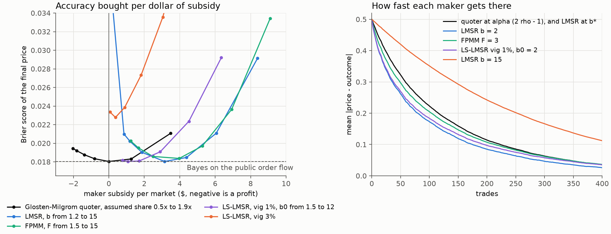

## Multi-asset market making

`multi.py` quotes d correlated assets at once, in the mean-variance version of
Gueant's multi-asset model. Reference prices are Brownian with covariance Sigma
and drift mu, requests of size z_i arrive on each side of asset i at intensity
Lambda_i(delta) for a quote delta away from the reference price, and the
objective is expected P&L minus gamma/2 times the integral of q' Sigma q. The
exact value function lives on a d-dimensional inventory grid, which is why
Bergault, Evangelista, Gueant and Vieira (2021) replace each Hamiltonian
H(p) = sup_delta Lambda(delta)(delta - p) by its second-order Taylor expansion
at 0. The HJB then has a quadratic solution theta = -q'A q - q'B - C with

```
dA/dtau = gamma/2 Sigma - 2 A D A,    dB/dtau = -mu - 2 A D B,    D = diag(2 z_i H_i''(0))
A(tau) = 1/2 D^-1/2 Ahat tanh(Ahat tau) D^-1/2,    Ahat = sqrt(gamma) (D^1/2 Sigma D^1/2)^1/2
B(tau) = -D^-1/2 Ahat^-1 tanh(Ahat tau) D^1/2 mu
```

which costs one symmetric eigendecomposition. The bid on asset i is
delta*_i(2(Aq)_i + z_i A_ii + B_i) and the ask delta*_i(-2(Aq)_i + z_i A_ii - B_i),
where delta*(p) is the exact best quote for the Hamiltonian. Two intensity
shapes are built in: exponential A e^(-k delta), and the logistic
lambda / (1 + e^(alpha + beta delta)) the paper uses for RFQ markets. For the
logistic both pieces are closed form through the Lambert W function:
H(p) = (lambda/beta) W(e^-(1 + alpha + beta p)) and delta*(p) = p + (1 + W)/beta.

Two checks come out of the algebra. With one asset the quotes are the
Gueant-Lehalle-Fernandez-Tapia approximation (the test matches `glft.Model`
at small gamma to 1e-5). And the inventory where bid and ask skews cancel,
-A^-1 B / 2, is the Markowitz portfolio Sigma^-1 mu / gamma: the stationary
equations say 2ADA = gamma/2 Sigma and 2ADB = -mu, so A^-1 B = -(gamma Sigma / 2)^-1 mu.

`Exact` integrates the full HJB on the inventory grid with risk limits
(DOP853). With exponential intensities and a common k the substitution
v = e^(k theta) makes the HJB linear, and the grid solver matches scipy's
`expm_multiply` on it to 1e-8. `Exact.evaluate(policy)` solves the linear
backward equation of any quoting rule, which gives a strategy's expected
objective with no Monte Carlo noise. Evaluating the optimal policy returns the
HJB value, and the simulator's mean P&L, risk penalty and objective all land
within 3 standard errors of the evaluated numbers.

`examples/multi_asset.py` uses the two-asset example from the paper: sigma 1.2
and 0.6 euros a root day, rho 0.5, drifts +0.1 and -0.1 euros a day,
gamma 8e-6, logistic intensities with 30 requests a day, alpha 0.7 and
beta 30 per euro, risk limits of 70,000 and 300,000 shares over 7 days. The
paper draws request sizes from a gamma distribution; here every request is
10,000 shares. Quotes at t = 0 (euros below or above the reference price):

| q1      | q2      | bid 1 exact | closed form | ask 1 exact | closed form | bid 2 exact | closed form | ask 2 exact | closed form |
| ------- | ------- | ----------- | ----------- | ----------- | ----------- | ----------- | ----------- | ----------- | ----------- |
| 0       | 0       | 0.0198      | 0.0219      | 0.0848      | 0.0796      | 0.1019      | 0.0985      | -0.0034     | -0.0017     |
| 20,000  | 0       | 0.0681      | 0.0653      | 0.0343      | 0.0344      | 0.1113      | 0.1069      | -0.0094     | -0.0072     |
| -20,000 | 0       | -0.0169     | -0.0123     | 0.1398      | 0.1280      | 0.0925      | 0.0901      | 0.0030      | 0.0041      |
| 0       | 80,000  | 0.0546      | 0.0515      | 0.0472      | 0.0475      | 0.2145      | 0.1922      | -0.0524     | -0.0466     |
| 0       | -80,000 | -0.0068     | -0.0031     | 0.1218      | 0.1132      | 0.0125      | 0.0140      | 0.0796      | 0.0770      |

A long position in asset 2 moves asset 1's bid further from the reference price
(0.0198 to 0.0546) and its ask closer (0.0848 to 0.0472): with rho > 0, selling
asset 1 also takes risk off. The drift
shows up as a target of +23,148 shares of asset 1 and -57,870 of asset 2,
which is Sigma^-1 mu / gamma to the share.

The value of each strategy over the 7 days (expected P&L minus the risk
penalty, from `evaluate`), where "independent" quotes each asset with the
closed form using only its own variance:

| rho  | drift | optimal | closed form | independent | closed form / optimal | independent / optimal | target q1 | target q2 |
| ---- | ----- | ------- | ----------- | ----------- | --------------------- | --------------------- | --------- | --------- |
| 0    | 0     | 33,732  | 33,696      | 33,696      | 0.9989                | 0.9989                | 0         | 0         |
| 0.6  | 0     | 34,192  | 34,159      | 33,696      | 0.9990                | 0.9855                | 0         | 0         |
| 0.9  | 0     | 35,097  | 35,070      | 33,696      | 0.9992                | 0.9601                | 0         | 0         |
| -0.9 | 0.1   | 54,378  | 54,343      | 37,946      | 0.9994                | 0.6978                | -36,550   | -100,512  |
| 0    | 0.1   | 48,017  | 47,978      | 47,978      | 0.9992                | 0.9992                | 8,681     | -34,722   |
| 0.6  | 0.1   | 66,315  | 66,277      | 54,667      | 0.9994                | 0.8243                | 29,839    | -70,530   |
| 0.8  | 0.1   | 94,753  | 94,345      | 56,896      | 0.9957                | 0.6005                | 62,693    | -135,031  |
| 0.9  | 0.1   | 125,051 | 104,247     | 58,011      | 0.8336                | 0.4639                | 127,924   | -264,985  |
| 0.95 | 0.1   | 143,538 | 28,450      | 58,568      | 0.1982                | 0.4080                | 258,191   | -525,285  |

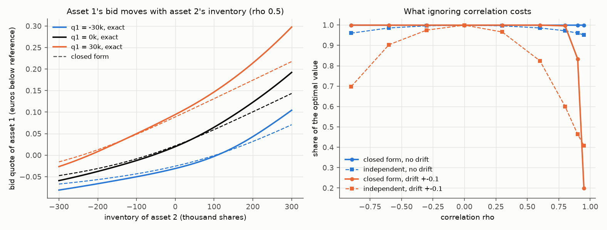

The closed form keeps 99.9% of the optimal value at every correlation without
drift, and with drift up to rho = 0.8. It fails where its Markowitz target
leaves the risk limits: at rho = 0.9 it wants 128,000 shares of asset 1 against
a limit of 70,000, keeps skewing towards a position it can never reach, and
drops to 83% of optimal, then 20% at 0.95. The exact solution knows the limits
and stops leaning near them. Quoting each asset on its own costs 4% without
drift at |rho| = 0.9, because it cannot offset risk across the two books, and
up to 60% with drift, because it never sees that long asset 1 and short asset 2
hedge each other. A Monte Carlo run (rho 0.5 with drift, 2000 paths,
dt = 0.001 day) agrees with `evaluate`: 60,519 (se 1,932) simulated against
60,200 for the optimal policy, 60,550 against 60,161 for the closed form and
53,179 (se 1,338) against 53,552 for independent quoting.

## ETF market making: hedging in the basket

An ETF dealer quotes the fund to clients, and the inventory it picks up can be
hedged in the stocks the fund holds. `etf.py` and `hy.py` cover three pieces:
how well QQQ can be hedged with its components on the real tape, a dealer that
quotes the ETF and trades the hedge with market impact, and the
creation/redemption arbitrage that ties the ETF price to its basket.

### Hedging QQQ on the tape

`python -m mmsim.itch` pulls 36 of the largest NASDAQ-100 names out of the
same ITCH day (2019-12-30) next to QQQ. `etf.hedge` is the minimum-variance
hedge with a subset of names, h = -C_SS^-1 C_S0 (the regression of the ETF on
those names), and `etf.stepwise` adds names greedily by variance removed. The
hedge is fit on 10:00 to 13:00 and scored on 13:00 to 15:50 as the share of
QQQ's variance it removes:

| k  | added | fit 60 s, score 60 s | fit 60 s, score 5 min | fit 1 s, score 1 s | fit 1 s, score 60 s | fit 1 s, score 5 min |
| -- | ----- | -------------------- | --------------------- | ------------------ | ------------------- | -------------------- |
| 1  | MSFT  | 0.635                | 0.598                 | 0.186              | 0.590               | 0.569                |
| 3  | AAPL  | 0.795                | 0.803                 | 0.335              | 0.808               | 0.818                |
| 5  | GOOGL | 0.877                | 0.937                 | 0.365              | 0.870               | 0.903                |
| 10 | VRTX  | 0.901                | 0.957                 | 0.393              | 0.890               | 0.928                |
| 20 | GILD  | 0.919                | 0.972                 | 0.424              | 0.913               | 0.939                |
| 36 | BIIB  | 0.931                | 0.967                 | 0.429              | 0.913               | 0.937                |

Five names (MSFT, AMAT, AAPL, AMZN, GOOGL) take out 88% of the minute-by-minute
variance and 94% at five minutes. All 36 leave a residual of 0.185 $/day
against 1.17 for QQQ itself; the other 64 names in the index are what is left.
At one-second sampling the same hedge removes only 43%. This is the Epps
effect: correlations measured on short intervals collapse (left chart). The
hedge ratios survive it, though. Ratios fit on one-second data and applied at
one minute keep 0.913 against 0.931 for ratios fit at one minute. What shrinks
is how much can be hedged over one second, not the ratios.

The Hayashi-Yoshida estimator sums products of increments over every pair of
overlapping observation intervals, which removes the bias from asynchronous
observation without picking a grid. `hy.covariance` does it in O(n log n) with
two `searchsorted` calls, and the test checks that it is unbiased on Poisson
observation times where previous-tick sampling on a fine grid loses most of
the covariance. On the tape it does not rescue the short horizons. Covariance
with QQQ over 10:00 to 13:00, as a share of the one-minute estimate (the grid
columns use staggered grids, so HY has real asynchrony to correct):

| name | HY on ticks | HY on 100 ms grids | HY on 1 s grids | previous tick 100 ms | previous tick 1 s |
| ---- | ----------- | ------------------ | --------------- | -------------------- | ----------------- |
| AAPL | 0.162       | 0.668              | 0.836           | 0.599                | 0.760             |
| MSFT | 0.126       | 0.649              | 0.850           | 0.580                | 0.741             |
| AMZN | 0.123       | 0.322              | 0.499           | 0.298                | 0.396             |
| INTC | 0.044       | 0.367              | 0.566           | 0.312                | 0.474             |

Correcting asynchrony gains 2 to 11 points over previous-tick sampling at the
same resolution, and most of the gap to one minute stays. A hedge built from
the tick-level HY matrix removes 79% at one minute, worse than any fitted on a
fixed interval. What is missing is delay: one book reacts to the other tens of
milliseconds later, and increments that do not overlap in time are never
multiplied together.

`hy.lead_lag` measures that delay (Hoffmann, Rosenbaum and Yoshida 2013): the
HY covariance with one series shifted by a lag, maximised over the lag. The
right chart shows it for three names at 10 ms resolution. Summarised by the
lead-lag ratio of Huth and Abergel (2014), the sum of squared
cross-covariances at positive lags over the sum at negative lags, 32 of the 36
names move before QQQ on the NASDAQ book. AMZN leads most clearly (LLR 0.09,
peak at -40 ms), then GOOG, FB and INTU (0.19). INTC (3.01), CSCO (1.58), AMD
(1.21) and CMCSA (1.17) follow QQQ: large, low-priced, heavily quoted names
whose quotes move a tick at a time. This is NASDAQ's book only. The
consolidated quote and the E-mini futures, which Hasbrouck (2003) found lead
both, are not in the file.

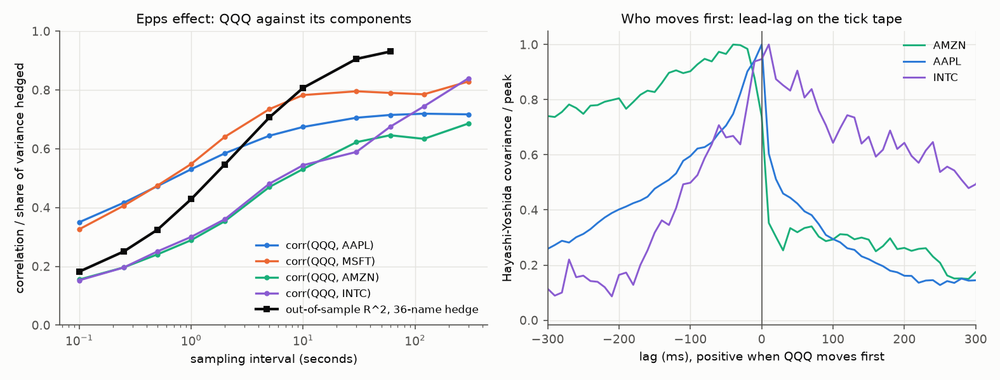

### Pre-averaging, and what the one-second gap is

Christensen, Kinnebrock and Podolskij (2010) make HY robust to quote noise by
pre-averaging. Each series is replaced by overlapping weighted sums of k
consecutive returns, with the tent weights g(x) = min(x, 1 - x), and HY is run
on those blocks: two blocks are multiplied when their time spans overlap, and
the sum is divided by (sum of g)^2. `hy.preaveraged` does it with one cumulative
sum and two `searchsorted` calls, and picks k = theta sqrt(n) for each series
from its own tick count. The variance needs a noise correction, the Jacod et
al. (2009) one, in `hy.preaveraged_variance`. In the tests, on noisy Poisson
observations of a pair where one series lags the other by 200 fine steps, HY
recovers almost none of the 0.6 covariance and pre-averaging gets it within
sampling error, while realized variance is 8% too high and the corrected
pre-averaged variance is unbiased.

On the tape (`examples/etf_basis.py`), as a share of the one-minute estimate:

| estimator | cross covariance with QQQ, median over 36 names | IQR | variance, median |
| --------- | ----------------------------------------------- | --- | ---------------- |
| HY on ticks | 0.130 | 0.103-0.171 | 1.221 |
| pre-averaged, theta 0.5 | 0.963 | 0.892-1.054 | 0.999 |
| pre-averaged, theta 1 | 0.967 | 0.915-1.048 | 1.011 |
| pre-averaged, theta 2 | 0.952 | 0.830-1.001 | 0.990 |

The blocks span seconds to minutes, long enough to bridge the tens of
milliseconds of delay, so the covariance comes back. The full matrix is a
different story. Pairwise estimates do not have to form a positive
semi-definite matrix, and this one has three negative eigenvalues (the
smallest is -0.020 of the largest). Inverting the 36-name block gives a hedge
that adds variance. Clipping the eigenvalues at 1e-3 of the largest (`hy.psd`)
gives 0.854 at one minute, still below plain one-minute sampling at 0.931.
With k = sqrt(n) a series has about sqrt(n) separate blocks: 400 to 550 for the
busiest books over the three hours, around 100 for the quietest, against 180
one-minute returns. That is not enough to pin down a 36-by-36 matrix.

So why does the hedge remove only 42% of QQQ's one-second variance? Regressing
QQQ's one-second move on the hedge basket's moves in the same second gives
R^2 0.416 out of sample. Adding the basket's five previous seconds gives
0.417, and adding its five following seconds instead, which no trader can use,
gives 0.416 (0.418 with both). The gap is not timing. Two other things fill it:

- Quote noise. Replacing every mid by the size-weighted mid (bid times ask
  size plus ask times bid size, over both sizes) raises R^2 to 0.497 and halves
  the one-second autocorrelations (-0.122 to -0.061 for QQQ, 0.148 to 0.054 for
  the basket).
- A basis that reverts. QQQ minus the basket has a variance ratio
  var(k-second change) / (k var(one-second change)) of 0.42 at 5 s, 0.12 at
  60 s and 0.06 at 5 min. Most of the one-second residual is gone within a
  minute, which is why the same hedge removes 93% at one minute.

The reversion is a small signal. The basis level (cumulative residual minus its
10-second EWMA) together with QQQ's own last move forecasts the next second's
mid move with R^2 0.033 out of sample, against 0.009 for the last move alone.
On size-weighted mids it is 0.005 against 0.002.

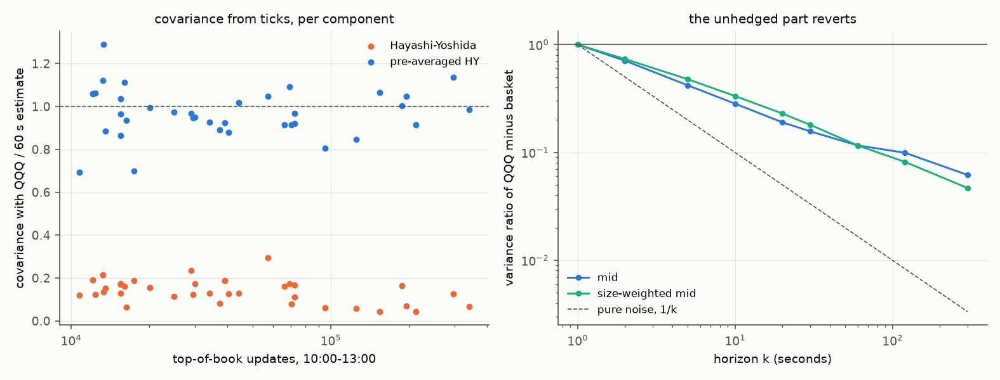

### A dealer that quotes the ETF and hedges in the basket

The dealer holds x = (q, h): q ETF shares from client requests and h shares of
m hedge names, which it trades at a rate xi with temporary impact, paying
eta_j xi_j^2 per unit of time (the externalization setup of Barzykin, Bergault
and Gueant). The risk penalty is gamma/2 x' Gamma x, where Gamma = M' Sigma M
plus the ETF's residual variance on q, and M maps x to share exposure in each
stock (q w + P h). With the Bergault et al. quadratic approximation of the
quoting Hamiltonian, the HJB keeps a quadratic solution theta = -x' A x, and
the hedge term sup_xi (-2 (A x)_h xi - eta xi^2) = (A x)_h^2 / eta is quadratic
already. Together:

```
dA/dtau = gamma/2 Gamma - 2 A D A,    D = diag(2 z H''(0), 1/(2 eta_1), ..., 1/(2 eta_m))
```

the same Riccati equation as the multi-asset quoter. A hedge name traded at
quadratic cost enters as one more asset with Hamiltonian curvature 1/(2 eta).
The quotes on the ETF are delta*(+-2 (A x)_0 + z A_00) and the hedge rate is
xi = -(A x)_h / eta.

The terminal condition is how the day ends. Unwinding everything over the last
30 minutes costs x' A_T x with A_T = diag(kappa_etf, kappa_h). Redeeming swaps
the ETF for the basket, so only the net stock exposure q w + P h has to be
unwound: A_T = M' K M. With A(0) = A_T the solution is still closed form. With
R = D^1/2, K the square root of gamma/4 R Gamma R and Delta = R A R - K, Delta
solves Delta' = -2(K Delta + Delta K + Delta^2), and

```
Delta(tau) = E Delta0 (I + 2 G Delta0)^-1 E,    E = e^(-2 K tau),    G = (I - e^(-4 K tau)) / (4 K)
```

in the eigenbasis of K. Only decaying exponentials appear, so it is stable at
any horizon, and with A_T = 0 it reduces to the tanh form. The tests check it
against `solve_ivp` on the matrix ODE to 1e-10 for both closes and against
`multi.Market` with no hedge names. They also check the whole loop with no
client flow, where the problem is exactly linear-quadratic and deterministic:
hedging cost plus risk penalty plus closing cost in the simulator equals
x0' A(T) x0 to 1e-4, and scaling the hedge rate by 0.8 or 1.2 costs more.

The target hedge, -A_hh^-1 A_hq q, is not the minimum-variance hedge. The
dealer expects its quotes to work the ETF position off, so it hedges less in
the names that are slow to trade. As client flow dries up the target converges
to the regression hedge (tested), and with the full basket and no residual it
is exactly -w q whatever the costs, because (1, -w) is a null vector of Gamma
and so of A. On QQQ the gap is small in variance terms: the dealer's
stationary hedge removes 92% (one name) to 99.5% (36 names) of the variance
the regression hedge removes.

`examples/etf_dealer.py` builds the fund from the tape: Sigma from one-minute
moves over 10:00 to 13:00 scaled to a day, w the 36-name regression hedge, and
eta_j = spread_j / volume_j from each name's NASDAQ volume and time-weighted
spread that day, so trading at NASDAQ's whole volume rate costs one spread per
share. Clients send 5,000-share requests at 150 e^(-100 delta) a day per side,
gamma is 1e-4, and the close unwinds over 30 minutes. One day, 2000 paths
(P&L se 67 to 107):

| hedge names | close  | P&L   | sd    | P&L - penalty | spread | hedging | fills | E abs(q_T) |
| ----------- | ------ | ----- | ----- | ------------- | ------ | ------- | ----- | ---------- |
| 0           | unwind | 4,357 | 4,793 | 3,270         | 4,518  | 0       | 89.7  | 3,768      |
| 1           | unwind | 4,546 | 4,131 | 3,653         | 4,778  | 117     | 90.4  | 4,668      |
| 3           | unwind | 4,837 | 3,817 | 4,126         | 4,964  | 157     | 92.7  | 5,582      |
| 5           | unwind | 4,866 | 3,609 | 4,253         | 5,076  | 188     | 93.7  | 6,360      |
| 10          | unwind | 4,850 | 3,370 | 4,298         | 5,159  | 211     | 94.5  | 6,830      |
| 36          | unwind | 5,002 | 3,015 | 4,555         | 5,238  | 221     | 95.8  | 8,452      |
| 36          | redeem | 5,005 | 3,028 | 4,557         | 5,242  | 223     | 95.8  | 9,588      |

Hedging raises the objective by 39% and cuts the P&L sd by 37%, and much of
the gain is spread. A hedged dealer can hold more ETF inventory, so it skews
its quotes less, trades more and earns 720 more in spread a day while paying
221 in impact. The first three names give two thirds of the gain.

Redemption barely matters for QQQ. Unwinding 8,000 shares of anything this
liquid over 30 minutes costs a few dollars, and the break-even fee (the gain
over unwinding per share redeemed) is 0.019 cents (se 0.055) with the full
basket. With components 100 times less liquid, hedging is worth only 230 a day
and redeeming loses to unwinding by about 4 cents a share: redemption hands the
dealer the basket, and an illiquid basket is the expensive leg. In this model
redemption is a netting device. It pays when the dealer is already hedged in
the full basket and the ETF is the costly leg to unwind, the opposite of QQQ.

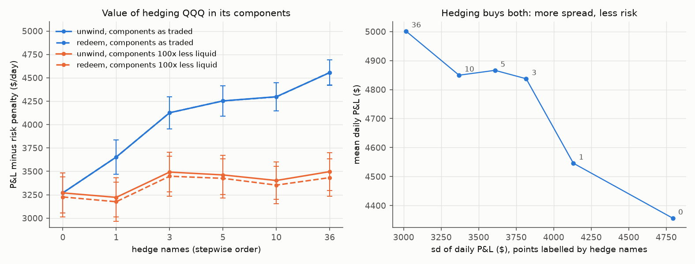

### Creation/redemption arbitrage

The ETF premium b (price minus NAV) moves as a Brownian motion with volatility
s, and an authorized participant checks it at Poisson times with rate lambda.
If abs(b) exceeds c, the cost of a creation or redemption round trip, it
creates or redeems until the premium is back at the edge, against an ETF book
with linear impact kappa. This is the fee-band chain from the pool section with
other labels. The stationary premium is uniform on [-c, c] with exponential
tails of rate sqrt(2 lambda)/s, so with zeta = c sqrt(2 lambda)/s:

```
P(trade at a check) = 1/(1 + zeta),    AP profit rate = s^2 / (2 kappa (1 + zeta))
units a day = lambda/(1 + zeta) * s / (sqrt(2 lambda) kappa)
```

and the premium's sd follows from the same density. `etf.Band` has the closed
forms and `etf.arbitrage` simulates the chain with exact Gaussian moves between
checks. With s = 0.05 $/root day, a check every minute and 1 cent of impact per
50,000 shares (1000 simulated days):

| band c (cents) | P(trade) | sim   | units/day | sim       | AP profit $/day | sim   | premium sd (cents) | sim   |
| -------------- | -------- | ----- | --------- | --------- | --------------- | ----- | ------------------ | ----- |
| 0              | 1.000    | 1.000 | 3,491,060 | 3,483,905 | 6,250           | 6,225 | 0.253              | 0.253 |
| 0.5            | 0.264    | 0.264 | 920,432   | 914,481   | 1,648           | 1,634 | 0.437              | 0.437 |
| 1              | 0.152    | 0.153 | 530,097   | 527,469   | 949             | 936   | 0.706              | 0.707 |
| 2              | 0.082    | 0.082 | 286,825   | 284,580   | 514             | 508   | 1.271              | 1.272 |
| 5              | 0.035    | 0.034 | 120,679   | 116,877   | 216             | 208   | 2.996              | 2.989 |

The parameters are illustrative, not fitted: the premium cannot be measured
here without the full basket and the fund's holdings file. What carries over
is the shape. Once c is a few times the move between checks, s/sqrt(lambda),
the premium's sd grows about linearly in the band and the AP's profit falls as
1/(1 + zeta), the same trade-off as an AMM's fee.

## Options market making

`options.py` quotes a chain of options on one underlying, hedges the delta on
the underlying and manages the vega, following Baldacci, Bergault and Gueant,
"Algorithmic market making for options" (2021). Clients send requests for each
option at a rate lambda_i / (1 + exp(alpha + beta delta / V_i)), where delta is
the quote's distance from mid in dollars and V_i the option's vega, so the
flow is set in vol points. The market maker is delta hedged, and with vegas
held constant over the horizon its only risk is the implied vol: inventory q
has P&L sum q_i V_i d sigma. The paper penalizes gamma/2 (eta sum q_i V_i)^2,
where eta is the vol of the implied vol, and the value function then depends
on q only through the portfolio vega v = sum q_i V_i.

Two solutions sit side by side:

- `market` turns the chain into the multi-asset problem from the previous
  section with the rank-one covariance Sigma = eta^2 V V' (plus an optional
  per-strike term eps^2 diag(V^2)), and the Bergault et al. closed form gives
  the quotes. With a rank-one Sigma the skew of option i is proportional to
  V_i v, so the tests check that two books with the same portfolio vega get
  the same quotes and that a vega-neutral book is not skewed at all.
- `Reduced` solves the paper's one-dimensional HJB in v on a grid, with the
  vega limit abs(v) <= vbar. With one option it equals `multi.Exact` on the
  inventory grid to 1e-7, and simulated in its own model its value matches the
  average objective within sampling error.

The simulator moves SPY as a lognormal with the ATM vol plus a common implied
vol factor (vol eta, correlation rho with the spot), adds per-strike noise,
reprices every option with Black-Scholes at its own implied vol and rehedges
the delta on a schedule at a half spread per share. P&L is split exactly into
spread, delta (between rehedges), gamma plus theta, vega, the second-order
vanna and volga terms, hedging cost, and a residual that is the Taylor
remainder. The split adds up to the total to 1e-8. The hedging error of a lone
short option hedged 84 times matches Derman and Kamal's sqrt(pi/4/N) sigma V
within 5%, the number QuantLib's DiscreteHedging example checks.

`examples/options_mm.py` fits vol-lab's SVI to a CBOE snapshot of SPY
(2026-11-07, spot 735.29), takes the expiries nearest 30, 60, 91 and 182 days
and strikes at 90 to 110% of spot, and quotes the 20 out-of-the-money options.
The flow and risk numbers are the paper's (30 requests a day at the money,
alpha 0.7, beta 150, eta 0.1, rho -0.5). Requests are sized at 2.5M of vega,
about the paper's at-the-money lot, and the vega limit is four lots, the
paper's 1e7. One simulated day, 1000 paths, rehedged every minute at half a
cent a share, gamma 1e-5:

| strategy | mean P&L | sd | objective (se) | fills |
| -------- | -------- | -- | -------------- | ----- |
| closed form, portfolio vega | 2,044,321 | 219,348 | 2,038,491 (6,952) | 106.0 |
| reduced HJB | 2,111,964 | 208,531 | 2,108,465 (6,598) | 109.4 |
| closed form, each option alone | 2,004,563 | 228,984 | 1,998,155 (7,265) | 101.9 |
| no skew | 2,002,969 | 228,474 | 1,996,468 (7,255) | 102.6 |

Spread is almost everything: 2.05M of the closed form's mean, against means of
about a thousand dollars for the vega, gamma and cross terms and -3,700 of
hedging cost. Sweeping gamma from 1e-6 to 1e-3 (bottom left), the reduced
HJB has the higher mean and the lower sd up to gamma 1e-4, and the closed form
only catches up at 3e-4. The reason is the tight vega limit. With four lots to
the edge, being shut out of one side is costly, so the exact solution skews
hard near the limit even when gamma is tiny (0.81 vol points at zero vega, 1.24
three lots long), while the closed form, which knows nothing of the limit,
moves from 0.78 to 0.85.
Quoting each option against its own vega ignores that a long put and a short
call offset, and its risk aversion turns into wider quotes and lost spread as
gamma grows.

The constant-vega assumption has a cost of its own. The policies read the true
current vegas, but the hard limit binds on true vega too, so whenever the
book's vega drifts up a lot can be refused that the model would take. With the
spot frozen, the reduced HJB scores 2,144,637 (se 6,829) on its own vega
bookkeeping and 2,120,795 (6,416) on true vegas, against its value of
2,165,633. The first gap is the one-minute step: at 12-second steps it is
2,169,381 (6,514).

Rehedging less often trades hedging cost for delta and gamma noise (bottom
right). Every minute costs 3,660 a day and leaves 27k of delta plus gamma sd.
Once a day costs nothing and leaves 452k, twice the whole P&L sd under
one-minute hedging.

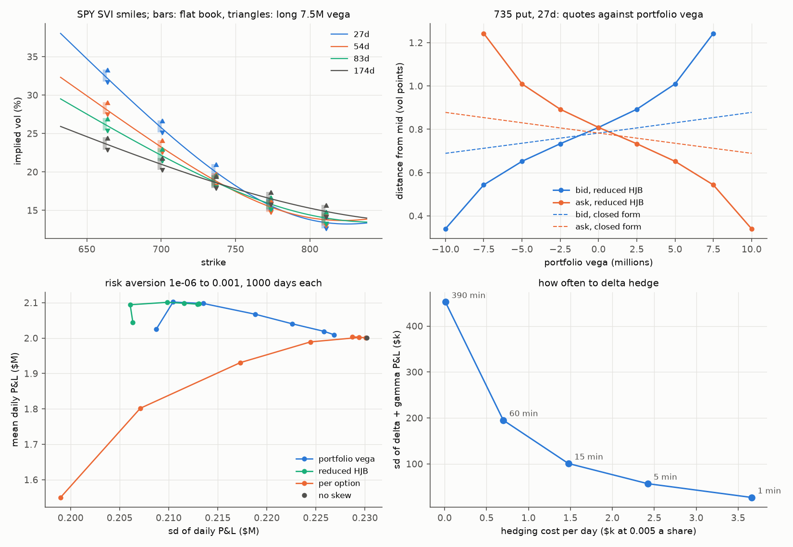

The example needs vol-lab installed (`pip install -e ../vol-lab`) for the CBOE
snapshot, the surface and the SVI fit. mm-sim carries its own Black-Scholes
Greeks, and a test compares them with vol-lab's to 1e-12 when vol-lab is
importable.

## An executor on the other side

So far the market maker's counterparties were noise or traders who know the
fundamental value. `execution.py` adds the third kind: someone with a large
order to work who knows nothing about the price. It has the two standard
schedules, an agent that follows one with market orders, and the measurements
needed to see what that agent does to a quoter.

**Almgren-Chriss (2000).** Selling X shares in N slices with permanent impact
gamma, temporary impact eta and volatility sigma, minimizing E + lambda V gives
holdings x_k = X sinh(kappa (T - t_k)) / sinh(kappa T) with
cosh(kappa tau) = 1 + lambda sigma^2 tau^2 / (2 eta~). On the paper's example
(one million shares over five days) kappa comes out at 0.609 a day, the paper's
"about 0.6". `cost` sums expected cost and variance for any trajectory, and for
the optimal one the sums agree with the paper's closed forms (its equations 20
and 21) to 1e-10. A numerical minimizer started from the straight line lands on
the sinh trajectory.

**Obizhaeva-Wang (2013).** A trade of x moves the ask by (lambda + kappa) x, of
which kappa x decays at rate rho. The strategy-dependent cost of trades x at
times t is the quadratic form kappa/2 x' K x with K_ij = exp(-rho |t_i - t_j|),
so the optimum is proportional to K^-1 1: two equal blocks at the ends,
X / (2 + (N - 1)(1 - e^(-rho tau))) each, and equal smaller trades between.
`trades` reproduces the first and last trade in the paper's Table 1 for seven
values of rho, and `optimum` against `steady` (a constant trading rate)
reproduces 25 entries of its Table 2 of cost savings to the two printed
decimals.

### The impact of a market order in the zero-intelligence book

`impulse` runs the same seed twice, once with a market buy at time zero and
once without, and returns the difference in the quotes afterwards. Pooled over
order sizes 1 to 4 with 2000 seeds each, per share bought (ticks):

| minutes after | 0 | 0.125 | 0.25 | 0.5 | 1 | 2 | 4 | 8 | 16 | 32 |
|---|---|---|---|---|---|---|---|---|---|---|
| ask | 0.554 | 0.415 | 0.356 | 0.316 | 0.289 | 0.286 | 0.257 | 0.252 | 0.234 | 0.240 |
| bid | 0.000 | 0.144 | 0.202 | 0.263 | 0.266 | 0.271 | 0.248 | 0.251 | 0.225 | 0.258 |

The ask jumps 0.55 ticks a share and gives half of it back with a half-life of
0.13 minutes. The bid follows it up within a minute, and the two then stay
about a quarter of a tick above where they would have been. So this book has
permanent impact with nobody in it who knows anything. The reason is in the
Cont-Stoikov-Talreja rates: limit orders arrive at a distance from the opposite
best quote, so once the ask has moved up, buy orders land closer to it and the
bid is rebuilt higher. The response is close to linear in size (0.52 a share
for one share at lag zero, 0.57 for four). The fitted Obizhaeva-Wang response
is lambda 0.283, kappa 0.269, rho 5.36 a minute.

### The Almgren-Chriss frontier, simulated

The fit gives Almgren-Chriss parameters with nothing left to choose: gamma is
the permanent part, the temporary cost of a slice of n shares is the walk up
the book, (lambda + kappa) n^2 / 2, and sigma is 0.965 ticks per root minute on
the undisturbed book. One correction comes from unit lots: the continuous model
charges every share half its own impact, and a single share in a real book pays
the quoted ask. The fixed cost per share is therefore the half spread (0.676)
minus (lambda + kappa) / 2.

Buying 24 shares in 24 minutes in 12 slices, 4000 sessions per schedule:

| risk aversion | first slice | model cost/share | model sd | simulated cost/share (se) | simulated sd |
|---|---|---|---|---|---|
| 0 (even) | 2 | 4.070 | 61.4 | 4.303 (0.051) | 76.8 |
| 0.0005 | 3 | 4.081 | 57.5 | 4.251 (0.049) | 74.9 |
| 0.005 | 6 | 4.249 | 38.5 | 4.662 (0.043) | 65.3 |
| 0.05 | 13 | 5.010 | 16.8 | 5.128 (0.033) | 50.8 |
| 5 (one block) | 24 | 7.025 | 0.0 | 5.136 (0.026) | 40.0 |

The model gets the mean within 6% for the two patient schedules and within 10%
for the next two. The block is off because 24 shares is more than the 15 or so
the book holds on a side: the order fills what is there and the executor buys
the rest in the following slices, which a linear book does not know about. The
risk is where the model is wrong. Its variance only counts the price moving
while shares are still to be bought. In the book the impact of each child order
is itself random, and the block that the model calls riskless has an sd of 40
ticks. Front-loading still buys a lower sd, 77 down to 51, for 0.8 ticks a
share.

Obizhaeva-Wang has nothing to add at this horizon. With rho at 5.36 a minute
and slices two minutes apart the book has forgotten the last slice
(e^(-rho tau) is 2e-5), so its 13 trades are 24/13 shares each, and the model
puts them at 4.049 a share against 4.070 for 12 even slices. Simulated, the 13
trades cost 4.298 (se 0.053), the same as the even slices. The continuous optimum, 3.850, would need fractions of a
share traded all the time.

### What the executor does to a market maker

One-hour sessions. In minutes 20 to 40 an executor buys or sells its order one
share at a time, evenly spaced. Three makers, each alone with it: a quoter that
joins the touch, a GLFT bot with the gamma tuned in the PPO comparison, and the same GLFT
quoting around a fair value that leans with a flow filter (next section). Score
is P&L minus 0.02 times the time integral of q^2 minus 0.25 q_T^2, over 1000
held-out sessions. "Position" is the final inventory counted in the executor's
direction, and "exec" is what the executor pays per share over its arrival mid.

| maker | shares | score (se) | spread | adverse | inventory | position | exec |
|---|---|---|---|---|---|---|---|
| join the touch | 0 | 5.57 (0.62) | 23.31 | -2.53 | -4.84 | 0.07 | |
| | 10 | 0.47 (0.77) | 24.98 | -2.73 | -10.07 | -1.32 | 1.475 |
| | 30 | -29.41 (1.12) | 26.95 | -5.09 | -35.86 | -2.50 | 4.404 |
| GLFT | 0 | 9.56 (0.35) | 18.92 | -1.77 | -4.70 | 0.00 | |
| | 10 | 8.54 (0.40) | 20.74 | -2.05 | -7.07 | -0.15 | 1.827 |
| | 30 | -4.61 (0.62) | 24.05 | -3.56 | -21.23 | -0.38 | 5.051 |
| GLFT + filter | 0 | 8.10 (0.34) | 18.02 | -2.55 | -4.86 | 0.04 | |
| | 10 | 7.88 (0.42) | 19.74 | -2.69 | -5.66 | 0.41 | 2.293 |
| | 30 | 20.65 (0.84) | 21.34 | -0.01 | 9.47 | 1.46 | 7.169 |

The executor pays the maker more spread and takes it back several times over
through inventory: the maker is short while the price is pushed up. Nearly all
of the loss is in the inventory term, the part of a fill's P&L after its first
minute. Each child order is harmless on its own, and the damage is the sum of
the ones that follow. A 30-share order turns the touch quoter's hour from +5.6
to -29.4 and GLFT's from +9.6 to -4.6. GLFT's inventory skew saves it 25 ticks
because it refuses to stay short.

With no maker in the book the executor pays 1.202 (se 0.071) a share for 5
shares, 2.023 (0.081) for 10, 3.492 (0.087) for 20 and 5.506 (0.104) for 30.
Linear impact, the half spread plus 0.283 for every share already bought,
gives 1.243, 1.951, 3.368 and 4.785: right up to 10 shares, 13% short at 30.
At 1.5 shares a minute against the 0.94 a minute of natural buying, the ask
side is being eaten faster than it refills and impact compounds.

A maker changes that price. For 30 shares the executor pays 4.404 against the
touch quoter and 5.051 against GLFT, less than the 5.506 in the empty book,
because both hand it liquidity at a loss. Against the filtered GLFT it pays
7.169, and the maker makes 20.65. That maker ends 1.5 lots long when the
executor is a buyer: it buys ahead of the remaining child orders and sells to
them higher.

### Finding the executor in the tape

`detect.py` has the filter. The market is in one of three hidden states, quiet,
a buyer working or a seller working, switching with a generator Q. Buys and
sells print at rates that depend on the state: mu and mu when quiet, mu + r on
the side being worked. Between prints the unnormalized posterior weights follow
p' = p (Q - Lambda), with Lambda the total print rate of each state, and a
print on one side multiplies each weight by that state's rate for that side.
`Filter` does the first step with one eigendecomposition and the second with a
multiply. With Q = 0 and two states the log odds reduce to the sequential
likelihood ratio, n_buy log(1 + r / mu) - r t.

Three checks. A forward pass on a 1e-4 time grid gives the same posterior to
2e-3. Without switching the log odds equal the likelihood-ratio formula. On 150
simulated paths of 400 minutes from a three-state chain the filter is
calibrated: among the moments it gives a state a probability in some bucket,
the state is there that often, bucket by bucket, within sampling error.

`RegimeLean` shifts the quoter's fair value by a number of ticks times
P(buyer) - P(seller). The filter here assumes one extra share a minute on the
worked side, and an order that starts once an hour and lasts 20 minutes. A
shift of 1 tick scored best on 400 tuning sessions at 20 shares (12.35, se
1.03, against 11.03 for half a tick and 11.21 for two), so anything from half a
tick to two is within noise.

A 30-share buyer is over 50% posterior in every session, after a median of 4.1
minutes. A 20-share one gets there in 98% of sessions after 7.5 minutes, a
10-share one in 56% and a 5-share one in 29%. Before the order starts the
posterior is over 50% for 1.7% of the time. The cost of listening shows in the
rows with no executor or a small one: 8.10 against 9.56 with nobody there, and
still behind plain GLFT at 10 shares. It pays from 20 shares up (10.95 against
4.77).

One thing this book flatters: its impact never decays, so leaning with the
executor has no way to go wrong after the order ends. Measured metaorder impact
does decay once the order is done, and a maker that is still long then gives
some of this back.

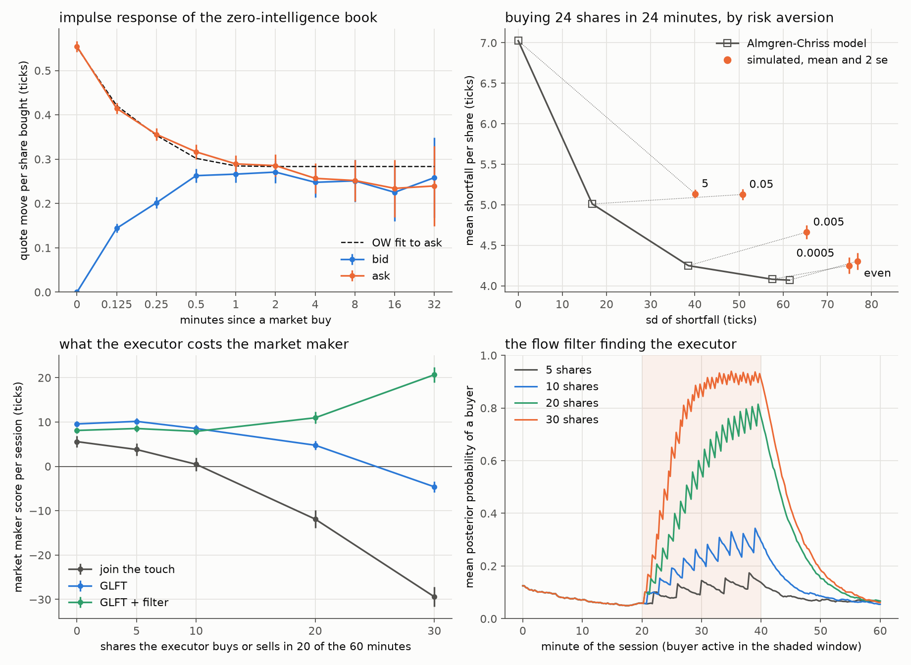

### Executors that hide, and a book that forgets

The executor above is as easy to see as an executor can be: one share at fixed
intervals, every one a market order. `execution.py` has three ways to look less
obvious, and `flow.Resilient` is a book where impact decays, so following the
flow can go wrong after the order ends.

**Hiding.** `scatter` splits X shares into N child orders of random size at
uniform random times (sorted, every child at least one share). `Pov` follows a
participation rate: after every print it buys up to rate / (1 - rate) times the
volume the others traded since it started, so its share of all volume is the
rate. It counts the others' volume as everything printed minus its own
position, which keeps its own prints from feeding back into the target.
`Passive` works a schedule with limit orders: at each slice it rests at the
others' best bid (for a buyer) for whatever the next slice needs, re-pegs when
someone improves the price, crosses only when it is more than `slack` shares
behind, and at the deadline takes the rest, retrying every 0.1 minutes if the
opposite side runs dry. A test caught that last case: a 14-share market order
emptied a thin ask and the first version ended two shares short.

**Resilience.** In the zero-intelligence book, impact is permanent because every
order is placed relative to the opposite best quote. `Resilient` adds a value V
(a Brownian motion with volatility sigma, started at the seed mid) and tilts
the side of market orders by the gap g = mid - V:

    buy rate  = mu (1 - tanh(c g))
    sell rate = mu (1 + tanh(c g))

The total stays 2 mu, so the clock of market orders does not depend on V. With
sigma = 0 the menu is exact between events. With sigma > 0 the sampler thins
against a bound of 2 mu per side and moves V by an exact Brownian increment at
every candidate time, so the rates are always evaluated at the true V. With
c = 0 it replays the plain flow event for event (a test checks the tape).

Linearizing, the net buy rate is about -2 mu c g, and with permanent impact
lambda per share the gap decays at rate 2 c mu lambda. That overstates it,
because tanh saturates when the gap is already wide. Averaging the slope over
the stationary gap gives 2 c mu lambda E[sech^2(c g)]: with c = 0.5 and sigma
= 1 the gap has sd 3.1 ticks, E[sech^2] is 0.49 and the predicted rate is 0.132
a minute (the linearized rate is 0.269). The fit to the measured response from
one minute on gives 0.116 (half-life 6.0 minutes):

| minutes after a 2-share buy | 0 | 0.5 | 1 | 2 | 4 | 8 | 16 | 32 |
|---|---|---|---|---|---|---|---|---|
| ask, plain book | 0.556 | 0.324 | 0.288 | 0.286 | 0.262 | 0.262 | 0.241 | 0.257 |
| ask, resilient book | 0.537 | 0.306 | 0.284 | 0.224 | 0.197 | 0.147 | 0.082 | 0.006 |

(per share, 2000 paired runs each). The first minute is the same in both
books: the queue refill that gives back half of the jump does not care about V.

**20 shares in 20 minutes, no market maker.** 1000 sessions per row, buyers and
sellers alternating, the same three-state filter as above watching the tape.
"Taken" is shares bought with market orders, "end" is where the mid sits at the
end of the hour against the arrival mid, "found" is the share of sessions where
the posterior on the executor's side passes one half during the window:

| book | style | cost a share | taken | end | found | median delay |
|---|---|---|---|---|---|---|
| plain | even | 3.64 (0.09) | 20.0 | 6.17 | 98% | 6.8 |
| plain | random | 4.15 (0.09) | 20.0 | 6.70 | 100% | 5.5 |
| plain | POV 40% | 4.08 (0.09) | 20.0 | 6.25 | 99% | 4.8 |
| plain | passive | 5.02 (0.09) | 10.7 | 8.92 | 58% | 11.8 |
| resilient | even | 2.05 (0.08) | 20.0 | 0.31 | 69% | 3.5 |
| resilient | random | 2.75 (0.08) | 20.0 | 0.14 | 86% | 4.2 |
| resilient | POV 40% | 2.81 (0.08) | 20.0 | 0.49 | 76% | 3.5 |
| resilient | passive | 2.68 (0.09) | 6.3 | 0.84 | 41% | 4.0 |

Random timing does not hide anything from this filter. It counts prints, and a
Poisson count does not care when they arrive; the random sizes only make the
children bigger, so they walk the book further and cost half a tick more.
POV is found fastest for a plainer reason: at 40% it buys about 1.25 shares a
minute and is done in 16.1 minutes, a faster rate than the even schedule.

Resting on the bid is the only style that hides (58% found, and late), and in
this book it costs the most. It fills 9.3 of the 20 shares passively on the
plain book; the rest goes through catch-up market orders near the deadline.
The resting order also moves the price: sells that hit it do not eat into the
others' bid, so the mid drifts up while the buyer waits, and it ends the hour
8.92 ticks above arrival against 6.17 for even slices. Every share bought, at
the bid or at the ask, is one less share sold into the book. A first version
of the re-peg read the order's size after cancelling it (zero by then) and
quietly dropped the order; an invariant test now checks that position plus
resting size always equals the current slice target.

On the resilient book everything costs less (impact from the first slices has
partly decayed by the time the last ones go), the price ends where it started,
and the executor is harder to see: the value traders sell into its buying, so
the net imbalance the filter looks for is smaller. The flip side is a filter
that cries wolf more: its posterior is over one half 9.3% of the time before
any executor shows up, against 1.2% on the plain book, because flow that
corrects a gap is itself one-sided for a while.

**What it does to a GLFT maker.** Score as before (P&L minus the exposure and
terminal penalties), 1000 sessions per cell, difference between GLFT with and
without the filter's lean (1 tick at certainty) on the same seeds:

| executor | plain: GLFT | plain: lean gain | resilient: GLFT | resilient: lean gain |
|---|---|---|---|---|
| none | 9.56 (0.35) | -1.47 (0.48) | -17.82 (0.64) | 7.81 (0.79) |
| even | 4.77 (0.49) | 6.18 (0.83) | -13.88 (0.63) | 6.08 (0.86) |
| random | -0.21 (0.55) | 8.66 (0.86) | -17.79 (0.68) | 2.74 (0.88) |
| POV 40% | 0.34 (0.57) | 9.50 (0.87) | -14.87 (0.69) | 5.81 (0.92) |
| passive | 2.14 (0.49) | 5.20 (0.75) | -19.72 (0.71) | 10.82 (0.85) |

The resilient book is a harder market for a maker even with nobody executing:
market orders now lean toward V, so they carry information, and plain GLFT
loses 17.8 a session to them. The flow filter picks that up too (+7.81 with no
executor). What changes is the value of leaning with an executor. On the plain
book an executor turns the lean from a small loss into a 6 to 9.5 tick gain,
because the price it pushes stays pushed. On the resilient book the aggressive executors add nothing to the lean and the
random-size one takes 5 ticks off it (2.74 against 7.81): the maker gets long
behind the buyer and the impact it leaned on is given back. The passive buyer
is the exception: plain GLFT does worst against it (-19.72) and the lean is
worth the most (+10.82). The attribution of that case is not broken down yet.

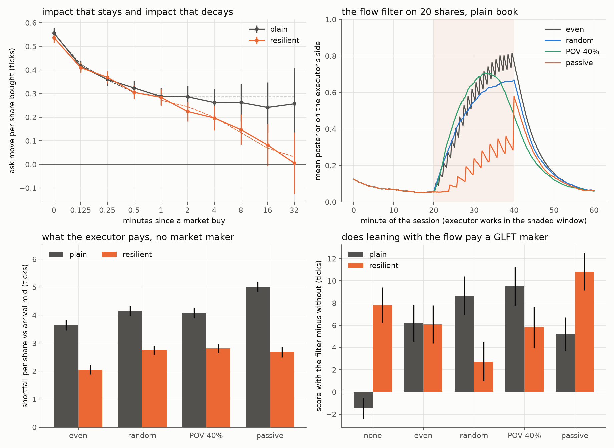

## Toxic bursts

The informed traders so far trade at a steady rate. Real toxic flow arrives in
bursts: someone learns something, trades on it for a while, and stops.
`informed.Bursty` is an informed trader that a two-state Markov chain switches
on (rate `on`, from quiet) and off (rate `off`, from active). While on, it
trades like `InformedTrader`: market orders at rate `rate` whenever the value
is outside the quotes. Its timer is either the next trade or the next switch,
whichever comes first, and a fresh trade time is drawn after each one, which
is exact because the exponential has no memory. `switches` keeps the switch
times for scoring.

Two filters look for the bursts. `detect.toxic` watches only the total print
rate (2 mu quiet, 2 mu + r in a burst); the three-state `one_sided` filter
from the executor section also uses the side. A quoter can use either one. A
lean shifts its fair value by P(buyer) - P(seller); `bots.Widen` instead
pushes both quotes out by round(ticks * P(burst)), and `GLFT(..., widen=...)`
applies it after its own quotes.

Writing the tests turned up a problem in `Filter`: it works on unnormalized
weights, and after a few hundred minutes with no prints both weights
underflowed to zero and the posterior came back NaN. The propagator is now
scaled by its largest eigenvalue, which cancels in the normalization.

**Setup.** Zero-intelligence book, one bursty trader with a Brownian value
(sigma 1 tick per square-root minute), rate 2 a minute while on, bursts that
start at rate 1/40 and last 10 minutes on average. 1000 sessions of 120
minutes, 2500 bursts in all.

| filter | flagged | within 2 minutes | median delay | false alarms |
|---|---|---|---|---|
| print rate (2 states) | 68% | 32% | 2.25 | 3.4% of quiet time |
| side (3 states) | 69% | 35% | 2.00 | 2.7% of quiet time |

A burst shows up in the tape only while the value is outside the quotes, so
some bursts never produce a trade. The side adds little at this rate: a burst
is one-sided almost by definition, and the count alone already carries most of
the evidence.

**GLFT makers.** Shift and width tuned on 300 separate sessions (lean 0.25,
0.5, 1 and 2 gave 16.02, 17.53, 15.95 and 12.97; widening by 1, 2 and 3 ticks
gave 10.58, 8.97 and 9.28), then 1000 held-out sessions:

| maker | score | P&L | spread | adverse | inventory |
|---|---|---|---|---|---|
| GLFT | 9.23 (0.68) | 15.73 | 46.62 | -9.59 | -21.30 |
| lean 0.5 | 17.73 (0.58) | 22.84 | 45.22 | -9.01 | -13.36 |
| widen 1 | 8.39 (0.64) | 14.54 | 36.71 | -5.53 | -16.65 |
| lean + widen | 13.48 (0.57) | 18.42 | 36.25 | -6.23 | -11.60 |

Widening does what it is meant to do, adverse selection goes from -9.59 to
-5.53, and loses on balance: it gives up 9.9 ticks of spread capture to save
4.1, because the filter is also wrong some of the time and a quote one tick
further out misses fills in quiet markets too. The lean keeps the spread and
cuts the inventory loss from -21.30 to -13.36, since a burst is one-sided and
the move it causes is what hurts an inventory. Adding the widening to the lean
costs 4.25 ticks. With one-tick granularity and a thin book, the answer to
toxic bursts here is to move the quotes, not to open them up.

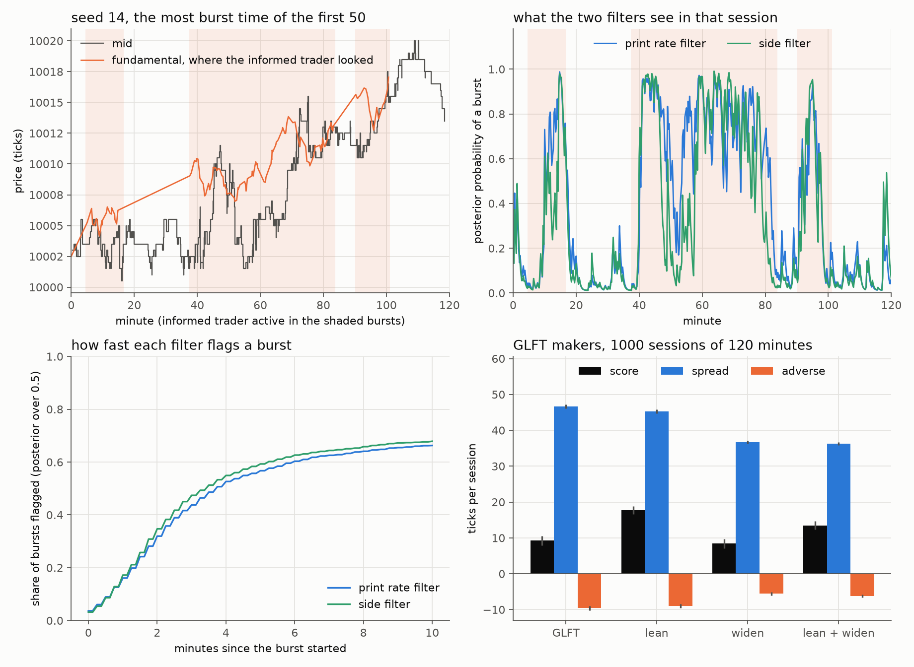

## Install

```
python -m venv .venv
.venv/Scripts/pip install -e ".[dev]"     # .venv/bin/pip on Linux and macOS
.venv/Scripts/python -m pytest
```

Requires Python 3.10+, numpy and scipy. matplotlib is only needed for the
examples, and gymnasium only for `mmsim.env` (`pip install -e ".[rl]"`).

## Usage

```python
from mmsim.bots import AvellanedaStoikov
from mmsim.flow import CSTParams, ZeroIntelligence
from mmsim.sim import Simulator

bot = AvellanedaStoikov(gamma=0.001, sigma=1.0, k=3.6)
sim = Simulator(ZeroIntelligence(CSTParams.sky_perfect()), [bot], seed=1)
sim.seed(10_000, 10_001)  # best bid and ask, in ticks
sim.warm_up(30)           # minutes of background flow before the bot starts
sim.run(390)
ctx = sim.contexts[0]
ctx.pnl(), ctx.position, len(ctx.account.fills)  # (27.0, 2, 208)
```

A bot is a subclass of `Agent` with any of `on_start`, `on_book` (after every
background event), `on_fill` and `on_timer`. Its `ctx` gives the clock, the book,
everyone else's best bid, ask and mid, its own open orders and account, and
`buy`, `sell`, `cancel`, `modify` and `set_timer`.

```python
from mmsim.bots import SymmetricQuoter
from mmsim.calibrate import calibrate
from mmsim.itch import read
from mmsim.replay import ItchFlow, ReplayBook

msgs = read("data/CSCO.itch")
bot = SymmetricQuoter(0.5, size=100, max_position=1000)
sim = Simulator(ItchFlow(msgs), [bot], book=ReplayBook)
sim.warm_up(9 * 60 + 35)  # minutes after midnight
sim.run(380)
ctx = sim.contexts[0]
ctx.pnl() / 100, ctx.position, len(ctx.account.fills)  # (-267.21, -982, 1983), dollars
calibrate(msgs, 575, 955).cst().mu  # 7.72
```

```python
from mmsim import avellaneda as av
from mmsim.flow import prob_mid_up

run = av.simulate(0.1, "inventory", n_paths=10_000, seed=1)
run.profit.mean(), run.profit.std()               # (64.87, 6.58)
bid, ask = av.quotes(100.0, 3, 0.5, 0.1, 2.0, 1.5)   # 98.65, 100.15: long, so both lower
prob_mid_up(2, 1, lam=1.85, mu=0.94, theta=0.71)   # 0.335; CST Table 3 says 0.336
```

```python
from mmsim.bots import GLFT
from mmsim.glft import Model
from mmsim.informed import Fundamental, InformedTrader
from mmsim.markout import curve, markouts

m = Model(sigma=0.3, A=0.9, k=0.3, gamma=0.01, Q=30)
bid, ask = m.quotes(float("inf"))   # mid minus bid and ask minus mid, q = -30..30
bid[30] + ask[30]                   # 6.626, the spread at q = 0

value = Fundamental(sigma=1.0, seed=1)
bot = GLFT(Model(sigma=1.0, A=2.1, k=3.6, gamma=0.3, Q=5))
flow = ZeroIntelligence(CSTParams.sky_perfect())
sim = Simulator(flow, [bot, InformedTrader(value, rate=1.0, seed=1)], seed=1)
sim.seed(10_000, 10_001)
sim.warm_up(30)
sim.run(390)
fills = sim.contexts[0].account.fills
curve(fills, markouts(fills, sim.tape, [0, 1, 5, 30], sim.end))
# mean markout per lot 0.50, 0.42, 0.23, 0.11 over 271 fills

from mmsim.attribution import attribute

a = attribute(fills, sim.tape, 1.0, sim.end)
a.spread, a.adverse, a.inventory, a.total   # (178.0, -63.0, -91.5, 23.5)
```

```python
import numpy as np

from mmsim import glosten as gm
from mmsim import kyle

gm.binary_quotes(0.5, 0.3, 90.0, 110.0)   # (97.0, 103.0): the spread is alpha (hi - lo)
v = np.linspace(60, 140, 321)
prior = np.exp(-0.5 * ((v - 100) / 10) ** 2)
prior /= prior.sum()
gm.quotes(gm.Model(0.3, noise=5.0, eta=0.4), v, prior)   # (97.41, 102.59)

eq = kyle.solve(16, Sigma0=1.0, sigma_u=1.0)
eq.lam[0], eq.Sigma[-1], eq.profit                     # (0.901, 0.074, 0.886)
```

```python
from functools import partial

from mmsim.env import Learned, MarketMakingEnv, sky
from mmsim.ppo import Config, train
from mmsim.tournament import session

env = MarketMakingEnv(phi=0.02, terminal=0.25)   # 60 one-minute steps, |q| <= 5
obs, _ = env.reset(seed=1)       # [q/Q, time left, spread - 1, imbalance, mid move, flow]
obs, reward, done, _, info = env.step(0)         # action 0: join both sides

make = partial(MarketMakingEnv, phi=0.02, terminal=0.25)
agent, curve = train(make, 6, 16, 30, Config(episodes=16, lr=1e-3, lam=0.9, epochs=8))
# mean score per session -1.46 over the first 5 iterations, 1.55 over the last 5

bot = lambda: Learned(agent.policy.greedy, Q=5, minutes=60.0, dt=1.0)
r = session({"ppo": bot}, 1, flow=sky, minutes=60.0)["ppo"]
r.pnl, r.fills, r.exposure       # (17.5, 23, 133.3): exposure is the integral of q^2 dt
```

```python
from mmsim import lvr, venues
from mmsim.amm import Pool

pool = Pool.around(2000.0, width=0.2, capital=1e6, gamma=0.003)   # +-20% in log price
pool.reserves()                               # (250.0, 500000.0): half and half at the centre
lvr.p_trade(0.6 / 8760**0.5, 300.0, 0.003)    # 0.080 with 12-second blocks and 60% vol

quoter = venues.Quoter(half=0.0015, gamma=3e-4, limit=50)
s = venues.run(venues.Market(), 0.2, 1e6, 0.003, quoter, paths=200, seed=31)
s.lp.hedged.mean(), s.lvr.mean(), s.mm.hedged.mean()   # (288, 1294, 3762) dollars a day
```

Several correlated assets at once, the closed-form quotes and an exact
evaluation on the inventory grid:

```python
from mmsim.multi import Exact, Logistic, Market

m = Market.of([1.2, 0.6], 0.5, Logistic(30, 0.7, 30), 8e-6, z=1e4, mu=[0.1, -0.1])
m.quotes([20_000, 0])   # bids (0.0653, 0.1069), asks (0.0344, -0.0072)
m.target()              # (23148, -57870), the Markowitz portfolio Sigma^-1 mu / gamma
Exact(m, (7, 30), 7.0).evaluate(m.policy)[7, 30]   # 60161, against 60200 optimal
```

```python
import numpy as np
from mmsim import options as o

c = o.Chain.otm(100.0, [90, 100, 110], 0.25, [0.25, 0.2, 0.17])
m = o.market(c, lam=o.requests(c), alpha=0.7, beta=150, z=1e6 / c.g.vega, eta=0.1, gamma=1e-5)
q = np.array([2e6 / c.g.vega[0], 0, 0])     # 2M of vega, all in the 90 put
bid, ask = m.quotes(q, 1 / 252)
100 * bid / c.g.vega, 100 * ask / c.g.vega  # 0.84 and 0.73 vol points on every strike, 0.785 flat
o.Reduced(m, c.g.vega, 0.1, 4e6, 1 / 252, points=81).value()   # 130223
s = o.simulate(c, m, o.closed(m, c), T=1 / 252, dt=1 / 252 / 390, paths=200, vol=0.2, eta=0.1,
               h=0.005)
s.pnl.mean(), s.terms["spread"].mean(), s.terms["cost"].mean()  # 130595, 133623, -1998
```

`python examples/as_replication.py`, `cst_sessions.py`, `glft_quotes.py`,
`informed_flow.py`, `why_spreads.py`, `queue_value.py`, `latency_cost.py`,
`hawkes_flow.py`, `flow_lean.py`, `tournament.py` and `itch_replay.py` redraw the
eleven charts; the last one needs the extracted ITCH files. The session
experiments run 1600 to 6800 sessions on all cores; `latency_cost.py` is the
longest at 8 minutes here, `flow_lean.py` takes 6 and `tournament.py` 1.
`rl_market_maker.py` trains the three PPO seeds and saves them under `data/`
(14 minutes), and `stress.py` reads seed 0 from there (9 minutes).
`amm_lvr.py` redraws the pool chart in a minute, `hedged_arb.py` and
`prediction_markets.py` theirs in a few seconds, and `multi_asset.py` the
multi-asset one in about two minutes. `dynamic_fees.py` runs 68 sessions of
200 paths and takes under two minutes, `signal_markets.py` about one.
`etf_hedge.py` and `etf_dealer.py` need QQQ and the 36 component ITCH files in
`data/` and take about two minutes each, `etf_basis.py` under one.
`options_mm.py` reads vol-lab's SPY snapshot (from `../vol-lab/data/cboe`, or
the folder in `VOLLAB_CBOE`) and runs 33 simulated batches in about three and a
half minutes.
`execution.py` runs about 66,000 sessions in seven minutes, `stealth.py` about
36,000 in six and `toxic_bursts.py` about 7,000 in two and a half.

## Notes

**Matching engine.** `book.py` ports the rules of the C++ engine: limit and
market orders, IOC, FOK, post-only, and modify, which keeps time priority only
when an order shrinks at the same price. It emits the same event stream as the
C++ engine, which `NativeBook` swaps in without touching the bots. Levels are keyed by
sign times price, with bids negated, so the best level of either side is the
smallest key and one matching loop serves both. A differential test runs 30 seeds
of 2000 random commands against a deliberately naive reference book (one flat
list, sorted on every take) and compares every event and every resting order.
Six hand-injected bugs each failed between 22 and 30 of the seeds.

**Order flow.** In Cont, Stoikov and Talreja (2010) every limit order, market
order and cancel is a Poisson arrival with a rate that depends only on the
distance from the opposite best quote, so the whole book is a continuous-time
Markov chain. `ZeroIntelligence.step` simulates it exactly: the waiting time is
exponential in the total rate and the event is drawn in proportion to its own
rate. When a bot's timer comes first, the draw is thrown away and redrawn later,
which is exact because the chain is memoryless. Parameters are the paper's
estimates for Sky Perfect Communications on the Tokyo Stock Exchange (rates per
minute).

The check against the paper: with a one-tick spread, the probability that the
mid moves up next is a race between two independent birth-death queues to empty
first. `prob_mid_up` solves it as a sparse linear system with one equation per
pair of queue sizes, instead of the paper's Laplace inversion. All 25 entries of
the paper's Table 3 match within 0.001, and simulated races through the real
book land within sampling error of the solve. Run for 20,000 minutes, the flow
has a one-tick spread 74% of the time and an average depth profile that peaks two
ticks from the opposite quote, the hump the paper describes.

**Simulator.** Every change to the book comes back as the book's own events, and
those update accounts, open orders and fills. Bots see `ctx.mid`, the mid of
everyone else's quotes. A bot that quoted around the full book's mid would be
quoting around its own orders, and those quotes would stay put when the market
moved. Callbacks never nest: all the events from one book change are booked
before any callback runs, and orders a bot sends from a callback are queued
behind it. Timers, orders in flight, fill reports and delayed feed updates all
wait in one heap keyed by time and a sequence number, so two things due at the
same instant happen in the order they were scheduled. The background flow draws
its next event with the time to the top of the heap as its horizon.

**Avellaneda-Stoikov on a book.** The model allows a quote on the far side of
the mid; on a book that is a market order. The bot rounds the model's prices
away from the reservation price and then keeps them passive, so a bid never
reaches past one tick below everyone else's ask. Inventory risk shows up as the
bot stepping back on the side that would add to its position, which on a queue
mostly means that side stops filling.

**Solving GLFT without losing the tails.** The quotes depend on ratios of
neighbouring entries of v = exp(-M tau) 1, and those entries can span many orders
of magnitude: with the order-book calibration (gamma = 1, Q = 10) the smallest is
1e-18 of the largest. An eigendecomposition gets the tails wrong, because the
eigenvectors are only accurate to about 1e-16 of their largest entry. But -M tau
has nonnegative off-diagonal entries, so shifting it by its smallest diagonal
entry makes every entry nonnegative. The Taylor series of a nonnegative matrix
has no cancellation, and neither does repeated squaring, so every entry of the
exponential comes out with full relative precision (the same idea as
uniformization for Markov chains). The long-horizon quotes are this exponential
at tau = 80 / (spectral gap), by which point the other eigenvectors have decayed
by e^-80.

**Markouts.** A markout is side times (mid at t + h minus fill price). The tape
keeps the last mid of each instant, so h = 0 already includes the book's
reaction to the fill. Horizons that run past the end of the session are left
out. Summed to the close, a fill's markouts are exactly its contribution to
P&L, which a test pins down.

## License

MIT
